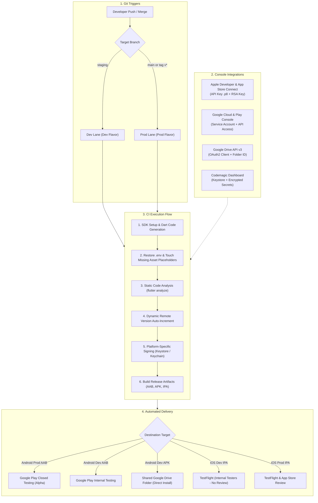
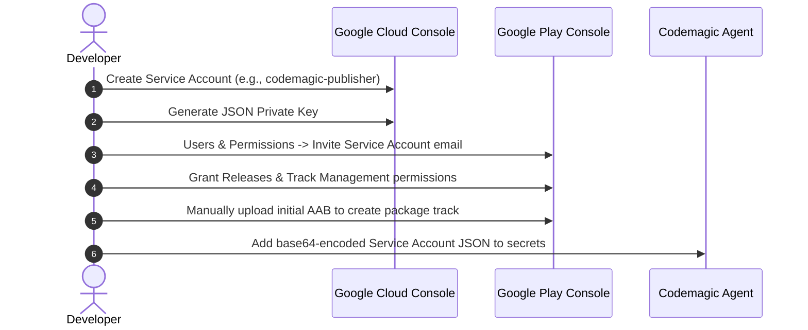
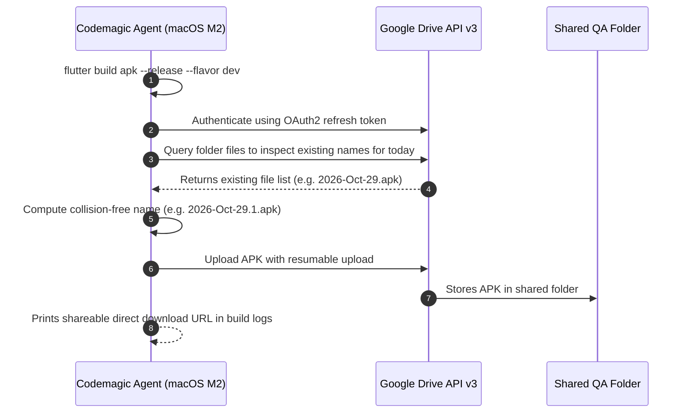
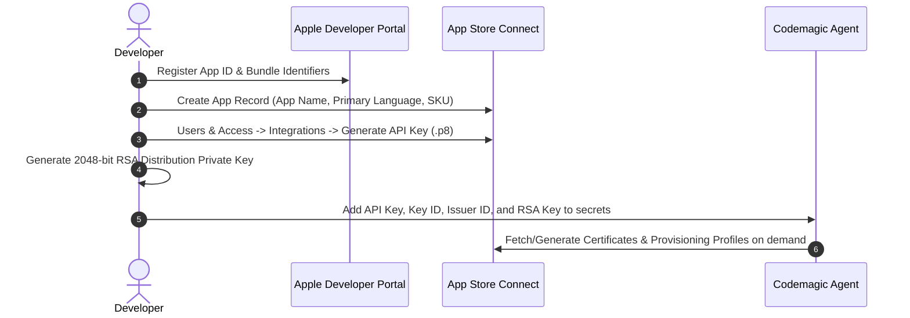

# End-to-End Flutter CI/CD with Codemagic: Complete Setup Guide (Android & iOS)

A complete, production-ready manual for implementing automated CI/CD for Flutter applications using **Codemagic**. This guide covers every console configuration step across **Google Cloud Console**, **Google Play Console**, **Google Drive API**, **Apple Developer Portal**, **App Store Connect**, and the **Codemagic Dashboard**, complete with architecture flowcharts, a Python Drive distribution script, and a sanitized, copy-paste-ready `codemagic.yaml` blueprint.

> [!TIP]
> **💡 The Robotic Auto Assembly & Delivery Fleet Analogy:**
> Codemagic is a 24/7 automated automotive assembly line. When an engineer commits code (`git push`), robotic arms spin up a fresh Mac machine, weld the engine components together (Flutter compilation), spray-coat it with official cryptographic sealants (code signing), and load the finished vehicles onto two synchronized delivery trucks: an express courier to the internal testing track (Google Drive APK) and an armored transport to global dealerships (App Store & Google Play).

---

## 1. Architecture & Pipeline Overview

The pipeline implements a dual-lane release strategy separating development verification from store releases:
* **Staging / Dev Lane:** Triggered automatically on push to `staging`. Builds the `dev` flavor, connects to development environments, distributes to **Google Play Internal Testing** (AAB), uploads an installable dev APK directly to a **Shared Google Drive Folder** for instant QA testing, and delivers to **TestFlight Internal Testers** (IPA) without waiting for store reviews.
* **Production Lane:** Triggered on merge to `main` or semantic release tags (`v*`). Builds the `prod` flavor and distributes to **Google Play Closed Testing (Alpha)** and **App Store Connect**.



---

## 2. Google Cloud & Google Play Console Setup (Android)

Automating Android deployments to Google Play requires a dedicated Google Cloud Service Account with granted API permissions in Google Play Console.



### Step 2.1: Generate the Android Upload Keystore Locally
If you do not already have an upload keystore, generate one using the Java `keytool`:

```bash
keytool -genkey -v -keystore app-upload-keystore.jks \
  -alias upload-key \
  -keyalg RSA -keysize 2048 -validity 10000 \
  -storetype JKS
```
> [!IMPORTANT]
> Keep `app-upload-keystore.jks`, your keystore password, and key alias safely backed up. Never commit `.jks` files or keystore passwords to source control.

---

### Step 2.2: Create a Service Account in Google Cloud Console
1. Navigate to [Google Cloud Console](https://console.cloud.google.com/).
2. Select your Google Cloud / Firebase project associated with your app.
3. In the navigation drawer, go to **IAM & Admin** &rarr; **Service Accounts**.
4. Click **+ Create Service Account**.
   * **Service account name**: `codemagic-publisher`
   * **Service account ID**: `codemagic-publisher`
5. Click **Create and Continue**. (Granting project-level roles is optional here; Play Console will handle access permissions directly). Click **Done**.
6. Find the newly created service account in the table, click the three-dots menu (**Actions**), and select **Manage keys**.
7. Click **Add Key** &rarr; **Create new key** &rarr; Select **JSON** &rarr; Click **Create**.
8. Save the downloaded JSON file (e.g., `play_service_account.json`). Note the `client_email` address inside.

---

### Step 2.3: Link Service Account in Google Play Console
1. Open [Google Play Console](https://play.google.com/console).
2. Ensure you are at the account level (or select your app).
3. Go to **API Access** (under **Developer Account** or **Users and permissions**).
4. Verify your Google Cloud project is linked.
5. In the left navigation, click **Users and permissions** &rarr; Click **Invite new users**.
6. In **Email address**, paste the exact `client_email` copied from the service account JSON.
7. Under **App permissions**, click **Add app** and select your application.
8. Grant the following permissions:
   * **Releases**:
     * *Manage testing tracks (Internal, Closed, Open)*
     * *Release to production, exclude devices, and use Play App Signing*
     * *Manage alpha and beta tracks*
   * **App access**:
     * *View app information and download bulk reports (read-only)*
9. Click **Invite user** &rarr; Click **Send invite**. The service account is now active immediately.

---

### Step 2.4: The Mandatory First Manual Upload
> [!WARNING]
> The Google Play Developer API forbids creating an application or first-time package name via automated API. You **must** build and upload the very first `.aab` manually through the Google Play Console UI before running automated CI/CD.

1. Build a local release bundle:
   ```bash
   flutter build appbundle --release --flavor dev -t lib/main_dev.dart
   ```
2. In Google Play Console, go to your app &rarr; **Testing** &rarr; **Internal testing**.
3. Click **Create new release**, upload the generated `.aab` from `build/app/outputs/bundle/devRelease/`, complete release details, and click **Save and publish**.
4. Repeat this once for the **Closed testing (Alpha)** track with the `prod` flavor bundle.

---

## 3. Instant Dev Distribution via Google Drive

While Google Play Internal Testing takes several minutes to process AABs and requires Google accounts to be enrolled in internal test lists, team members, QA, and product managers often need an **instant direct-download APK**.

The pipeline builds an installable dev APK on every push to `staging` and automatically uploads it to a shared Google Drive folder using the **Google Drive API v3**.



### Step 3.1: Enable Google Drive API in Google Cloud Console
1. In [Google Cloud Console](https://console.cloud.google.com/), open **APIs & Services** &rarr; **Library**.
2. Search for **Google Drive API** and click **Enable**.
3. Go to **OAuth consent screen**:
   * Set user type to **Internal** (if using Google Workspace) or **External** (add your developer email as a test user).
   * Add the scope: `https://www.googleapis.com/auth/drive`.
4. Go to **Credentials** &rarr; Click **+ Create Credentials** &rarr; **OAuth client ID**.
5. Select application type: **Desktop App** (or Web Application).
6. Save the generated `client_id` and `client_secret`.

---

### Step 3.2: Mint the OAuth2 Refresh Token Once Locally
Run a one-time local Python script to authorize access to your Google Drive account and mint a refresh token:

```python
from google_auth_oauthlib.flow import InstalledAppFlow

# Scopes required to upload and list files in the Drive folder
SCOPES = ['https://www.googleapis.com/auth/drive']

flow = InstalledAppFlow.from_client_config(
    {
        "installed": {
            "client_id": "YOUR_CLIENT_ID.apps.googleusercontent.com",
            "client_secret": "YOUR_CLIENT_SECRET",
            "auth_uri": "https://accounts.google.com/o/oauth2/auth",
            "token_uri": "https://oauth2.googleapis.com/token",
        }
    },
    SCOPES,
)
credentials = flow.run_local_server(port=0)

print("\n--- SAVE THIS AS DRIVE_OAUTH_TOKEN_JSON IN CODEMAGIC ---")
import json
print(json.dumps({
    "client_id": credentials.client_id,
    "client_secret": credentials.client_secret,
    "refresh_token": credentials.refresh_token,
}))
```
1. Run the script, log in with the Google account that owns or has write access to the target Google Drive folder, and approve access.
2. The script prints a JSON string containing `client_id`, `client_secret`, and `refresh_token`. Save this single-line JSON as `DRIVE_OAUTH_TOKEN_JSON` in Codemagic environment variables.

---

### Step 3.3: Locate Target Google Drive Folder ID
1. Open [Google Drive](https://drive.google.com/) and create or open your shared QA folder (e.g., `App Dev Builds`).
2. Inspect the browser address bar URL:
   `https://drive.google.com/drive/folders/1a2b3c4d5e6f7g8h9i0jKLMNOPQRSTUVWXYZ`
3. Copy the string of characters after `/folders/` (e.g., `1a2b3c4d5e6f7g8h9i0jKLMNOPQRSTUVWXYZ`). This is your `DRIVE_FOLDER_ID`.

---

### Step 3.4: Reusable Python Upload Script (`tools/ci/upload_apk_to_drive.py`)
Save this script in your repository at `tools/ci/upload_apk_to_drive.py`:

```python
#!/usr/bin/env python3
"""Upload a staging APK to a shared Google Drive folder.

Runs on Codemagic after the dev APK build.
Auto-names files with date stamps (e.g., 2026-Oct-29.apk), adding .1, .2
suffixes if multiple builds run on the same day.
"""

import json
import os
import re
import sys
from datetime import datetime, timezone

APK_MIME = "application/vnd.android.package-archive"
MONTHS = ["Jan", "Feb", "Mar", "Apr", "May", "Jun", "Jul", "Aug", "Sep", "Oct", "Nov", "Dec"]


def date_stamp():
    """Returns date stamp formatted as YYYY-MMM-DD (e.g., 2026-Oct-29)."""
    now = datetime.now(timezone.utc)
    return f"{now.year}-{MONTHS[now.month - 1]}-{now.day:02d}"


def next_free_name(existing_names, stamp):
    """Pick <stamp>.apk, or <stamp>.N.apk if files already exist for today."""
    pattern = re.compile(r"^" + re.escape(stamp) + r"(?:\.(\d+))?\.apk$")
    used = set()
    for name in existing_names:
        m = pattern.match(name)
        if m:
            used.add(int(m.group(1)) if m.group(1) else 0)
    n = 0
    while n in used:
        n += 1
    return f"{stamp}.apk" if n == 0 else f"{stamp}.{n}.apk"


def main():
    if len(sys.argv) != 2:
        print(f"Usage: {sys.argv[0]} <path-to-apk>", file=sys.stderr)
        return 1
    apk_path = sys.argv[1]
    if not os.path.isfile(apk_path):
        print(f"ERROR: APK not found: {apk_path}", file=sys.stderr)
        return 1

    token_raw = os.environ.get("DRIVE_OAUTH_TOKEN_JSON", "")
    folder_id = os.environ.get("DRIVE_FOLDER_ID", "")
    if not token_raw or not folder_id:
        print("ERROR: DRIVE_OAUTH_TOKEN_JSON or DRIVE_FOLDER_ID missing.", file=sys.stderr)
        return 1

    try:
        token = json.loads(token_raw)
        client_id, client_secret = token["client_id"], token["client_secret"]
        refresh_token = token["refresh_token"]
    except Exception as e:
        print(f"ERROR parsing DRIVE_OAUTH_TOKEN_JSON: {e}", file=sys.stderr)
        return 1

    from google.auth.transport.requests import Request
    from google.oauth2.credentials import Credentials
    from googleapiclient.discovery import build
    from googleapiclient.http import MediaFileUpload

    creds = Credentials(
        token=None,
        refresh_token=refresh_token,
        token_uri="https://oauth2.googleapis.com/token",
        client_id=client_id,
        client_secret=client_secret,
        scopes=["https://www.googleapis.com/auth/drive"],
    )
    creds.refresh(Request())
    service = build("drive", "v3", credentials=creds)

    stamp = date_stamp()
    existing = []
    page_token = None
    while True:
        resp = (
            service.files()
            .list(
                q=f"'{folder_id}' in parents and trashed = false",
                fields="files(name), nextPageToken",
                pageSize=200,
                pageToken=page_token,
            )
            .execute()
        )
        existing.extend(f["name"] for f in resp.get("files", []))
        page_token = resp.get("nextPageToken")
        if not page_token:
            break

    name = next_free_name(existing, stamp)
    media = MediaFileUpload(apk_path, mimetype=APK_MIME, resumable=True)
    created = (
        service.files()
        .create(body={"name": name, "parents": [folder_id]}, media_body=media)
        .execute()
    )
    print(f"Successfully uploaded {apk_path} -> Drive as '{name}'")
    print(f"Direct link: https://drive.google.com/file/d/{created['id']}/view")
    return 0


if __name__ == "__main__":
    sys.exit(main())
```

---

## 4. Apple Developer Portal & App Store Connect Setup (iOS)

Automating iOS code signing and TestFlight distribution without manual certificate exports uses the official App Store Connect API.



### Step 4.1: Register App IDs on Apple Developer Portal
1. Navigate to [Apple Developer Certificates, Identifiers & Profiles](https://developer.apple.com/account/resources/identifiers/list).
2. Click **+** (Add Identifier) &rarr; Select **App IDs** &rarr; Click **Continue**.
3. Choose type **App**, click **Continue**.
4. Enter:
   * **Description**: e.g., `My Application`
   * **Bundle ID**: Select **Explicit** and enter your bundle identifier (e.g., `com.example.app`).
5. Select all required capabilities (e.g., *Associated Domains*, *Push Notifications*, *Sign in with Apple*).
6. Click **Continue** &rarr; **Register**.
*(If your `dev` flavor uses a separate bundle ID like `com.example.app.dev`, repeat these steps to register that App ID as well).*

---

### Step 4.2: Create App Record in App Store Connect
1. Navigate to [App Store Connect](https://appstoreconnect.apple.com/) &rarr; **Apps**.
2. Click **+** &rarr; **New App**.
3. Select **iOS**.
4. Enter your **App Name**, **Primary Language**, select the **Bundle ID** created in Step 4.1, and enter a unique **SKU** (e.g., `app-sku-001`).
5. Choose **User Access** (Full Access) &rarr; Click **Create**.
6. After creation, go to **App Information** &rarr; Under **General Information**, locate and copy your numeric **Apple ID** (App Store ID, e.g., `6814457361`).

---

### Step 4.3: Generate App Store Connect API Key (`.p8`)
1. In App Store Connect, select **Users and Access** from the top header.
2. Select the **Integrations** tab (or **Keys** tab).
3. If not already requested, click **Request Access** to enable API access.
4. Click **+** (Add API Key):
   * **Name**: `Codemagic CI/CD`
   * **Access Role**: Choose **App Manager** (or **Admin** if required by your team).
5. Click **Generate**.
6. Note down:
   * **Issuer ID** (UUID at the top of the page).
   * **Key ID** (10-character alphanumeric string in the table).
7. Click **Download API Key** to download the `AuthKey_XXXXXXXXXX.p8` file.
> [!CAUTION]
> The `.p8` private key file can only be downloaded once from Apple. Store it in a secure password manager.

---

### Step 4.4: Generate the RSA Distribution Private Key Locally
Codemagic creates or reuses the iOS Distribution Certificate in your Apple account on your behalf using a dedicated RSA private key. Generate this once in your terminal:

```bash
ssh-keygen -t rsa -b 2048 -m PEM -f ~/ios_distribution_private_key -q -N ""
```
This generates:
* `~/ios_distribution_private_key` (Private key)
* `~/ios_distribution_private_key.pub` (Public key)

You will copy the full contents of `~/ios_distribution_private_key` into Codemagic.

---

## 5. Codemagic Dashboard Configuration

Now configure the Codemagic web dashboard to store your keystores and encrypted environment variables.

### Step 5.1: Connect Repository
1. Log in to [Codemagic](https://codemagic.io/).
2. Go to **Applications** &rarr; Click **Add application**.
3. Select your Git provider (GitHub, GitLab, Bitbucket, or Other) and select your repository.
4. Select **Flutter App** as the project type.

---

### Step 5.2: Upload Android Keystore
1. In your app settings on Codemagic, navigate to the **Code signing** tab &rarr; **Android keystores**.
2. Click **Add keystore**:
   * **Keystore file**: Upload `app-upload-keystore.jks`.
   * **Keystore password**: Enter keystore password.
   * **Key alias**: Enter `upload-key` (or your alias).
   * **Key password**: Enter key password.
   * **Reference name**: `app-upload-keystore` *(This exact reference name is referenced in your `codemagic.yaml`)*.
3. Click **Save**.

---

### Step 5.3: Prepare and Encode Secret Variables
Run these commands in your terminal to format multiline files into clean, single-line strings:

```bash
# 1. Base64-encode Google Play service account JSON into single line
openssl base64 -A -in play_service_account.json | pbcopy

# 2. Copy the RSA Distribution Private Key
cat ~/ios_distribution_private_key | pbcopy

# 3. Copy the App Store Connect .p8 Private Key
cat AuthKey_XXXXXXXXXX.p8 | pbcopy

# 4. Copy your local .env contents
cat .env.dev | pbcopy
cat .env.prod | pbcopy
```

---

### Step 5.4: Add Secure Environment Variable Group
1. Go to your application settings on Codemagic &rarr; Click **Environment variables**.
2. Create an environment group named **`app-secrets`**.
3. Add the following variables (mark each as **Secure**):

| Variable Name | Value Source | Purpose |
| :--- | :--- | :--- |
| `ENV_DEV_CONTENT` | Full text of `.env.dev` | Injected into build workspace for `dev` flavor |
| `ENV_PROD_CONTENT` | Full text of `.env.prod` | Injected into build workspace for `prod` flavor |
| `GC_PLAY_SERVICE_ACCOUNT_B64` | Single-line base64 of Google Play JSON | Decoded on CI to authenticate `google-play` CLI |
| `DRIVE_OAUTH_TOKEN_JSON` | Single-line JSON containing OAuth2 tokens | Authenticates Python Google Drive upload script |
| `DRIVE_FOLDER_ID` | Alphanumeric folder ID from Google Drive URL | Destination folder for staging dev APKs |
| `APP_STORE_CONNECT_ISSUER_ID` | UUID string from App Store Connect | Authenticates App Store Connect API |
| `APP_STORE_CONNECT_KEY_IDENTIFIER` | 10-character Key ID from App Store Connect | Authenticates App Store Connect API |
| `APP_STORE_CONNECT_PRIVATE_KEY` | Entire content of `AuthKey_XXXXXXXXXX.p8` | Private key for App Store Connect API |
| `CERTIFICATE_PRIVATE_KEY` | Entire content of `ios_distribution_private_key` | RSA key for Codemagic iOS certificate generation |

Click **Save group**.

---

## 6. Complete Sanitized `codemagic.yaml` Blueprint

Save this file as `codemagic.yaml` in the root of your repository:

```yaml
# ==============================================================================
# Codemagic CI/CD Pipeline - Flutter (Android & iOS)
# ==============================================================================

definitions:
  scripts:
    - name: Flutter SDK Setup
      script: |
        flutter --version
        flutter pub get

    - name: Code Generation & Quality Gate
      script: |
        dart run build_runner build --delete-conflicting-outputs
        flutter analyze

    - name: Setup Keystore Environment
      script: |
        export ANDROID_KEYSTORE_PATH="${CM_KEYSTORE_PATH:-$ANDROID_KEYSTORE_PATH}"
        export ANDROID_KEYSTORE_PASSWORD="${CM_KEYSTORE_PASSWORD:-$ANDROID_KEYSTORE_PASSWORD}"
        export ANDROID_KEY_ALIAS="${CM_KEY_ALIAS:-$ANDROID_KEY_ALIAS}"
        export ANDROID_KEY_PASSWORD="${CM_KEY_PASSWORD:-$ANDROID_KEY_PASSWORD}"
        if [ -z "$ANDROID_KEYSTORE_PATH" ]; then
          echo "ERROR: Keystore reference missing. Check Codemagic Code signing."
          exit 1
        fi
        echo "ANDROID_KEYSTORE_PATH=$ANDROID_KEYSTORE_PATH" >> $CM_ENV
        echo "ANDROID_KEYSTORE_PASSWORD=$ANDROID_KEYSTORE_PASSWORD" >> $CM_ENV
        echo "ANDROID_KEY_ALIAS=$ANDROID_KEY_ALIAS" >> $CM_ENV
        echo "ANDROID_KEY_PASSWORD=$ANDROID_KEY_PASSWORD" >> $CM_ENV

workflows:
  # ----------------------------------------------------------------------------
  # Android Dev -> Google Play Internal Testing + Shared Google Drive APK
  # ----------------------------------------------------------------------------
  android-internal-dev:
    name: Android Dev (Play Internal + Drive APK)
    instance_type: mac_mini_m2
    max_build_duration: 30
    environment:
      flutter: stable
      android_signing:
        - app-upload-keystore
      groups:
        - app-secrets
      vars:
        PACKAGE_NAME: "com.example.app"
    triggering:
      events:
        - push
      branch_patterns:
        - pattern: staging
          include: true
    scripts:
      - name: Flutter SDK Setup
        script: |
          flutter --version
          flutter pub get
      - name: Restore Dev Environment
        script: |
          printf '%s' "$ENV_DEV_CONTENT" > .env.dev
          touch .env.prod  # Empty asset placeholder
      - name: Quality Checks
        script: |
          dart run build_runner build --delete-conflicting-outputs
          flutter analyze
      - name: Configure Keystore
        script: |
          echo "ANDROID_KEYSTORE_PATH=$CM_KEYSTORE_PATH" >> $CM_ENV
          echo "ANDROID_KEYSTORE_PASSWORD=$CM_KEYSTORE_PASSWORD" >> $CM_ENV
          echo "ANDROID_KEY_ALIAS=$CM_KEY_ALIAS" >> $CM_ENV
          echo "ANDROID_KEY_PASSWORD=$CM_KEY_PASSWORD" >> $CM_ENV
      - name: Decode Google Play Credentials
        script: |
          printf '%s' "$GC_PLAY_SERVICE_ACCOUNT_B64" | tr -d ' \n\r\t' | openssl base64 -d -A > "$CM_BUILD_DIR/play-service-account.json"
          python3 -c "import json; d=json.load(open('$CM_BUILD_DIR/play-service-account.json')); print('Authenticated for:', d.get('client_email'))"
      - name: Auto-Resolve Version Code from Play
        script: |
          command -v google-play >/dev/null 2>&1 || pip3 install codemagic-cli-tools >/dev/null 2>&1 || true
          LATEST=$(google-play get-latest-build-number \
            --credentials "@file:$CM_BUILD_DIR/play-service-account.json" \
            --package-name "$PACKAGE_NAME" | tail -1)
          NEXT=${BUILD_NUMBER:-1}
          if echo "$LATEST" | grep -Eq '^[0-9]+$'; then
            NEXT=$((LATEST + 1))
          fi
          echo "Building version code: $NEXT (Latest on Play was '$LATEST')"
          echo "RESOLVED_BUILD_NUMBER=$NEXT" >> $CM_ENV
      - name: Build Android App Bundle (for Play Store)
        script: |
          flutter build appbundle --release --flavor dev -t lib/main_dev.dart --build-number=$RESOLVED_BUILD_NUMBER
      - name: Publish AAB to Internal Testing
        script: |
          google-play bundles publish \
            --credentials "@file:$CM_BUILD_DIR/play-service-account.json" \
            --bundle build/app/outputs/bundle/devRelease/*.aab \
            --track internal
      - name: Build Dev APK (for Google Drive Direct Install)
        script: |
          flutter build apk --release --flavor dev -t lib/main_dev.dart --build-number=$RESOLVED_BUILD_NUMBER
      - name: Upload Dev APK to Google Drive
        script: |
          if [ -z "$DRIVE_OAUTH_TOKEN_JSON" ] || [ -z "$DRIVE_FOLDER_ID" ]; then
            echo "ERROR: Drive credentials not set in Codemagic environment variables."
            exit 1
          fi
          pip3 install google-api-python-client google-auth >/dev/null 2>&1
          python3 tools/ci/upload_apk_to_drive.py build/app/outputs/flutter-apk/*.apk
    artifacts:
      - build/app/outputs/bundle/**/*.aab
      - build/app/outputs/flutter-apk/*.apk

  # ----------------------------------------------------------------------------
  # Android Production -> Google Play Closed Testing (Alpha)
  # ----------------------------------------------------------------------------
  android-prod-release:
    name: Android Prod (Closed Alpha)
    instance_type: mac_mini_m2
    max_build_duration: 30
    environment:
      flutter: stable
      android_signing:
        - app-upload-keystore
      groups:
        - app-secrets
      vars:
        PACKAGE_NAME: "com.example.app"
    triggering:
      events:
        - push
        - tag
      branch_patterns:
        - pattern: main
          include: true
      tag_patterns:
        - pattern: v*
          include: true
    scripts:
      - name: Flutter SDK Setup
        script: |
          flutter --version
          flutter pub get
      - name: Restore Prod Environment
        script: |
          printf '%s' "$ENV_PROD_CONTENT" > .env.prod
          touch .env.dev  # Empty asset placeholder
      - name: Quality Checks
        script: |
          dart run build_runner build --delete-conflicting-outputs
          flutter analyze
      - name: Configure Keystore
        script: |
          echo "ANDROID_KEYSTORE_PATH=$CM_KEYSTORE_PATH" >> $CM_ENV
          echo "ANDROID_KEYSTORE_PASSWORD=$CM_KEYSTORE_PASSWORD" >> $CM_ENV
          echo "ANDROID_KEY_ALIAS=$CM_KEY_ALIAS" >> $CM_ENV
          echo "ANDROID_KEY_PASSWORD=$CM_KEY_PASSWORD" >> $CM_ENV
      - name: Decode Google Play Credentials
        script: |
          printf '%s' "$GC_PLAY_SERVICE_ACCOUNT_B64" | tr -d ' \n\r\t' | openssl base64 -d -A > "$CM_BUILD_DIR/play-service-account.json"
      - name: Auto-Resolve Version Code from Play
        script: |
          command -v google-play >/dev/null 2>&1 || pip3 install codemagic-cli-tools >/dev/null 2>&1 || true
          LATEST=$(google-play get-latest-build-number \
            --credentials "@file:$CM_BUILD_DIR/play-service-account.json" \
            --package-name "$PACKAGE_NAME" | tail -1)
          NEXT=${BUILD_NUMBER:-1}
          if echo "$LATEST" | grep -Eq '^[0-9]+$'; then
            NEXT=$((LATEST + 1))
          fi
          echo "Building version code: $NEXT (Latest on Play was '$LATEST')"
          echo "RESOLVED_BUILD_NUMBER=$NEXT" >> $CM_ENV
      - name: Build Android App Bundle
        script: |
          flutter build appbundle --release --flavor prod -t lib/main_prod.dart --build-number=$RESOLVED_BUILD_NUMBER
      - name: Publish to Closed Testing (Alpha)
        script: |
          google-play bundles publish \
            --credentials "@file:$CM_BUILD_DIR/play-service-account.json" \
            --bundle build/app/outputs/bundle/prodRelease/*.aab \
            --track alpha
    artifacts:
      - build/app/outputs/bundle/**/*.aab

  # ----------------------------------------------------------------------------
  # iOS Dev -> TestFlight (Internal Testers Only - No Beta Review)
  # ----------------------------------------------------------------------------
  ios-testflight-dev:
    name: iOS Dev (TestFlight Internal)
    instance_type: mac_mini_m2
    max_build_duration: 60
    environment:
      flutter: stable
      xcode: latest
      cocoapods: default
      groups:
        - app-secrets
      vars:
        BUNDLE_ID: "com.example.app"
        APP_STORE_ID: "0000000000"
    triggering:
      events:
        - push
      branch_patterns:
        - pattern: staging
          include: true
    scripts:
      - name: Flutter SDK Setup
        script: |
          flutter --version
          flutter pub get
      - name: Restore Dev Environment
        script: |
          printf '%s' "$ENV_DEV_CONTENT" > .env.dev
          touch .env.prod  # Empty asset placeholder
      - name: Quality Checks
        script: |
          dart run build_runner build --delete-conflicting-outputs
          flutter analyze
      - name: Auto-Resolve Build Number from App Store Connect
        script: |
          command -v app-store-connect >/dev/null 2>&1 || pip3 install codemagic-cli-tools >/dev/null 2>&1 || true
          LATEST=$(app-store-connect get-latest-build-number "$APP_STORE_ID" --platform IOS 2>/dev/null | tail -1 || true)
          NEXT=${BUILD_NUMBER:-1}
          if echo "$LATEST" | grep -Eq '^[0-9]+$'; then
            NEXT=$((LATEST + 1))
          fi
          echo "Building iOS build number: $NEXT (Latest on App Store Connect was '$LATEST')"
          echo "RESOLVED_BUILD_NUMBER=$NEXT" >> $CM_ENV
      - name: Code Signing Setup
        script: |
          keychain initialize
          app-store-connect fetch-signing-files "$BUNDLE_ID" --type IOS_APP_STORE --create
          keychain add-certificates
          # Fast-path: export for internal testing to skip Apple beta app review
          xcode-project use-profiles --custom-export-options='{"testFlightInternalTestingOnly": true}'
      - name: Build IPA
        script: |
          flutter build ipa --release --flavor dev -t lib/main_dev.dart \
            --build-number=$RESOLVED_BUILD_NUMBER \
            --export-options-plist=$HOME/export_options.plist
    artifacts:
      - build/ios/ipa/*.ipa
    publishing:
      app_store_connect:
        api_key: $APP_STORE_CONNECT_PRIVATE_KEY
        key_id: $APP_STORE_CONNECT_KEY_IDENTIFIER
        issuer_id: $APP_STORE_CONNECT_ISSUER_ID

  # ----------------------------------------------------------------------------
  # iOS Production -> TestFlight / App Store Release
  # ----------------------------------------------------------------------------
  ios-appstore-prod:
    name: iOS Prod (App Store)
    instance_type: mac_mini_m2
    max_build_duration: 60
    environment:
      flutter: stable
      xcode: latest
      cocoapods: default
      groups:
        - app-secrets
      vars:
        BUNDLE_ID: "com.example.app"
        APP_STORE_ID: "0000000000"
    triggering:
      events:
        - push
        - tag
      branch_patterns:
        - pattern: main
          include: true
      tag_patterns:
        - pattern: v*
          include: true
    scripts:
      - name: Flutter SDK Setup
        script: |
          flutter --version
          flutter pub get
      - name: Restore Prod Environment
        script: |
          printf '%s' "$ENV_PROD_CONTENT" > .env.prod
          touch .env.dev  # Empty asset placeholder
      - name: Quality Checks
        script: |
          dart run build_runner build --delete-conflicting-outputs
          flutter analyze
      - name: Auto-Resolve Build Number from App Store Connect
        script: |
          command -v app-store-connect >/dev/null 2>&1 || pip3 install codemagic-cli-tools >/dev/null 2>&1 || true
          LATEST=$(app-store-connect get-latest-build-number "$APP_STORE_ID" --platform IOS 2>/dev/null | tail -1 || true)
          NEXT=${BUILD_NUMBER:-1}
          if echo "$LATEST" | grep -Eq '^[0-9]+$'; then
            NEXT=$((LATEST + 1))
          fi
          echo "Building iOS build number: $NEXT (Latest on App Store Connect was '$LATEST')"
          echo "RESOLVED_BUILD_NUMBER=$NEXT" >> $CM_ENV
      - name: Code Signing Setup
        script: |
          keychain initialize
          app-store-connect fetch-signing-files "$BUNDLE_ID" --type IOS_APP_STORE --create
          keychain add-certificates
          xcode-project use-profiles
      - name: Build IPA
        script: |
          flutter build ipa --release --flavor prod -t lib/main_prod.dart \
            --build-number=$RESOLVED_BUILD_NUMBER \
            --export-options-plist=$HOME/export_options.plist
    artifacts:
      - build/ios/ipa/*.ipa
    publishing:
      app_store_connect:
        api_key: $APP_STORE_CONNECT_PRIVATE_KEY
        key_id: $APP_STORE_CONNECT_KEY_IDENTIFIER
        issuer_id: $APP_STORE_CONNECT_ISSUER_ID
        submit_to_app_store: false
```

---

## 7. Step-by-Step Verification Checklist

To test the entire pipeline end-to-end:

1. **Verify Dev Lane**:
   * Commit a change to your branch and push to `staging`.
   * Observe Codemagic kicking off `android-internal-dev` and `ios-testflight-dev` in parallel.
   * Confirm Android AAB arrives in Google Play Console &rarr; **Internal testing**.
   * Confirm Android APK arrives in your shared **Google Drive QA folder** as `YYYY-MMM-DD.apk` (or `.1.apk`) with direct install link logged in CI.
   * Confirm iOS build arrives in TestFlight under **Internal Testers** immediately without beta review.
2. **Verify Prod Lane**:
   * Create a pull request from `staging` into `main`, merge it, or push a tag (`git tag v1.0.0 && git push origin v1.0.0`).
   * Observe Codemagic kicking off `android-prod-release` and `ios-appstore-prod`.
   * Confirm Android AAB is deployed to **Closed testing (Alpha)**.
   * Confirm iOS IPA is processed in App Store Connect ready for release testing.
