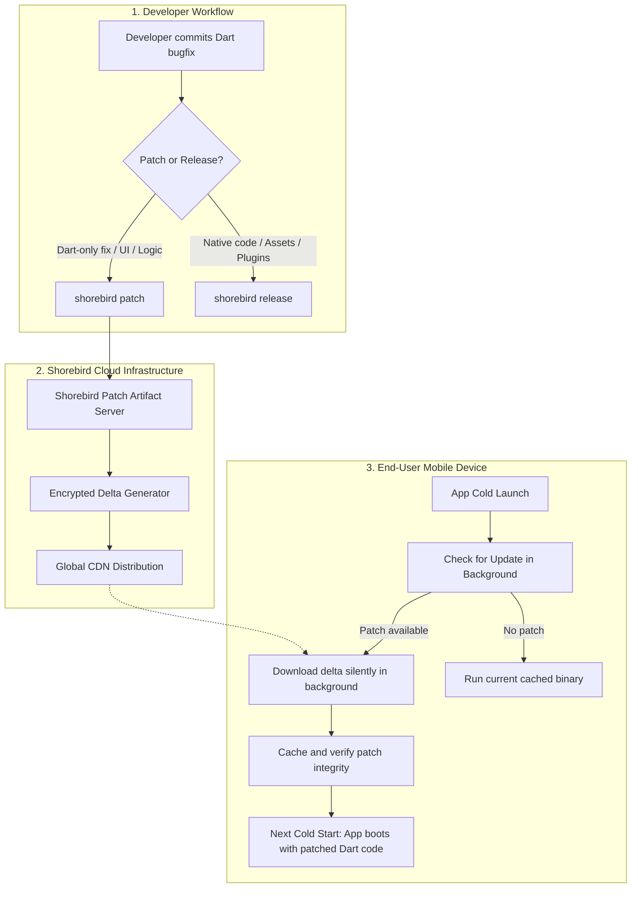
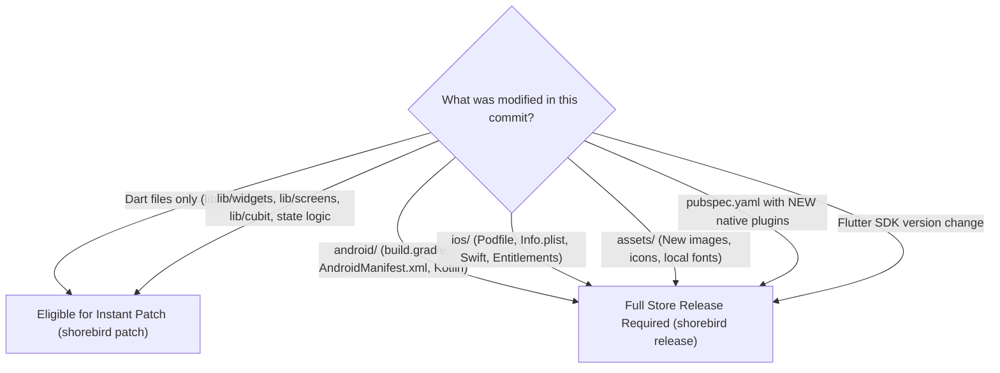

# Complete Flutter Code Push with Shorebird: End-to-End Setup & Patching Guide

A comprehensive, production-ready manual for configuring over-the-air (OTA) hot updates in Flutter applications using **Shorebird Code Push**. This guide details how to install the CLI, configure multi-flavor apps (`dev` and `prod`), generate base store releases for Google Play and Apple App Store, push instant Dart patches without store review delays, and automate patching within CI/CD pipelines.

> [!TIP]
> **💡 The Over-the-Air Electric Car Firmware Update Analogy:**
> When an electric car company finds a bug in the climate control dashboard, they don't demand 100,000 owners tow their cars into physical dealership service centers for a 3-day inspection (App Store review queues). They beam an over-the-air firmware update over cellular while the car is parked in the driveway. Shorebird delivers Dart bytecode updates directly to user devices on next boot—patching emergency bugs in seconds.

---

## 1. Architecture & How Shorebird Works

Shorebird replaces the default Flutter engine with a custom, drop-in replacement that enables dynamically updating Dart code over the air while remaining strictly compliant with Google Play and Apple App Store policies.



### Apple App Store Compliance (Guideline 3.3.2)
Apple App Store Review Guidelines permit over-the-air code execution provided that the code is run through an interpreter and does not change the primary purpose of the application. On iOS:
- The base release runs entirely as native ahead-of-time (AOT) machine code.
- Patched functions run through Shorebird's optimized Dart interpreter embedded in the engine.
- Typically, 95%–99% of unchanged functions continue running at full native AOT speed.

---

## 2. Prerequisites & System Installation

Ensure your local development machine and CI/CD environment have the following installed:

1. **Flutter SDK**: Shorebird manages its own fork of the Flutter engine, but your local project must match a stable Flutter version.
2. **Git**: Used by Shorebird for tracking release state and hashes.
3. **Shorebird CLI**: Installed via official installer.

### Installing Shorebird CLI

#### macOS / Linux
```bash
curl --proto '=https' --tlsv1.2 https://raw.githubusercontent.com/shorebirdtech/install/main/install.sh -sSf | bash
```

#### Windows (PowerShell)
```powershell
Set-ExecutionPolicy RemoteSigned -scope CurrentUser
iwr -useb https://raw.githubusercontent.com/shorebirdtech/install/main/install.ps1 | iex
```

After installation, reload your shell or run:
```bash
export PATH="$HOME/.shorebird/bin:$PATH"
shorebird doctor
```

### Authenticating with Shorebird
Authenticate your developer account:
```bash
shorebird login
```
This opens a browser window to authenticate with your Google account. In CI/CD environments, you will use a headless token (`SHOREBIRD_TOKEN`).

---

## 3. Initializing Shorebird in a Flutter Project

Navigate to your Flutter project root and initialize Shorebird:

```bash
cd /path/to/my_flutter_app
shorebird init
```

The initialization wizard will:
1. Detect your app's bundle identifier / package name.
2. Register an app record in the Shorebird Console.
3. Create a `shorebird.yaml` file in your project root.
4. Add `shorebird.yaml` to the `assets` block of your `pubspec.yaml`.

### Multi-Flavor Configuration (`shorebird.yaml`)
In production applications utilizing flavors (e.g., `dev` and `prod`), map each flavor to its corresponding Shorebird `app_id` to prevent staging patches from affecting production users:

```yaml
# shorebird.yaml
# Unique identifier assigned to your app in the Shorebird Console.
# This file is safe to commit to version control (app_id is public, not a secret).
app_id: 11111111-2222-3333-4444-555555555555

flavors:
  dev: 11111111-2222-3333-4444-555555555555
  prod: 22222222-3333-4444-5555-666666666666

# auto_update controls whether updates download automatically on launch.
# Defaults to true. Set to false only if managing updates manually in Dart.
# auto_update: true
```

> [!IMPORTANT]
> Always commit `shorebird.yaml` to Git. Never commit API tokens or service account keys.

---

## 4. The Golden Rule: "Patch vs. Full Release"

Shorebird can only patch **Dart code**. It cannot modify compiled native code, platform permissions, or static bundled assets.



### Pre-Patch Verification Script
Run this git check before triggering a patch to ensure no unpatchable files were modified:

```bash
#!/usr/bin/env bash
# tools/ci/check_patch_safety.sh
LAST_RELEASE_TAG="v1.0.0"

DIVERGED_FILES=$(git diff --name-only "$LAST_RELEASE_TAG"..HEAD | grep -E '^(android/|ios/|assets/|pubspec.yaml|\.env)')

if [ -n "$DIVERGED_FILES" ]; then
  echo "⚠️ DANGER: The following native or asset files have changed since $LAST_RELEASE_TAG:"
  echo "$DIVERGED_FILES"
  echo "You CANNOT use 'shorebird patch'. You MUST perform a full 'shorebird release' and submit to App Store / Google Play."
  exit 1
else
  echo "✅ Safe: Only Dart files were modified. Proceed with 'shorebird patch'."
  exit 0
fi
```

---

## 5. Android: Release & Patching Workflow

### Step 5.1: Create the Base Android Release
Before an app can receive patches, the base binary running on user devices must be compiled with `shorebird release`. Artifacts built with standard `flutter build` cannot receive Shorebird patches.

```bash
# Build production release AAB for Google Play Store
shorebird release android \
  --flavor prod \
  -t lib/main_prod.dart \
  --flutter-version=3.29.0 \
  -- --no-tree-shake-icons
```

> [!TIP]
> Locking the Flutter engine version via `--flutter-version=<version>` guarantees that Shorebird builds on the exact engine revision matching your QA verification.

This command outputs an Android App Bundle (`.aab`) located at:
`build/app/outputs/bundle/prodRelease/app-prod-release.aab`

1. Upload this `.aab` manually or via Fastlane to **Google Play Console** (Internal Testing or Production track).
2. Wait for Google Play to approve and publish the build to users.

### Step 5.2: Send a Dart Patch to Android Users
When a bug is discovered in production, fix the Dart code in `lib/` and publish an immediate patch:

```bash
shorebird patch android \
  --flavor prod \
  -t lib/main_prod.dart \
  --release-version 1.0.0+1 \
  --no-tree-shake-icons
```

#### What happens next:
1. Shorebird compiles the new Dart code and computes a cryptographic delta against the base release (`1.0.0+1`).
2. The delta is uploaded to Shorebird's CDN.
3. When users open the app, the engine detects the patch, downloads the small delta (~50KB to 200KB) in the background.
4. On the user's **next cold restart**, the app boots with the patched code.

---

## 6. iOS: Release & Patching Workflow

### Step 6.1: Create the Base iOS Release
Compile the base iOS binary with code signing:

```bash
# Build production release IPA for App Store Connect
shorebird release ios \
  --flavor prod \
  -t lib/main_prod.dart \
  --flutter-version=3.29.0
```

This command generates an unsigned or signed `.ipa` archive:
`build/ios/ipa/Runner.ipa`

1. Upload the `.ipa` to **App Store Connect** (via Fastlane `pilot` or Xcode Transporter).
2. Distribute to **TestFlight** first to verify that patching behaves identically to App Store builds.
3. Submit to the App Store for review.

### Step 6.2: Send a Dart Patch to iOS Users
Deploy the instant Dart patch targeting the active iOS release:

```bash
shorebird patch ios \
  --flavor prod \
  -t lib/main_prod.dart \
  --release-version 1.0.0+1
```

> [!NOTE]
> Android and iOS maintain **independent release versions and patch tracks**. If a bug exists across both platforms, push `shorebird patch android` and `shorebird patch ios` separately.

---

## 7. Staging Tracks & Verification (`--track=staging`)

To test patches on internal team devices before rolling them out to all production end users, use Shorebird **tracks**:

```bash
# 1. Release base binary to the staging track
shorebird release android --flavor prod -t lib/main_prod.dart --track=staging

# 2. Deploy a patch targeted strictly to the staging track
shorebird patch android --flavor prod -t lib/main_prod.dart --track=staging

# 3. Preview the patched build on your physical device or emulator
shorebird preview --track=staging --release-version 1.0.0+1
```

---

## 8. Rollback a Compromised Patch

If a patch introduces an unforeseen regression, it can be revoked instantly without publishing any code:

1. Open the [Shorebird Web Console](https://console.shorebird.dev/).
2. Select your application and navigate to **Releases** &rarr; Select your release version (e.g. `1.0.0+1`).
3. Click the **Patches** tab.
4. Click the toggle switch to **Disable** or **Rollback** the patch.

Within minutes, devices checking for updates will revert to the previous stable state on their next boot.

---

## 9. CI/CD Automation with GitHub Actions

### Generating CI Token
Run locally to generate a non-expiring CI token:
```bash
shorebird account create-ci-token
```
Copy the generated token string and add it to your repository secrets as `SHOREBIRD_TOKEN`.

### GitHub Actions Workflow Blueprint (`.github/workflows/shorebird_patch.yml`)

```yaml
name: Deploy Shorebird Hot Patch

on:
  workflow_dispatch:
    inputs:
      platform:
        description: 'Target platform to patch'
        required: true
        default: 'android'
        type: choice
        options:
          - android
          - ios
          - both
      release_version:
        description: 'Target store release version (e.g. 1.0.0+1)'
        required: true
        type: string

jobs:
  patch-android:
    name: Patch Android (Production)
    if: inputs.platform == 'android' || inputs.platform == 'both'
    runs-on: ubuntu-latest
    steps:
      - name: Checkout Code
        uses: actions/checkout@v4

      - name: Setup Java 17
        uses: actions/setup-java@v4
        with:
          distribution: 'temurin'
          java-version: '17'

      - name: Setup Shorebird
        uses: shorebirdtech/actions/setup-shorebird@v1

      - name: Restore Keystore Secrets
        env:
          KEYSTORE_BASE64: ${{ secrets.ANDROID_KEYSTORE_BASE64 }}
        run: |
          echo "$KEYSTORE_BASE64" | base64 --decode > android/app/upload-keystore.jks

      - name: Deploy Shorebird Android Patch
        env:
          SHOREBIRD_TOKEN: ${{ secrets.SHOREBIRD_TOKEN }}
          KEYSTORE_PASSWORD: ${{ secrets.KEYSTORE_PASSWORD }}
          KEY_ALIAS: ${{ secrets.KEY_ALIAS }}
          KEY_PASSWORD: ${{ secrets.KEY_PASSWORD }}
        run: |
          shorebird patch android \
            --flavor prod \
            -t lib/main_prod.dart \
            --release-version ${{ inputs.release_version }} \
            --no-tree-shake-icons

  patch-ios:
    name: Patch iOS (Production)
    if: inputs.platform == 'ios' || inputs.platform == 'both'
    runs-on: macos-14
    steps:
      - name: Checkout Code
        uses: actions/checkout@v4

      - name: Setup Shorebird
        uses: shorebirdtech/actions/setup-shorebird@v1

      - name: Setup Fastlane Match Certificates
        env:
          MATCH_PASSWORD: ${{ secrets.MATCH_PASSWORD }}
          MATCH_GIT_PRIVATE_KEY: ${{ secrets.MATCH_GIT_PRIVATE_KEY }}
        run: |
          bundle exec fastlane match appstore --readonly

      - name: Deploy Shorebird iOS Patch
        env:
          SHOREBIRD_TOKEN: ${{ secrets.SHOREBIRD_TOKEN }}
        run: |
          shorebird patch ios \
            --flavor prod \
            -t lib/main_prod.dart \
            --release-version ${{ inputs.release_version }}
```

---

## 10. Commands Quick Reference

| Action | Command |
|---|---|
| Verify Installation | `shorebird doctor` |
| Initialize in Project | `shorebird init` |
| Create Android Base Release | `shorebird release android --flavor prod -t lib/main_prod.dart` |
| Create iOS Base Release | `shorebird release ios --flavor prod -t lib/main_prod.dart` |
| Patch Latest Android | `shorebird patch android --flavor prod -t lib/main_prod.dart` |
| Patch Specific Android Version | `shorebird patch android --flavor prod -t lib/main_prod.dart --release-version 1.0.0+1` |
| Patch Specific iOS Version | `shorebird patch ios --flavor prod -t lib/main_prod.dart --release-version 1.0.0+1` |
| Preview Patch on Device | `shorebird preview --flavor prod --release-version 1.0.0+1` |
| Generate Headless CI Token | `shorebird account create-ci-token` |

