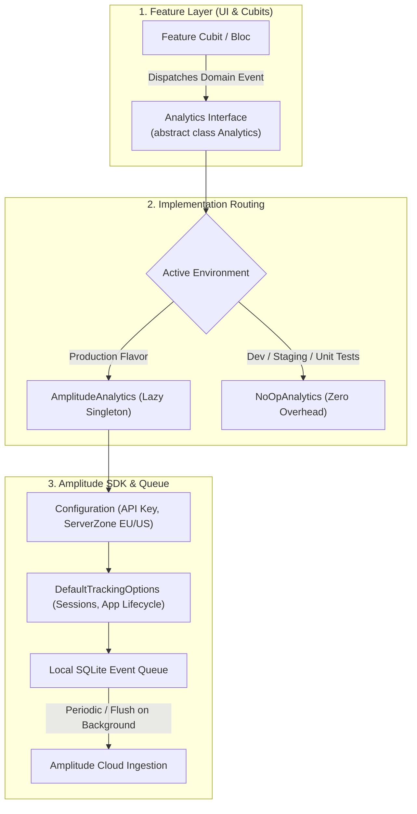

# Product Analytics & User Metrics with Amplitude: Complete Flutter Guide

A production-grade implementation guide for **Amplitude Analytics** in Flutter. This guide documents an architectural pattern featuring an abstract analytics interface, **ANR prevention during app startup** (avoiding blocking `@preResolve` traps), strongly typed event models, privacy-safe identity management, and sanitized, copy-paste-ready code.

> [!TIP]
> **💡 The Theme Park Footstep & Heatmap Tracker Analogy:**
> Crash monitors tell you when a roller coaster derails, but Amplitude tells you how guests actually enjoy the theme park: which attractions have the longest lines, what pathways lead to souvenir purchases, and where visitors drop out of the line. By loading Amplitude lazily (`@lazySingleton`), you avoid making guests wait at the turnstiles before entering the park.

---

## 1. Architecture & Analytics Pipeline

Directly coupling UI widgets or business logic to third-party analytics SDKs creates tight coupling, makes unit tests cumbersome, and risks cold-start ANR (Application Not Responding) freezes if the SDK initializes synchronously on the main thread.



---

## 2. Dependencies

Add `amplitude_flutter` and `injectable` to `pubspec.yaml`:

```yaml
dependencies:
  flutter:
    sdk: flutter
  amplitude_flutter: ^4.3.9
  injectable: ^2.5.0
  get_it: ^8.0.3

dev_dependencies:
  injectable_generator: ^2.6.2
  build_runner: ^2.4.14
```

---

## 3. The Cold-Start ANR Pitfall

> [!CAUTION]
> **Avoid `@preResolve` on Analytics SDKs:**
> Initializing heavy native analytics libraries synchronously before `runApp()` or with `@preResolve` inside dependency injection will block the Android main looper thread for 3 to 5+ seconds during cold launch. Google Play Console will flag this as a severe **ANR rate violation**.
>
> **The Solution:** Use `@lazySingleton` so the SDK is initialized on-demand without delaying the initial UI frame render.

---

## 4. Implementation: The Clean Analytics Pattern

### Step 4.1: Abstract `Analytics` Interface
Define an abstraction for analytics operations:

```dart
// lib/core/analytics/analytics.dart
import 'package:amplitude_flutter/events/base_event.dart';

abstract class Analytics {
  /// Track a typed or raw domain event
  void track(BaseEvent event);

  /// Clear user identification upon logout (GDPR compliance)
  void reset();

  /// Assign an authenticated user identifier
  void setUserId(String? userId);

  /// Assign group properties (e.g. company, team, organization)
  void setGroup(String groupType, String? groupKey);

  /// Force flush pending queued events to remote servers
  void flush();
}
```

---

### Step 4.2: Production `AmplitudeAnalytics`
Delegates operations to the Amplitude SDK:

```dart
// lib/core/analytics/amplitude_analytics.dart
import 'package:amplitude_flutter/amplitude.dart';
import 'package:amplitude_flutter/events/base_event.dart';
import 'analytics.dart';

class AmplitudeAnalytics implements Analytics {
  final Amplitude _amplitude;

  AmplitudeAnalytics(this._amplitude);

  @override
  void track(BaseEvent event) => _amplitude.track(event);

  @override
  void reset() => _amplitude.reset();

  @override
  void setUserId(String? userId) => _amplitude.setUserId(userId);

  @override
  void setGroup(String groupType, String? groupKey) =>
      _amplitude.setGroup(groupType, groupKey);

  @override
  void flush() => _amplitude.flush();
}
```

---

### Step 4.3: `NoOpAnalytics` for Development & Unit Tests
Guarantees zero network calls and zero overhead during tests:

```dart
// lib/core/analytics/no_op_analytics.dart
import 'package:amplitude_flutter/events/base_event.dart';
import 'analytics.dart';

class NoOpAnalytics implements Analytics {
  @override
  void track(BaseEvent event) {}

  @override
  void reset() {}

  @override
  void setUserId(String? userId) {}

  @override
  void setGroup(String groupType, String? groupKey) {}

  @override
  void flush() {}
}
```

---

### Step 4.4: Injectable Module Configuration
Configure conditional injection without blocking app cold startup:

```dart
// lib/core/services/amplitude_module.dart
import 'package:amplitude_flutter/amplitude.dart';
import 'package:amplitude_flutter/configuration.dart';
import 'package:amplitude_flutter/constants.dart';
import 'package:amplitude_flutter/default_tracking.dart';
import 'package:injectable/injectable.dart';
import 'package:my_app/core/analytics/analytics.dart';
import 'package:my_app/core/analytics/amplitude_analytics.dart';
import 'package:my_app/core/analytics/no_op_analytics.dart';

@module
abstract class AmplitudeModule {
  // Use @lazySingleton instead of @preResolve to protect cold startup latency
  @lazySingleton
  Analytics get analytics {
    const isProduction = bool.fromEnvironment('dart.vm.product');

    if (isProduction) {
      return AmplitudeAnalytics(
        Amplitude(
          Configuration(
            apiKey: const String.fromEnvironment(
              'AMPLITUDE_API_KEY',
              defaultValue: 'YOUR_AMPLITUDE_API_KEY_HERE',
            ),
            // Select ServerZone.eu if European GDPR compliance is required
            serverZone: ServerZone.us,
            // Track sessions, app opens, and backgrounding automatically
            defaultTracking: DefaultTrackingOptions.all(),
          ),
        ),
      );
    }

    return NoOpAnalytics();
  }
}
```

---

## 5. Strongly Typed Domain Events

Avoid magic strings in analytics tracking by subclassing `BaseEvent`:

```dart
// lib/core/analytics/events/auth_events.dart
import 'package:amplitude_flutter/events/base_event.dart';

class UserSignedUpEvent extends BaseEvent {
  UserSignedUpEvent({
    required String method,
    required bool optedIntoNewsletter,
  }) : super(
          eventType: 'User Signed Up',
          eventProperties: {
            'signup_method': method,
            'newsletter_opt_in': optedIntoNewsletter,
            'timestamp': DateTime.now().toIso8601String(),
          },
        );
}

class ScreenViewedEvent extends BaseEvent {
  ScreenViewedEvent({
    required String screenName,
    String? source,
  }) : super(
          eventType: 'Screen Viewed',
          eventProperties: {
            'screen_name': screenName,
            if (source != null) 'source': source,
          },
        );
}
```

---

## 6. Real-World Usage in Cubits / BLoCs

Inject `Analytics` into your state management layer:

```dart
import 'package:flutter_bloc/flutter_bloc.dart';
import 'package:injectable/injectable.dart';
import 'package:my_app/core/analytics/analytics.dart';
import 'package:my_app/core/analytics/events/auth_events.dart';

@injectable
class AuthCubit extends Cubit<AuthState> {
  final Analytics _analytics;
  final AuthRepository _authRepository;

  AuthCubit(this._analytics, this._authRepository) : super(const AuthState.initial());

  Future<void> loginWithApple() async {
    emit(const AuthState.loading());
    try {
      final user = await _authRepository.signInWithApple();

      // Set user identity and track event
      _analytics.setUserId(user.id);
      _analytics.track(UserSignedUpEvent(method: 'apple', optedIntoNewsletter: true));

      emit(AuthState.authenticated(user));
    } catch (e) {
      emit(AuthState.error(e.toString()));
    }
  }

  Future<void> logout() async {
    await _authRepository.signOut();

    // Critical: reset Amplitude identity so subsequent user events are not merged
    _analytics.reset();
    _analytics.flush();

    emit(const AuthState.unauthenticated());
  }
}
```

---

## 7. App Lifecycle & Background Flush

Flush pending analytics events when the user sends the application to the background:

```dart
import 'package:flutter/widgets.dart';
import 'package:get_it/get_it.dart';
import 'package:my_app/core/analytics/analytics.dart';

class AnalyticsLifecycleObserver with WidgetsBindingObserver {
  @override
  void didChangeAppLifecycleState(AppLifecycleState state) {
    if (state == AppLifecycleState.paused || state == AppLifecycleState.detached) {
      // Force write pending in-memory events before OS terminates process
      GetIt.I<Analytics>().flush();
    }
  }
}
```

---

## 8. Verification & Debugging Checklist

| Step | Verification Check | Expected Behavior |
| :--- | :--- | :--- |
| **Startup Benchmark** | Measure `main()` execution duration | Under 80ms cold boot; zero UI stutter. |
| **Event Delivery** | Open Amplitude Live Stream dashboard | Events show up with accurate properties and event names within 15 seconds. |
| **Logout Sanitization** | Call `analytics.reset()` | Device ID is regenerated; previous user ID is unlinked from subsequent events. |
| **Offline Buffering** | Turn off network, perform actions, turn network on | Events are stored in SQLite and uploaded automatically upon reconnection. |
| **Unit Test Safety** | Run `flutter test` | Tests execute with `NoOpAnalytics` with zero native method channel mock requirements. |

