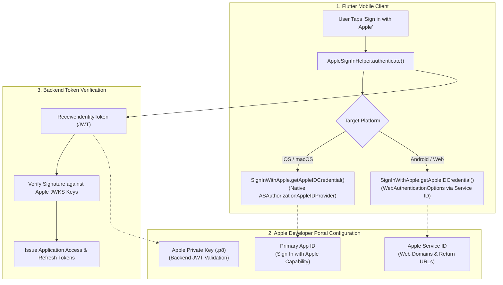

# Complete Sign in with Apple Integration Guide for Flutter (iOS & Android)

A complete, production-ready manual for implementing **Sign in with Apple** across **Apple Developer Portal**, native iOS configuration, cross-platform Android Web Authentication, and a robust Dart helper with concurrency protection.

> [!TIP]
> **💡 The VIP Masquerade Mask & Security Guard Analogy:**
> Apple Sign-In is like walking into an exclusive VIP lounge. Apple's personal security guard verifies your face via FaceID, but gives you a private masquerade mask (*Hide My Email* relay) before introducing you to the host. The app receives a cryptographically authenticated guest badge without ever exposing your real personal email to spam or data breaches.

---

## 1. Architecture & Authentication Flow

Sign in with Apple provides native, biometric-backed authentication on iOS via Apple's `AuthenticationServices` framework. For Android and Web environments, Apple authenticates users through a secure browser redirect flow using an **Apple Service ID**.



---

## 2. Apple Developer Portal Configuration

```mermaid
sequenceDiagram
    autonumber
    actor Dev as Developer
    participant ADP as Apple Developer Portal
    participant iOS as iOS Device (Native)
    participant Android as Android Device (Web Auth)
    participant Apple as Apple Identity Provider

    Dev->>ADP: Identifiers -> App IDs -> Enable Sign in with Apple
    Dev->>ADP: Identifiers -> Services IDs -> Create Service ID
    Dev->>ADP: Configure Domains & Return URLs for Service ID
    Dev->>ADP: Keys -> Generate Apple Sign In Private Key (.p8)
    
    rect rgb(30, 40, 55)
        Note over iOS,Apple: Native iOS Authorization
        iOS->>Apple: ASAuthorizationAppleIDProvider (Native Sheet)
        Apple-->>iOS: Return Identity Token & Authorization Code
    end

    rect rgb(40, 30, 50)
        Note over Android,Apple: Cross-Platform Web Flow
        Android->>Apple: Open Custom Tab (clientId = Service ID, redirectUri)
        Apple-->>Android: POST Authorization Code & Token to Return URL
    end
```



---

### Step 2.1: Enable Capability on App ID (iOS)
1. Navigate to [Apple Developer Portal](https://developer.apple.com/account/) &rarr; **Certificates, Identifiers & Profiles** &rarr; **Identifiers**.
2. Select **App IDs** in the filter dropdown.
3. Click your existing iOS App ID (e.g., `com.example.app`).
4. In the **Capabilities** list, locate **Sign In with Apple** and check the box.
5. Click **Edit** next to it, choose **Enable as a primary App ID**, and click **Save**.

---

### Step 2.2: Create a Service ID (Required for Android & Web)
Because Android devices do not have Apple's native `AuthenticationServices` framework, they authenticate via a secure web flow using an Apple **Service ID**:

1. In Apple Developer Portal &rarr; **Identifiers**, switch the dropdown from *App IDs* to **Services IDs**.
2. Click the **+** button.
3. **Description**: `Example App Web Auth`.
4. **Identifier**: e.g., `com.example.app.service`. Click **Continue** &rarr; **Register**.
5. Find the newly created Service ID in the list and click it.
6. Check **Sign in with Apple** and click **Configure**:
   * **Primary App ID**: Select the App ID configured in Step 2.1.
   * **Domains and Subdomains**: Your backend API domain (e.g., `api.example.com`).
   * **Return URLs**: The HTTPS endpoint where Apple will redirect after authorization (e.g., `https://api.example.com/auth/apple/callback`).
7. Click **Next** &rarr; **Done** &rarr; **Save**.

---

### Step 2.3: Create Private Key (.p8) for Backend Validation
Your backend requires an Apple Private Key to generate client secrets when validating authorization codes:
1. In Developer Portal, go to **Keys** &rarr; Click **+**.
2. **Key Name**: `Apple Sign In Key`.
3. Check **Sign in with Apple** &rarr; Click **Configure** &rarr; Choose your **Primary App ID**.
4. Click **Save** &rarr; **Continue** &rarr; **Register**.
5. Download the `.p8` key file. Note the **Key ID** and your **Team ID**.

---

## 3. Flutter Client Implementation

### Step 3.1: Add Package Dependency
Add `sign_in_with_apple` to `pubspec.yaml`:

```yaml
dependencies:
  flutter:
    sdk: flutter
  sign_in_with_apple: ^7.0.1
  flutter_dotenv: ^5.2.1
```

Run `flutter pub get`.

---

### Step 3.2: iOS Xcode Capability & Entitlements
1. Open the `ios` directory in **Xcode** (`xed ios`).
2. Select the top-level **Runner** project in the navigator.
3. Select the **Runner** target &rarr; **Signing & Capabilities** tab.
4. Click **+ Capability** and double-click **Sign in with Apple**.
5. Xcode will automatically create `Runner.entitlements` containing:

```xml
<?xml version="1.0" encoding="UTF-8"?>
<!DOCTYPE plist PUBLIC "-//Apple//DTD PLIST 1.0//EN" "http://www.apple.com/DTDs/PropertyList-1.0.dtd">
<plist version="1.0">
<dict>
    <key>com.apple.developer.applesignin</key>
    <array>
        <string>Default</string>
    </array>
</dict>
</plist>
```

---

### Step 3.3: Production-Grade Apple Sign-In Helper (Dart)
This helper uses native Apple authentication on iOS/macOS and automatically switches to `WebAuthenticationOptions` when running on Android:

```dart
import 'package:flutter/foundation.dart';
import 'package:flutter_dotenv/flutter_dotenv.dart';
import 'package:sign_in_with_apple/sign_in_with_apple.dart';

class AppleSignInResult {
  final String idToken;
  final String? authorizationCode;
  final String? email;
  final String? givenName;
  final String? familyName;

  const AppleSignInResult({
    required this.idToken,
    this.authorizationCode,
    this.email,
    this.givenName,
    this.familyName,
  });
}

class AppleSignInHelper {
  AppleSignInHelper._();

  static bool _isAuthenticating = false;

  /// Performs Apple Sign-In and returns identityToken (JWT) for backend verification
  static Future<AppleSignInResult> authenticate() async {
    // 1. Mutex locking: Prevent rapid double taps
    if (_isAuthenticating) {
      throw const AppleSignInException(
        message: 'Apple sign-in was canceled.',
      );
    }

    _isAuthenticating = true;
    try {
      final isAvailable = await SignInWithApple.isAvailable();
      if (!isAvailable) {
        throw const AppleSignInException(
          message: 'Apple Sign-In is not supported on this device.',
        );
      }

      final credential = await SignInWithApple.getAppleIDCredential(
        scopes: const [
          AppleIDAuthorizationScopes.email,
          AppleIDAuthorizationScopes.fullName,
        ],
        // On iOS/macOS webAuthenticationOptions is null; on Android it loads Service ID config
        webAuthenticationOptions: _getWebAuthenticationOptions(),
      );

      final idToken = credential.identityToken;
      if (idToken == null || idToken.isEmpty) {
        throw const AppleSignInException(
          message: 'Apple did not return an identity token.',
        );
      }

      return AppleSignInResult(
        idToken: idToken,
        authorizationCode: credential.authorizationCode,
        email: credential.email,
        givenName: credential.givenName,
        familyName: credential.familyName,
      );
    } finally {
      _isAuthenticating = false;
    }
  }

  static WebAuthenticationOptions? _getWebAuthenticationOptions() {
    // Native iOS/macOS uses native dialogs; Android/Web uses Apple Service ID
    final isNativeApple = !kIsWeb &&
        (defaultTargetPlatform == TargetPlatform.iOS ||
         defaultTargetPlatform == TargetPlatform.macOS);

    if (isNativeApple) return null;

    final serviceId = dotenv.env['APPLE_SERVICE_ID'] ?? '';
    final redirectUriStr = dotenv.env['APPLE_REDIRECT_URI'] ?? '';

    if (serviceId.isEmpty || redirectUriStr.isEmpty) {
      throw const AppleSignInException(
        message: 'Missing APPLE_SERVICE_ID or APPLE_REDIRECT_URI for Android/Web.',
      );
    }

    return WebAuthenticationOptions(
      clientId: serviceId,
      redirectUri: Uri.parse(redirectUriStr),
    );
  }

  static String readableError(Object error) {
    if (error is SignInWithAppleAuthorizationException) {
      switch (error.code) {
        case AuthorizationErrorCode.canceled:
          return 'Apple sign-in was canceled.';
        case AuthorizationErrorCode.failed:
          return 'Apple sign-in failed. Please try again.';
        case AuthorizationErrorCode.invalidResponse:
          return 'Invalid response from Apple servers.';
        case AuthorizationErrorCode.notHandled:
          return 'Sign-in request could not be handled.';
        case AuthorizationErrorCode.notInteractive:
          return 'Sign-in required user interaction.';
        case AuthorizationErrorCode.unknown:
        default:
          return error.message.isNotEmpty ? error.message : 'Apple sign-in failed.';
      }
    }
    return error.toString();
  }
}

class AppleSignInException implements Exception {
  final String message;
  const AppleSignInException({required this.message});
  @override
  String toString() => message;
}
```

> [!NOTE]
> Apple only returns the user's `email`, `givenName`, and `familyName` on the **very first** authorization. Subsequent sign-ins return only the `idToken`. Make sure your backend stores the name upon initial account registration.

---

## 4. Environment Variables Reference

Store these sanitized keys in your `.env` or CI secret storage:

| Environment Variable | Description | Platform | Example Format |
|---|---|---|---|
| `APPLE_SERVICE_ID` | Apple Service Identifier for Android & Web OAuth | Android / Web | `com.example.app.service` |
| `APPLE_REDIRECT_URI` | HTTPS backend redirect URL registered in Apple Portal | Android / Web | `https://api.example.com/auth/apple/callback` |

---

## 5. Troubleshooting & Common Pitfalls

### 1. Error 1000 (`AuthorizationErrorCode.failed`)
* **Symptom:** Apple authorization sheet fails with generic error 1000.
* **Cause:** The App ID does not have the **Sign In with Apple** capability enabled in Apple Developer Portal, or the provisioning profile does not include the capability.
* **Fix:** 
  1. Ensure capability is enabled in Apple Developer Portal.
  2. In Xcode, ensure **Sign in with Apple** is added to **Signing & Capabilities**.
  3. Regenerate provisioning profiles (or run `bundle exec fastlane match appstore` if using Fastlane).

### 2. Missing User Name / Email on Subsequent Logins
* **Symptom:** User logs in a second time and `credential.givenName` or `credential.email` is null.
* **Cause:** Apple security policy intentionally only delivers name/email on the initial authorization.
* **Fix:** Always persist the user's profile metadata in your database upon their first registration.

### 3. Android Web Auth Fails with `invalid_request`
* **Symptom:** Custom Chrome Tab opens Apple login and displays `invalid_request`.
* **Cause:** The `APPLE_REDIRECT_URI` or `APPLE_SERVICE_ID` does not exactly match the values registered in Apple Developer Portal.
* **Fix:** Check your Apple Service ID configuration under *Identifiers* &rarr; *Services IDs* &rarr; *Sign in with Apple* &rarr; *Configure*. Ensure the Return URL protocol, domain, and path match identically.

