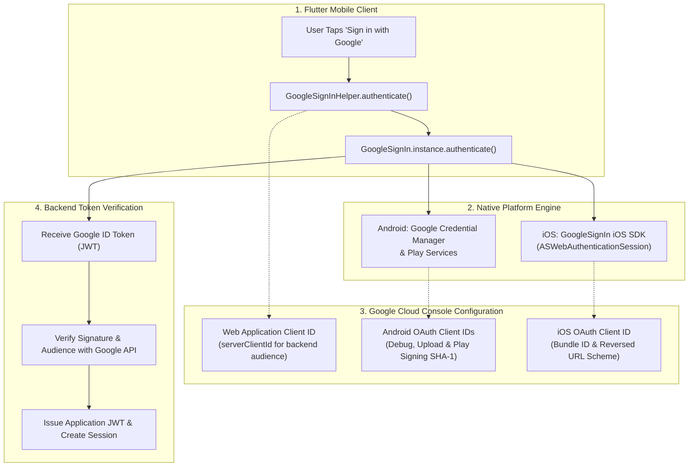
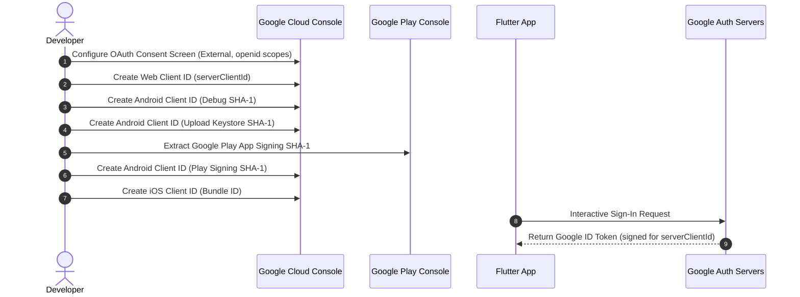

# Complete Google Sign-In Integration Guide for Flutter (Android & iOS)

A complete, production-ready manual for implementing **Sign in with Google** in Flutter applications. This guide covers every console configuration step across **Google Cloud Console** and **Google Play Console**, the mandatory 3 SHA-1 fingerprints setup, iOS `Info.plist` URL schemes, and a robust Dart helper with concurrency protection and Android Credential Manager recovery.

> [!TIP]
> **💡 The Biometric Passport & Consulate Visa Analogy:**
> Instead of forcing travelers to register a whole new identity dossier at every hotel front desk, Google Sign-In is like presenting an official biometric passport. Google confirms the user's face or fingerprint, affixes an unforgeable diplomatic visa stamp (`idToken` JWT), and hands it to your backend server—which verifies the official embassy watermark in milliseconds without ever touching the user's secret password.

---

## 1. Architecture & Authentication Flow

Google Sign-In uses native platform engines (Credential Manager on Android, GoogleSignIn SDK on iOS) to authenticate users with Google and obtain a cryptographically signed **ID Token** (JWT). The Flutter client passes this token to your backend API, which verifies it against Google's public certificates.



---

## 2. Google Cloud Console Configuration

Google Sign-In requires matching **OAuth 2.0 Client IDs** for each target environment.



---

### Step 2.1: Configure the OAuth Consent Screen
1. Open [Google Cloud Console](https://console.cloud.google.com/) and select your project.
2. In the navigation drawer, go to **APIs & Services** &rarr; **OAuth consent screen**.
3. Choose **External** user type and click **Create**.
4. Fill in the standard application details:
   * **App name**: Your Application Name
   * **User support email**: Your support or team email address
   * **Developer contact email**: Your engineering email address
5. In the **Scopes** section, add the core OpenID scopes:
   * `.../auth/userinfo.email`
   * `.../auth/userinfo.profile`
   * `openid`
6. Save and finish. While the app is in "Testing" publishing status, add your test Gmail accounts under **Test users**.

---

### Step 2.2: Create the Web Application Client ID (Server Client ID)
> [!IMPORTANT]
> A **Web Application Client ID** is mandatory even for pure mobile apps. This Client ID is passed as `serverClientId` to Google Sign-In so that Google returns an OpenID Connect `idToken` signed for your backend audience. Without it, Google Sign-In will not return an ID token.

1. In Google Cloud Console, navigate to **APIs & Services** &rarr; **Credentials**.
2. Click **+ Create Credentials** &rarr; **OAuth client ID**.
3. **Application type**: Select **Web application**.
4. **Name**: `Web Backend Client` (or `Production Server Client`).
5. Leave Authorized JavaScript origins and redirect URIs empty unless your backend or web client needs them.
6. Click **Create** and record the **Client ID**:
   * Example: `123456789012-abcdefghijklmnopqrstuvwxyz.apps.googleusercontent.com`
   * Store this as `GOOGLE_SERVER_CLIENT_ID` in your `.env` or CI secrets.

---

### Step 2.3: Extract Android SHA-1 & SHA-256 Fingerprints
Google OAuth on Android validates the caller application's package name and the SHA-1 signing fingerprint. **If any SHA-1 fingerprint is missing, Google Sign-In will silently cancel or throw error code 10 (`DEVELOPER_ERROR`).**

You must register **three** separate SHA-1 fingerprints in production:

#### 1. Local Debug Keystore Fingerprint:
```bash
keytool -list -v -keystore ~/.android/debug.keystore \
  -alias androiddebugkey -storepass android -keypass android
```
Locate the `SHA1` fingerprint (e.g., `AA:BB:CC:...`).

#### 2. Release / Upload Keystore Fingerprint:
```bash
keytool -list -v -keystore android/upload-keystore.jks -alias upload-key
```
Enter your keystore password and copy the `SHA1` fingerprint.

#### 3. Google Play App Signing Fingerprint:
When using Google Play App Signing, Google removes your upload key and signs user APKs/AABs with an internal Google signing key.
1. Open [Google Play Console](https://play.google.com/console/).
2. Select your application &rarr; **Release** &rarr; **Setup** &rarr; **App Integrity**.
3. In the **App Signing** tab, find **App signing key certificate**.
4. Copy the **SHA-1 certificate fingerprint**.

---

### Step 2.4: Create Android OAuth 2.0 Client IDs
For **each** of the three fingerprints extracted above:
1. Go to Google Cloud Console &rarr; **APIs & Services** &rarr; **Credentials** &rarr; **Create Credentials** &rarr; **OAuth client ID**.
2. **Application type**: **Android**.
3. **Name**: e.g., `Android Debug Client`, `Android Release Client`, `Android Play Store Client`.
4. **Package name**: Your exact `applicationId` (e.g., `com.example.app`).
5. **SHA-1 certificate fingerprint**: Paste the corresponding fingerprint.
6. Click **Create**.

---

### Step 2.5: Create iOS OAuth 2.0 Client ID
1. In Google Cloud Console &rarr; **Credentials** &rarr; **Create Credentials** &rarr; **OAuth client ID**.
2. **Application type**: **iOS**.
3. **Name**: `iOS Client`.
4. **Bundle ID**: Your exact iOS Bundle Identifier (e.g., `com.example.app`).
5. Click **Create**.
6. Note the following values:
   * **Client ID**: e.g., `123456789012-abcdef123456.apps.googleusercontent.com` (`GOOGLE_IOS_CLIENT_ID`)
   * **iOS URL scheme (Reversed Client ID)**: `com.googleusercontent.apps.123456789012-abcdef123456`

---

## 3. Flutter Client Implementation

### Step 3.1: Add Package Dependency
Add `google_sign_in` to your `pubspec.yaml`:

```yaml
dependencies:
  flutter:
    sdk: flutter
  google_sign_in: ^7.2.0
  flutter_dotenv: ^5.2.1
```

Run `flutter pub get`.

---

### Step 3.2: iOS `Info.plist` Configuration
Open `ios/Runner/Info.plist` and add your **Reversed Client ID** under `CFBundleURLTypes`:

```xml
<key>CFBundleURLTypes</key>
<array>
    <dict>
        <key>CFBundleTypeRole</key>
        <string>Editor</string>
        <key>CFBundleURLSchemes</key>
        <array>
            <!-- Replace with your actual Reversed Client ID from Google Cloud Console -->
            <string>com.googleusercontent.apps.123456789012-abcdef123456</string>
        </array>
    </dict>
</array>
```

---

### Step 3.3: Production-Grade Google Sign-In Helper (Dart)
This helper handles mutex locking to prevent duplicate interactive calls (`cancelled by second request`), checks platform compatibility, handles Android Credential Manager recovery, and extracts the OpenID `idToken`.

```dart
import 'package:flutter/foundation.dart';
import 'package:flutter_dotenv/flutter_dotenv.dart';
import 'package:google_sign_in/google_sign_in.dart';

class GoogleSignInResult {
  final String idToken;
  final String email;
  final String? displayName;
  final String? photoUrl;

  const GoogleSignInResult({
    required this.idToken,
    required this.email,
    this.displayName,
    this.photoUrl,
  });
}

class GoogleSignInHelper {
  GoogleSignInHelper._();

  static bool _initialized = false;
  static bool _isAuthenticating = false;

  /// Authenticates user and returns Google OpenID idToken for backend verification
  static Future<GoogleSignInResult> authenticate() async {
    // 1. Mutex: Reject simultaneous taps that cause native SDK abort crashes
    if (_isAuthenticating) {
      throw const GoogleSignInException(
        code: GoogleSignInExceptionCode.canceled,
        description: 'Google sign-in was canceled.',
      );
    }

    _isAuthenticating = true;
    try {
      await _ensureInitialized();

      if (!GoogleSignIn.instance.supportsAuthenticate()) {
        throw const GoogleSignInException(
          code: GoogleSignInExceptionCode.unknownError,
          description: 'Google Sign-In is not supported on this platform.',
        );
      }

      try {
        final account = await GoogleSignIn.instance.authenticate();
        return _toResult(account);
      } on GoogleSignInException catch (error) {
        // Handle Android Credential Manager edge cases
        if (_isAndroid && error.code == GoogleSignInExceptionCode.canceled) {
          final recovered = await _recoverAndroidAuthentication();
          if (recovered != null) return recovered;
        }
        rethrow;
      }
    } finally {
      _isAuthenticating = false;
    }
  }

  static bool get _isAndroid =>
      !kIsWeb && defaultTargetPlatform == TargetPlatform.android;

  static Future<GoogleSignInResult?> _recoverAndroidAuthentication() async {
    try {
      final account = await (GoogleSignIn.instance.attemptLightweightAuthentication(
        reportAllExceptions: true,
      ) ?? Future<GoogleSignInAccount?>.value(null));

      if (account == null) return null;
      return _toResult(account);
    } catch (_) {
      return null;
    }
  }

  static GoogleSignInResult _toResult(GoogleSignInAccount account) {
    final idToken = account.authentication.idToken;
    if (idToken == null || idToken.isEmpty) {
      throw const GoogleSignInException(
        code: GoogleSignInExceptionCode.clientConfigurationError,
        description: 'Google did not return an ID token. Verify serverClientId configuration.',
      );
    }

    return GoogleSignInResult(
      idToken: idToken,
      email: account.email,
      displayName: account.displayName,
      photoUrl: account.photoUrl,
    );
  }

  static Future<void> _ensureInitialized() async {
    if (_initialized) return;

    final serverClientId = dotenv.env['GOOGLE_SERVER_CLIENT_ID'] ?? '';
    final iosClientId = dotenv.env['GOOGLE_IOS_CLIENT_ID'] ?? '';

    if (serverClientId.isEmpty) {
      throw const GoogleSignInException(
        code: GoogleSignInExceptionCode.clientConfigurationError,
        description: 'Missing GOOGLE_SERVER_CLIENT_ID environment variable.',
      );
    }

    await GoogleSignIn.instance.initialize(
      serverClientId: serverClientId,
      clientId: defaultTargetPlatform == TargetPlatform.iOS ? iosClientId : null,
    );
    _initialized = true;
  }

  /// Converts native exceptions into user-friendly error messages
  static String readableError(Object error) {
    if (error is GoogleSignInException) {
      switch (error.code) {
        case GoogleSignInExceptionCode.canceled:
          return 'Google sign-in was canceled.';
        case GoogleSignInExceptionCode.clientConfigurationError:
          return 'Configuration error: Check package name, SHA-1 fingerprint, and Client IDs.';
        case GoogleSignInExceptionCode.uiUnavailable:
          return 'Google sign-in UI is currently unavailable. Please try again.';
        case GoogleSignInExceptionCode.interrupted:
          return 'Sign-in was interrupted. Please retry.';
        case GoogleSignInExceptionCode.unknownError:
        default:
          return error.description ?? 'Google sign-in failed. Please try again.';
      }
    }
    return error.toString();
  }
}
```

---

## 4. Environment Variables Reference

Store these sanitized keys in your `.env` or CI secret storage:

| Environment Variable | Description | Platform | Example Format |
|---|---|---|---|
| `GOOGLE_SERVER_CLIENT_ID` | Web Client ID used for backend token verification | All | `123456789-abc.apps.googleusercontent.com` |
| `GOOGLE_IOS_CLIENT_ID` | Native iOS OAuth Client ID | iOS | `123456789-def.apps.googleusercontent.com` |
| `GOOGLE_REVERSED_CLIENT_ID`| Reversed scheme for iOS `Info.plist` | iOS | `com.googleusercontent.apps.123456789-def` |

---

## 5. Troubleshooting & Common Pitfalls

### 1. Error Code 10 (`DEVELOPER_ERROR` / Canceled immediately on Android)
* **Symptom:** Account selector appears, user taps an account, and the dialog immediately disappears with error code 10 or canceled.
* **Cause:** The SHA-1 fingerprint of the active signing certificate does not match any registered Android OAuth Client ID in Google Cloud Console.
* **Fix:** Ensure you have registered:
  1. Local debug keystore SHA-1 (`~/.android/debug.keystore`)
  2. Release keystore SHA-1 (`upload-keystore.jks`)
  3. Google Play App Signing key SHA-1 (from Play Console &rarr; App Integrity)

### 2. Missing `idToken`
* **Symptom:** User signs in successfully, but `account.authentication.idToken` is null.
* **Cause:** `serverClientId` was omitted during `GoogleSignIn.instance.initialize()`.
* **Fix:** Pass your Web Client ID (`GOOGLE_SERVER_CLIENT_ID`) to `GoogleSignIn.instance.initialize(serverClientId: ...)`.

### 3. iOS App Crashes Immediately When Tapping Google Sign-In
* **Symptom:** App terminates with `NSInvalidArgumentException: URL scheme not registered`.
* **Cause:** Missing `CFBundleURLSchemes` entry in `ios/Runner/Info.plist`.
* **Fix:** Add your Reversed Client ID (`com.googleusercontent.apps.XXX`) to `Info.plist` under `CFBundleURLTypes`.

