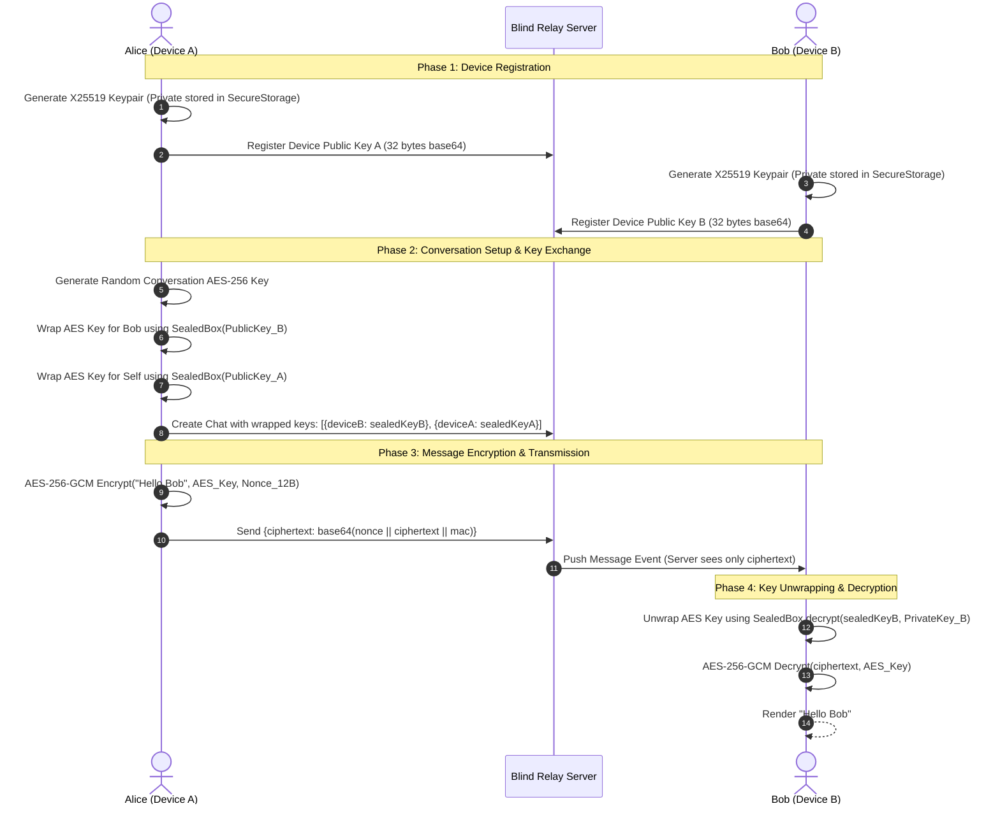

# End-to-End Encrypted (E2EE) Chat Architecture: Complete Guide

A production-grade implementation guide for **End-to-End Encrypted (E2EE) messaging** in Flutter. This architecture combines **X25519 asymmetric key exchange (Libsodium SealedBox)** for multi-device key distribution with **AES-256-GCM authenticated symmetric encryption** for zero-knowledge message payloads, ensuring the backend server functions as a blind relay without access to conversation plaintext.

> [!TIP]
> **💡 The Blindfolded Courier & Titanium Padlock Analogy:**
> The backend server is like a blindfolded postal courier wearing thick oven mitts. Alice places her letter inside a titanium lockbox, snaps Bob's personal padlock shut (`SealedBox`), and hands it to the courier. The courier delivers the heavy box without knowing what's inside or being able to forge the contents (`AES-GCM Auth Tag`). Only Bob, possessing the unique physical key in his pocket, can unlock and read the message.

---

## 1. Cryptographic Architecture & Flow

The encryption model implements a **hybrid cryptosystem** designed for multi-device messaging:

1. **Device Identity (Asymmetric X25519):** Each user device generates an asymmetric Curve25519 key pair. The private key remains permanently trapped in hardware keystore/Keychain; the public key is registered with the server.
2. **Conversation Key (Symmetric AES-256):** Every conversation has an independent, cryptographically random 256-bit symmetric AES key.
3. **Key Distribution (SealedBox):** The conversation AES key is wrapped for each participant device using Libsodium-compatible `crypto_box_seal`. Only the intended device private key can unwrap it.
4. **Message Cipher (AES-256-GCM):** Message contents are encrypted using AES-256 in Galois/Counter Mode with a 12-byte cryptographically secure random nonce and a 16-byte authentication tag (MAC).



---

## 2. Dependencies & Cryptographic Libraries

Add these packages to `pubspec.yaml`:

```yaml
dependencies:
  flutter:
    sdk: flutter
  # AES-256-GCM authenticated cipher
  cryptography: ^2.7.0
  # Libsodium X25519 SealedBox (crypto_box_seal)
  pinenacl: ^0.6.0
  # Secure hardware keystore / Keychain storage
  flutter_secure_storage: ^9.2.2
  injectable: ^2.5.0
```

---

## 3. Component 1: Libsodium SealedBox Key Exchange

This component wraps and unwraps the conversation AES key for target device X25519 public keys. It utilizes Libsodium-compatible ephemeral-static Diffie-Hellman (`crypto_box_seal`):

```dart
// lib/core/crypto/crypto_key_exchange.dart
import 'dart:convert';
import 'dart:typed_data';
import 'package:injectable/injectable.dart';
import 'package:pinenacl/x25519.dart';

abstract class CryptoKeyExchange {
  /// Wraps [aesKeyBytes] using recipient device public key (base64)
  Future<String> wrap({
    required List<int> aesKeyBytes,
    required String recipientPublicKeyBase64,
  });

  /// Unwraps backend [encryptedKeyBase64] using local device private key bytes
  Future<List<int>> unwrap({
    required String encryptedKeyBase64,
    required List<int> privateKeyBytes,
  });
}

@LazySingleton(as: CryptoKeyExchange)
class SealedBoxCryptoKeyExchange implements CryptoKeyExchange {
  @override
  Future<String> wrap({
    required List<int> aesKeyBytes,
    required String recipientPublicKeyBase64,
  }) async {
    final publicKeyBytes = base64Decode(recipientPublicKeyBase64.trim());
    if (publicKeyBytes.length != PublicKey.keyLength) {
      throw ArgumentError('Recipient public key must be ${PublicKey.keyLength} bytes');
    }

    // PineNaCl SealedBox performs libsodium crypto_box_seal
    final box = SealedBox(PublicKey(Uint8List.fromList(publicKeyBytes)));
    final sealed = box.encrypt(Uint8List.fromList(aesKeyBytes));
    return base64Encode(sealed);
  }

  @override
  Future<List<int>> unwrap({
    required String encryptedKeyBase64,
    required List<int> privateKeyBytes,
  }) async {
    if (privateKeyBytes.length != PrivateKey.keyLength) {
      throw ArgumentError('Private key must be ${PrivateKey.keyLength} bytes');
    }

    final privateKey = PrivateKey(Uint8List.fromList(privateKeyBytes));
    final box = SealedBox(privateKey);
    final opened = box.decrypt(
      Uint8List.fromList(base64Decode(encryptedKeyBase64.trim())),
    );
    return opened.toList(growable: false);
  }
}
```

---

## 4. Component 2: AES-256-GCM Message Cipher

Messages are encrypted and authenticated using AES-256-GCM. The wire format consists of a concatenated byte payload:
$$\text{Wire Payload} = \text{Base64}\big(\text{Nonce}_{12\text{ bytes}} \parallel \text{Ciphertext} \parallel \text{MAC}_{16\text{ bytes}}\big)$$

```dart
// lib/core/crypto/conversation_message_cipher.dart
import 'dart:convert';
import 'dart:typed_data';
import 'package:cryptography/cryptography.dart';
import 'package:injectable/injectable.dart';

@lazySingleton
class ConversationMessageCipher {
  static const int _nonceLength = 12; // 96-bit standard GCM nonce
  static const int _macLength = 16;   // 128-bit authentication tag

  final AesGcm _algorithm = AesGcm.with256bits();

  /// Encrypts plaintext string using the conversation AES key
  Future<String> encrypt({
    required String plaintext,
    required List<int> aesKeyBytes,
  }) async {
    final secretKey = SecretKey(aesKeyBytes);
    final secretBox = await _algorithm.encrypt(
      utf8.encode(plaintext),
      secretKey: secretKey,
    );

    // Combine: Nonce (12B) + Ciphertext + MAC (16B)
    final combined = Uint8List.fromList(<int>[
      ...secretBox.nonce,
      ...secretBox.cipherText,
      ...secretBox.mac.bytes,
    ]);

    return base64Encode(combined);
  }

  /// Attempts to decrypt ciphertext; returns null if not valid GCM (handles legacy plaintext fallback)
  Future<String?> tryDecrypt({
    required String ciphertext,
    required List<int> aesKeyBytes,
  }) async {
    final trimmed = ciphertext.trim();
    if (trimmed.isEmpty) return '';

    late final Uint8List combined;
    try {
      combined = base64Decode(trimmed);
    } on FormatException {
      // Legacy plaintext message support
      return null;
    }

    if (combined.length <= _nonceLength + _macLength) {
      return null;
    }

    final nonce = combined.sublist(0, _nonceLength);
    final macStart = combined.length - _macLength;
    final cipherText = combined.sublist(_nonceLength, macStart);
    final macBytes = combined.sublist(macStart);

    try {
      final clearBytes = await _algorithm.decrypt(
        SecretBox(cipherText, nonce: nonce, mac: Mac(macBytes)),
        secretKey: SecretKey(aesKeyBytes),
      );
      return utf8.decode(clearBytes);
    } catch (_) {
      // MAC verification failed or wrong AES key
      return null;
    }
  }
}
```

---

## 5. Component 3: Local Keystore & Conversation Cache

Keys are cached securely in memory and encrypted hardware storage so unwrap operations occur only once:

```dart
// lib/core/crypto/conversation_key_store.dart
import 'dart:convert';
import 'package:flutter_secure_storage/flutter_secure_storage.dart';
import 'package:injectable/injectable.dart';

@lazySingleton
class ConversationKeyStore {
  final FlutterSecureStorage _storage;
  final Map<String, List<int>> _memoryCache = {};

  ConversationKeyStore(this._storage);

  Future<List<int>?> getKey(String conversationId) async {
    if (_memoryCache.containsKey(conversationId)) {
      return _memoryCache[conversationId];
    }

    final storedBase64 = await _storage.read(key: 'aes_key_$conversationId');
    if (storedBase64 != null && storedBase64.isNotEmpty) {
      final bytes = base64Decode(storedBase64);
      _memoryCache[conversationId] = bytes;
      return bytes;
    }
    return null;
  }

  Future<void> saveKey(String conversationId, List<int> keyBytes) async {
    _memoryCache[conversationId] = keyBytes;
    await _storage.write(
      key: 'aes_key_$conversationId',
      value: base64Encode(keyBytes),
    );
  }

  void clearMemoryCache() {
    _memoryCache.clear();
  }
}
```

---

## 6. Component 4: Unified Messaging Crypto Service

Orchestrates outgoing encryption and incoming message decryption:

```dart
// lib/features/chat/domain/services/chat_message_crypto_service.dart
import 'package:injectable/injectable.dart';
import 'package:my_app/core/crypto/conversation_key_store.dart';
import 'package:my_app/core/crypto/conversation_message_cipher.dart';

enum MessageType { text, image, system }

class ChatMessage {
  final String id;
  final String conversationId;
  final String senderId;
  final String text;
  final MessageType type;

  ChatMessage({
    required this.id,
    required this.conversationId,
    required this.senderId,
    required this.text,
    required this.type,
  });

  ChatMessage copyWith({String? text}) => ChatMessage(
        id: id,
        conversationId: conversationId,
        senderId: senderId,
        text: text ?? this.text,
        type: type,
      );
}

@lazySingleton
class ChatMessageCryptoService {
  final ConversationKeyStore _keyStore;
  final ConversationMessageCipher _cipher;

  ChatMessageCryptoService(this._keyStore, this._cipher);

  /// Encrypt outgoing message text before sending to WebSocket or REST API
  Future<String?> encryptOutgoingText({
    required String conversationId,
    required String plaintext,
  }) async {
    final trimmed = plaintext.trim();
    if (trimmed.isEmpty) return trimmed;

    final aesKey = await _keyStore.getKey(conversationId);
    if (aesKey == null) {
      // Cannot send without encryption key
      return null;
    }

    return await _cipher.encrypt(plaintext: trimmed, aesKeyBytes: aesKey);
  }

  /// Decrypt an incoming message (handles system message bypass & decryption failures)
  Future<ChatMessage> decryptMessage(ChatMessage message) async {
    // 1. System messages are server-generated plain text; never decrypt
    if (message.type == MessageType.system) {
      return message;
    }

    final aesKey = await _keyStore.getKey(message.conversationId);
    if (aesKey == null) {
      return message.copyWith(
        text: 'Encrypted message (Key unavailable on this device)',
      );
    }

    final decrypted = await _cipher.tryDecrypt(
      ciphertext: message.text,
      aesKeyBytes: aesKey,
    );

    return message.copyWith(
      text: decrypted ?? 'Unable to decrypt message (Integrity check failed)',
    );
  }
}
```

---

## 7. Security Best Practices & Audit Checklist

| Security Requirement | Implementation Standard | Verification |
| :--- | :--- | :--- |
| **Zero-Knowledge Backend** | Server stores only ciphertext and sealed keys. Never receives private keys or plaintext. | Verify database inspects; message text is Base64 GCM payload. |
| **Replay Attack Resistance** | Each message generates a fresh, random 12-byte nonce via `AesGcm.with256bits()`. | Nonces are never reused for the same AES key. |
| **Tamper Protection** | GCM produces a 16-byte MAC tag verified prior to payload decryption. | Modifying a single bit of ciphertext returns null during `tryDecrypt()`. |
| **System Message Isolation** | System notifications (e.g. member joined) explicitly bypass AES decryption. | System events render properly without decryption errors. |
| **Hardware Keystore** | Device X25519 private keys stored in `flutter_secure_storage` with hardware encryption (`kSecAttrAccessibleAfterFirstUnlockThisDeviceOnly`). | Keys do not export to unencrypted iCloud/Google Drive backups. |

