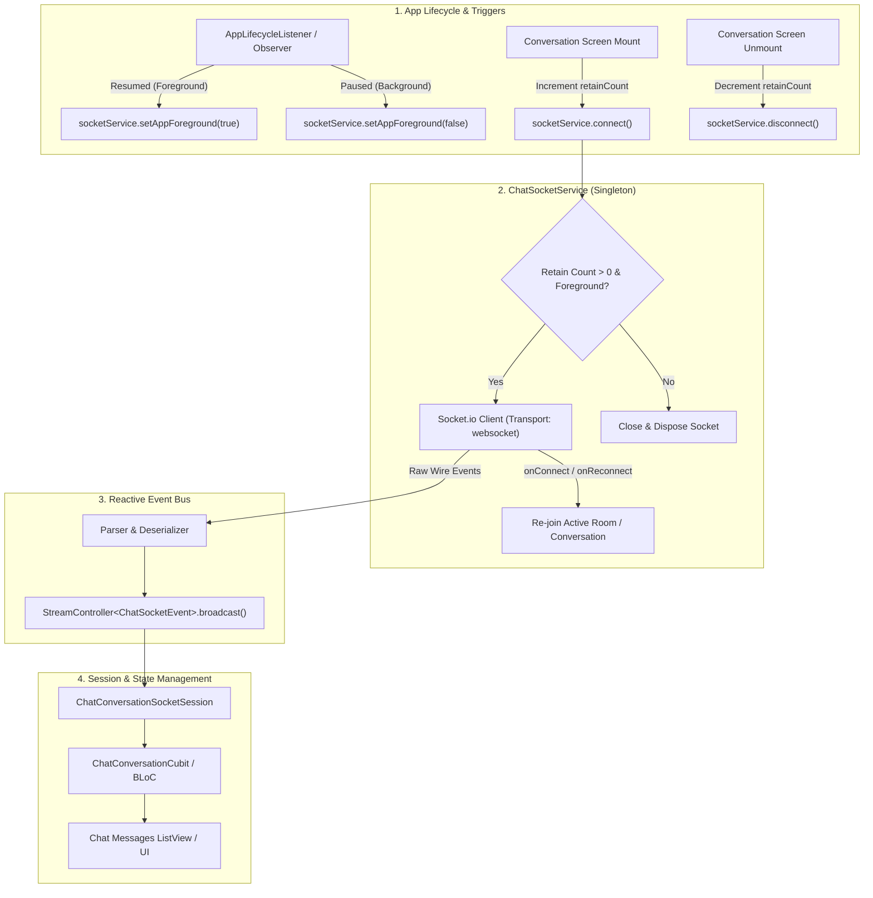

# Production WebSocket & Socket.io Architecture in Flutter: Complete Guide

A comprehensive, production-ready manual for implementing **real-time WebSocket and Socket.io messaging** in Flutter. This architecture features **connection retain counting** (preventing connection thrashing across screens), **app lifecycle background/foreground synchronization**, **deterministic room re-joining on reconnect**, **strongly typed event streams**, and sanitized, copy-paste-ready code.

> [!TIP]
> **💡 The Walkie-Talkie Base Station & Retain Counter Analogy:**
> While standard HTTP is like mailing letters back and forth, a WebSocket is a live walkie-talkie channel with the server. But you shouldn't shut off the base station every time a single person steps out for coffee. **Connection retain counting** acts like a roster: the radio stays keyed open as long as at least one screen is listening (`retainCount > 0`), and only shuts down to save battery when the room is completely empty.

---

## 1. Architecture & Real-Time Pipeline

Managing WebSockets in mobile applications presents unique challenges: battery-saving OS kills, network handoffs between Wi-Fi and 5G, multiple screens needing simultaneous socket access, and backgrounding events. 

This architecture decouples the raw socket connection into three distinct layers:
1. **`ChatSocketService`:** Centralized singleton managing connection lifecycle, auth headers, retain counting, and wire event emission.
2. **`ChatConversationSocketSession`:** Ephemeral session controller managing room subscriptions and stream cleanup per UI screen.
3. **Feature Presentation (BLoC/Cubit):** Reacts to typed domain events and updates immutable UI state.



---

## 2. Dependencies & Prerequisites

Add `socket_io_client` and `injectable` to `pubspec.yaml`:

```yaml
dependencies:
  flutter:
    sdk: flutter
  # Socket.io Client for Flutter (Dart native)
  socket_io_client: ^3.0.2
  injectable: ^2.5.0
  get_it: ^8.0.3
```

---

## 3. Strongly Typed Socket Domain Events

Avoid passing raw untyped `Map<String, dynamic>` payloads into your UI or BLoCs. Define an immutable event hierarchy:

```dart
// lib/features/chat/domain/entities/chat_socket_event.dart
import 'package:flutter/foundation.dart';

@immutable
sealed class ChatSocketEvent {
  const ChatSocketEvent();
}

class ChatSocketConnectionChanged extends ChatSocketEvent {
  final bool isConnected;
  const ChatSocketConnectionChanged(this.isConnected);
}

class ChatSocketMessageReceived extends ChatSocketEvent {
  final dynamic message; // Or your typed ChatMessage entity
  const ChatSocketMessageReceived(this.message);
}

class ChatSocketMessageSeen extends ChatSocketEvent {
  final String messageId;
  final DateTime? seenAt;
  const ChatSocketMessageSeen({required this.messageId, this.seenAt});
}

class ChatSocketMessageReactionReceived extends ChatSocketEvent {
  final String messageId;
  final String userId;
  final String reaction;
  final String conversationId;

  const ChatSocketMessageReactionReceived({
    required this.messageId,
    required this.userId,
    required this.reaction,
    required this.conversationId,
  });
}

class ChatSocketMessageDeleted extends ChatSocketEvent {
  final String messageId;
  final String conversationId;
  const ChatSocketMessageDeleted({required this.messageId, required this.conversationId});
}

class ChatSocketUserPresenceChanged extends ChatSocketEvent {
  final String userId;
  final bool isOnline;
  final DateTime? lastSeen;

  const ChatSocketUserPresenceChanged({
    required this.userId,
    required this.isOnline,
    this.lastSeen,
  });
}

class ChatSocketErrorEvent extends ChatSocketEvent {
  final String message;
  const ChatSocketErrorEvent(this.message);
}
```

---

## 4. The Core Socket Service (`ChatSocketService`)

This service manages the native socket, handles connection retain counts, listens for reconnects, and safely dispatches events:

```dart
// lib/features/chat/data/services/chat_socket_service.dart
import 'dart:async';
import 'package:flutter/foundation.dart';
import 'package:injectable/injectable.dart';
import 'package:socket_io_client/socket_io_client.dart' as io;
import 'package:my_app/features/chat/domain/entities/chat_socket_event.dart';

@lazySingleton
class ChatSocketService {
  final StreamController<ChatSocketEvent> _eventsController =
      StreamController<ChatSocketEvent>.broadcast();

  io.Socket? _socket;
  String _activeConversationId = '';
  int _connectionRetainCount = 0;
  bool _isAppForeground = true;

  Stream<ChatSocketEvent> get events => _eventsController.stream;
  bool get isConnected => _socket?.connected ?? false;

  /// Requests a socket connection with retain counting.
  /// If already connected, increments retain counter and reuses connection.
  Future<void> connect({required String serverUrl, required String token}) async {
    _connectionRetainCount += 1;

    final existingSocket = _socket;
    if (existingSocket != null) {
      if (!existingSocket.connected && _isAppForeground) {
        existingSocket.connect();
      }
      return;
    }

    // Initialize fresh socket.io client
    final socket = io.io(
      serverUrl,
      io.OptionBuilder()
          // Force pure WebSocket transport (bypasses slow HTTP long-polling)
          .setTransports(<String>['websocket'])
          // Inject auth token in handshake headers
          .setExtraHeaders(<String, dynamic>{'Authorization': 'Bearer $token'})
          .setAuthFn((callback) => callback({'token': token}))
          .enableReconnection()
          .enableAutoConnect()
          .setReconnectionDelay(1000)
          .setReconnectionDelayMax(5000)
          .setReconnectionAttempts(10)
          .build(),
    );

    _socket = socket;
    _registerSocketListeners(socket);

    if (_isAppForeground) {
      socket.connect();
    }
  }

  /// Releases connection reference. Socket is only terminated when retainCount hits 0.
  void disconnect() {
    if (_connectionRetainCount > 0) {
      _connectionRetainCount -= 1;
    }

    if (_connectionRetainCount > 0) {
      return; // Still in use by other listeners
    }

    _socket?.disconnect();
    _socket?.dispose();
    _socket = null;
    _activeConversationId = '';
    _eventsController.add(const ChatSocketConnectionChanged(false));
  }

  /// Synchronized with AppLifecycleState (Paused = false, Resumed = true)
  void setAppForeground(bool isForeground) {
    if (_isAppForeground == isForeground) return;
    _isAppForeground = isForeground;

    final socket = _socket;
    if (socket == null) return;

    if (!isForeground) {
      // Disconnect socket immediately on backgrounding to conserve battery & network
      socket.disconnect();
    } else if (_connectionRetainCount > 0) {
      // Re-establish socket on foreground return
      socket.connect();
    }
  }

  /// Joins a specific chat room/channel
  void joinConversation(String conversationId) {
    final trimmed = conversationId.trim();
    if (trimmed.isEmpty) return;

    _activeConversationId = trimmed;
    final socket = _socket;
    if (socket != null && socket.connected) {
      socket.emit('join_conversation', trimmed);
    }
  }

  /// Leave the active chat room
  void leaveConversation(String conversationId) {
    final socket = _socket;
    if (socket != null && socket.connected) {
      socket.emit('leave_conversation', conversationId);
    }
    if (_activeConversationId == conversationId) {
      _activeConversationId = '';
    }
  }

  /// Send message over socket
  void sendMessage({
    required String conversationId,
    required String encryptedText,
    String? replyToId,
    List<Map<String, String>>? encryptedKeys,
  }) {
    final socket = _ensureConnected();
    socket.emit('send_message', {
      'conversationId': conversationId,
      'encryptedText': encryptedText,
      if (replyToId != null) 'replyToId': replyToId,
      if (encryptedKeys != null) 'encryptedKeys': encryptedKeys,
    });
  }

  /// Mark message as seen
  void markSeen({required String conversationId, required String messageId}) {
    final socket = _ensureConnected();
    socket.emit('mark_seen', {
      'conversationId': conversationId,
      'messageId': messageId,
    });
  }

  // --- Internal Wiring & Listeners ---

  io.Socket _ensureConnected() {
    final socket = _socket;
    if (socket == null || !socket.connected) {
      throw StateError('Cannot emit socket event: socket is not connected');
    }
    return socket;
  }

  void _registerSocketListeners(io.Socket socket) {
    socket.onConnect((_) {
      _eventsController.add(const ChatSocketConnectionChanged(true));
      // Re-join active room automatically if recovering from connection drop
      if (_activeConversationId.isNotEmpty) {
        socket.emit('join_conversation', _activeConversationId);
      }
    });

    socket.onDisconnect((_) {
      _eventsController.add(const ChatSocketConnectionChanged(false));
    });

    socket.onConnectError((data) {
      _eventsController.add(ChatSocketErrorEvent(data.toString()));
    });

    socket.on('message', (data) {
      if (data is Map<String, dynamic>) {
        _eventsController.add(ChatSocketMessageReceived(data));
      }
    });

    socket.on('message_seen', (data) {
      if (data is Map) {
        _eventsController.add(ChatSocketMessageSeen(
          messageId: data['messageId']?.toString() ?? '',
          seenAt: DateTime.tryParse(data['seenAt']?.toString() ?? ''),
        ));
      }
    });

    socket.on('message_reaction', (data) {
      if (data is Map) {
        _eventsController.add(ChatSocketMessageReactionReceived(
          messageId: data['messageId']?.toString() ?? '',
          userId: data['userId']?.toString() ?? '',
          reaction: data['reaction']?.toString() ?? '',
          conversationId: data['conversationId']?.toString() ?? '',
        ));
      }
    });

    socket.on('message_deleted', (data) {
      if (data is Map) {
        _eventsController.add(ChatSocketMessageDeleted(
          messageId: data['messageId']?.toString() ?? '',
          conversationId: data['conversationId']?.toString() ?? '',
        ));
      }
    });

    socket.on('presence_updated', (data) {
      if (data is Map) {
        _eventsController.add(ChatSocketUserPresenceChanged(
          userId: data['userId']?.toString() ?? '',
          isOnline: data['isOnline'] == true,
          lastSeen: DateTime.tryParse(data['lastSeen']?.toString() ?? ''),
        ));
      }
    });
  }

  void dispose() {
    _connectionRetainCount = 0;
    disconnect();
    _eventsController.close();
  }
}
```

---

## 5. Screen Session Controller (`ChatConversationSocketSession`)

Encapsulates the event subscription lifecycle for an individual chat conversation screen so that stream subscriptions are never leaked:

```dart
// lib/features/chat/presentation/session/chat_conversation_socket_session.dart
import 'dart:async';
import 'package:my_app/features/chat/data/services/chat_socket_service.dart';
import 'package:my_app/features/chat/domain/entities/chat_socket_event.dart';

typedef SocketEventHandler = void Function(ChatSocketEvent event);

class ChatConversationSocketSession {
  final ChatSocketService _socketService;
  StreamSubscription<ChatSocketEvent>? _subscription;
  String? _conversationId;

  ChatConversationSocketSession(this._socketService);

  /// Starts real-time listening and joins conversation room
  Future<void> start({
    required String conversationId,
    required String serverUrl,
    required String authToken,
    required SocketEventHandler onEvent,
  }) async {
    await stop(); // Clean previous session if any

    _conversationId = conversationId;
    _subscription = _socketService.events.listen(onEvent);

    await _socketService.connect(serverUrl: serverUrl, token: authToken);
    _socketService.joinConversation(conversationId);
  }

  /// Stops listening, leaves conversation room, and releases socket retain reference
  Future<void> stop() async {
    if (_conversationId != null) {
      _socketService.leaveConversation(_conversationId!);
      _conversationId = null;
    }
    await _subscription?.cancel();
    _subscription = null;
    _socketService.disconnect();
  }
}
```

---

## 6. Wiring into BLoC / Cubit State Management

```dart
// lib/features/chat/presentation/cubit/chat_conversation_cubit.dart
import 'package:flutter_bloc/flutter_bloc.dart';
import 'package:injectable/injectable.dart';
import 'package:my_app/features/chat/data/services/chat_socket_service.dart';
import 'package:my_app/features/chat/domain/entities/chat_socket_event.dart';
import 'package:my_app/features/chat/presentation/session/chat_conversation_socket_session.dart';

@injectable
class ChatConversationCubit extends Cubit<ChatConversationState> {
  final ChatSocketService _socketService;
  late final ChatConversationSocketSession _session;

  ChatConversationCubit(this._socketService)
      : super(const ChatConversationState.initial()) {
    _session = ChatConversationSocketSession(_socketService);
  }

  Future<void> enterConversation(String conversationId, String token) async {
    emit(const ChatConversationState.loading());

    await _session.start(
      conversationId: conversationId,
      serverUrl: 'https://api.example.com',
      authToken: token,
      onEvent: _handleSocketEvent,
    );

    emit(const ChatConversationState.ready());
  }

  void _handleSocketEvent(ChatSocketEvent event) {
    switch (event) {
      case ChatSocketMessageReceived(:final message):
        // Append new message to local timeline
        emit(state.copyWithMessage(message));
      case ChatSocketMessageSeen(:final messageId):
        // Update read receipt checkmark in state
        emit(state.markSeen(messageId));
      case ChatSocketMessageReactionReceived(:final reaction, :final messageId):
        // Update reaction emoji badge
        emit(state.updateReaction(messageId, reaction));
      case ChatSocketConnectionChanged(:final isConnected):
        // Toggle 'Connecting...' banner in app bar
        emit(state.copyWith(isOnline: isConnected));
      default:
        break;
    }
  }

  @override
  Future<void> close() async {
    await _session.stop();
    return super.close();
  }
}
```

---

## 7. App Lifecycle Synchronization

Ensure sockets disconnect when the app is minimized and reconnect on return by placing this in your top-level app widget:

```dart
class _MyAppState extends State<MyApp> with WidgetsBindingObserver {
  @override
  void initState() {
    super.initState();
    WidgetsBinding.instance.addObserver(this);
  }

  @override
  void dispose() {
    WidgetsBinding.instance.removeObserver(this);
    super.dispose();
  }

  @override
  void didChangeAppLifecycleState(AppLifecycleState state) {
    final isForeground = state == AppLifecycleState.resumed;
    GetIt.I<ChatSocketService>().setAppForeground(isForeground);
  }

  @override
  Widget build(BuildContext context) {
    return const MaterialApp(home: HomeScreen());
  }
}
```

---

## 8. Verification & Production Checklist

| Verification Item | Target Behavior | Troubleshooting |
| :--- | :--- | :--- |
| **Pure WebSocket Transport** | Check network inspector: Request protocol shows `101 Switching Protocols` (`ws://` or `wss://`). | If requests show repeated HTTP `GET /socket.io/?EIO=4`, ensure `.setTransports(['websocket'])` is configured. |
| **No Thrashing on Navigation** | Opening and closing chat screens does not repeatedly disconnect and re-create socket connections. | Verified via `_connectionRetainCount`. Only drops when count reaches 0. |
| **Room Re-join on Reconnect** | Toggle Airplane Mode off/on while in a chat. When connection returns, user automatically resumes receiving messages. | Verified via `socket.onConnect` / `socket.onReconnect` calling `_joinActiveConversation()`. |
| **Zero Background Battery Drain** | Minimize app. Sockets must disconnect immediately. | Verified via `didChangeAppLifecycleState` invoking `setAppForeground(false)`. |
| **Stream Leak Prevention** | Navigating away cancels subscription. | `ChatConversationSocketSession.stop()` cancels stream subscription and emits `leave_conversation`. |

