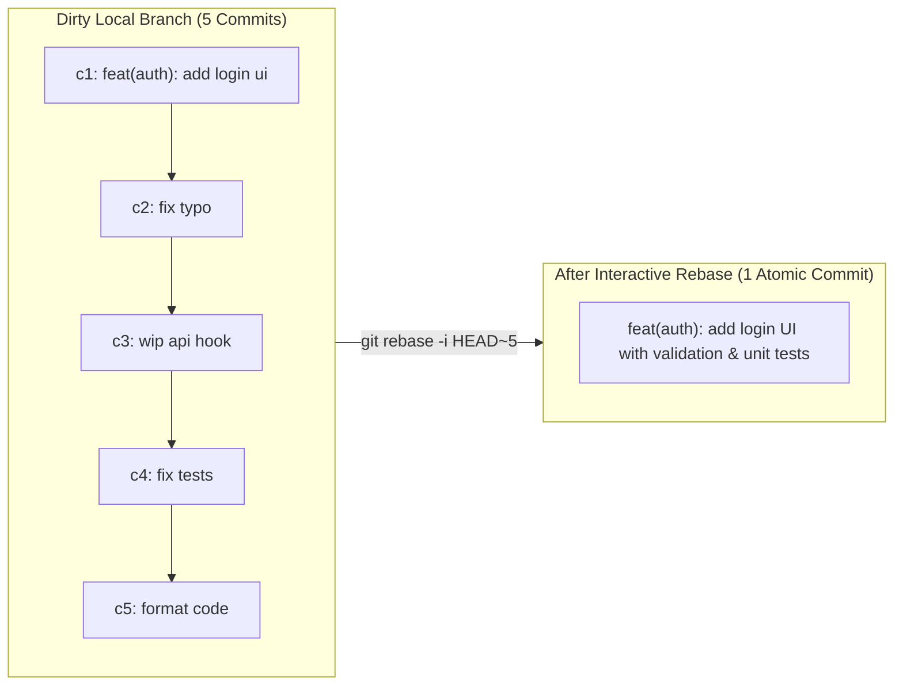
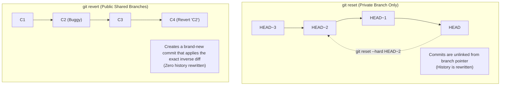
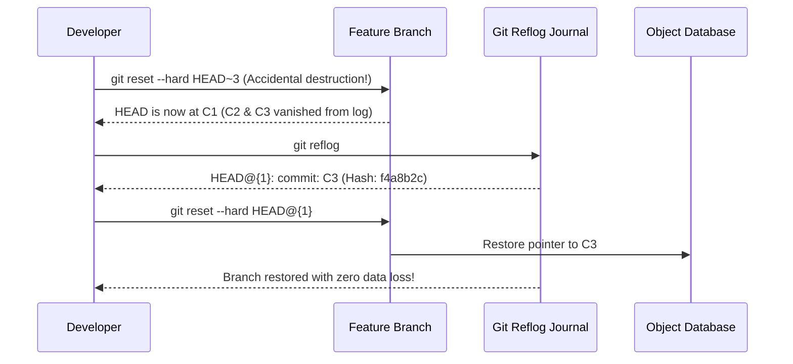
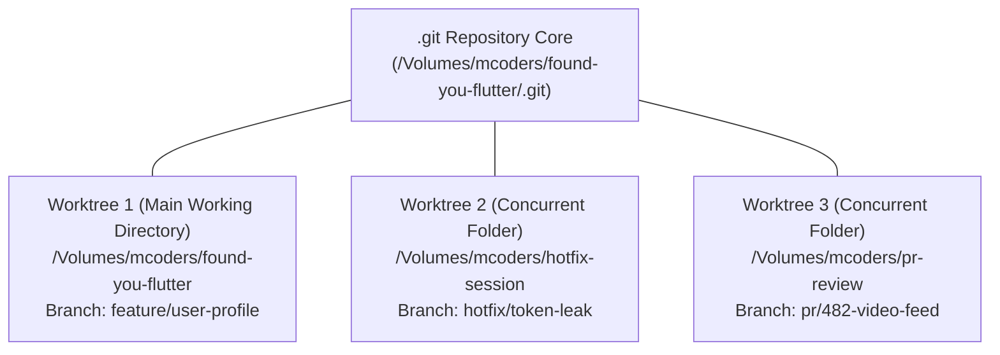
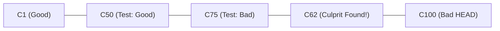

# Advanced Git: Plumbing, Interactive Rebase & Disaster Recovery

A masterclass in advanced Git engineering for senior developers and architects. This guide covers **interactive rebasing**, the exact mental mechanics of `reset` versus `revert`, **disaster recovery via reflog**, multi-directory **worktrees**, automated binary search debugging with **`git bisect`**, and enterprise pre-commit hooks.

> [!TIP]
> **💡 The Film Editor's Cutting Room Analogy:**
> While shooting a movie, the director films 20 messy takes, lighting experiments, and line stumbles. You don't release that raw reel to theaters. Interactive rebase (`git rebase -i`) is the cutting room where the master editor splices, trims, and squashes those 20 chaotic clips into one clean, cinematic cut. And if you accidentally drop a scene down the trash chute (`git reset --hard`), the cutting room's 24/7 security surveillance tape (`git reflog`) lets you rewind time and recover the exact missing film strip.

---

## 1. Interactive Rebase: Rewriting Branch History

Interactive rebase (`git rebase -i`) is the primary tool for cleaning up messy, iterative local commits before opening a Pull Request.



### 1.1 The Rebase Instruction Sheet

```bash
git rebase -i HEAD~5
# Or rebase against the target branch base:
git rebase -i main
```

Your editor opens with an instruction manifest ordered **oldest commit first**:

```text
pick a1b2c3d feat(auth): add login ui
squash d4e5f6a fix typo
pick 7b8c9d0 feat(auth): wire viewmodel to repository
fixup 1a2b3c4 fix unit tests
reword 9f8e7d6 feat(auth): finalize error state banner

# Commands:
# p, pick <commit>   = use commit as-is
# r, reword <commit> = use commit, but edit commit message
# e, edit <commit>   = stop for amending (files or message)
# s, squash <commit> = meld into previous commit and keep commit message
# f, fixup <commit>  = meld into previous commit, discarding this message
# d, drop <commit>   = remove commit entirely
# x, exec <command>  = run shell command (e.g. flutter test) after this step
```

### 1.2 Pro Tip: `--autosquash` Workflow

Instead of manually editing the instruction sheet, use Git's automated fixup flags:

```bash
# 1. Modify the file that needs fixing
# 2. Commit as a targeted fixup referencing the original commit hash
git commit --fixup=a1b2c3d

# 3. Rebase with autosquash enabled (automatically pairs and marks as fixup!)
git rebase -i --autosquash main
```

> [!CAUTION]
> **Golden Rule of Rebasing:** Never rebase commits that have already been pushed to a shared public branch (like `main` or `develop`). Rebase only your private local feature branches before merging.

---

## 2. The Mental Model: `git reset` vs `git revert`

Choosing between `reset` and `revert` depends on whether the commit is **private (local only)** or **public (already pushed and shared)**.



### 2.1 The Three Flavors of `git reset`

All `git reset` variations move the branch `HEAD` pointer backward. The flag dictates what happens to the Staging Area (Index) and Working Directory:

| Command | Moves HEAD? | Modifies Staging Area (Index)? | Modifies Working Directory? | Use Case |
| :--- | :---: | :---: | :---: | :--- |
| **`git reset --soft HEAD~1`** | **Yes** | **No** (Keeps staged) | **No** (Untouched) | Re-bundle last commit into staging to add more files or re-write message. |
| **`git reset --mixed HEAD~1`** *(default)* | **Yes** | **Yes** (Unstages files) | **No** (Files preserved on disk) | Undo commits while keeping all written code intact to re-stage selectively. |
| **`git reset --hard HEAD~1`** | **Yes** | **Yes** (Cleared) | **Yes** (Wiped to match target) | Completely abandon experimental commits and disk modifications. |

### 2.2 Safe Rollback with `git revert`

```bash
# Revert a standard commit (creates new inverse commit)
git revert 7b8c9d0

# Revert without automatically committing (allows grouping multiple reverts)
git revert -n 7b8c9d0
git revert -n 1a2b3c4
git commit -m "revert: rollback auth token refactor due to token expiration bug"

# Reverting a Merge Commit (Must specify parent number with -m)
# -m 1 keeps the changes of the receiving branch (main)
git revert -m 1 <merge-commit-hash>
```

---

## 3. Disaster Recovery with `git reflog`

The **Reference Log (`reflog`)** records every single time `HEAD` moves in your local repository (commits, checkouts, rebases, resets, pulls). Even if you ran `git reset --hard` and deleted your commits from `git log`, the snapshots still exist in Git's object database for at least 30–90 days.



### Scenario 1: Recovering from an Accidental `reset --hard`

```bash
# 1. Inspect recent HEAD movements
git reflog

# Output:
# 3b4c5d6 (HEAD -> main) HEAD@{0}: reset: moving to HEAD~3
# f4a8b2c HEAD@{1}: commit: feat(chat): implement E2EE socket listener
# 9e8d7c6 HEAD@{2}: commit: feat(chat): setup libsodium sealedbox

# 2. Jump back to the exact state before the mistake
git reset --hard HEAD@{1}
# or: git reset --hard f4a8b2c
```

### Scenario 2: Resurrecting a Deleted Branch

```bash
# 1. Find the last commit that was on the deleted branch
git reflog | grep "checkout: moving from feature/feed"

# Output:
# 8c7d6e5 HEAD@{4}: checkout: moving from feature/feed to main

# 2. Re-create the branch pointing directly at that commit
git branch feature/feed 8c7d6e5
```

### Scenario 3: Recovering Dangling / Orphaned Commits

```bash
# Search Git object database for unreferenced commits
git fsck --lost-found

# Inspect recovered dangling commits
git show <dangling-commit-hash>

# Reattach to a branch
git merge <dangling-commit-hash>
```

---

## 4. `git worktree`: Multiple Concurrent Workspaces

Switching branches in a large mobile repository forces package resets (`flutter pub get`, `pod install`, CMake builds). `git worktree` allows you to have **multiple branches checked out simultaneously in separate folders** while sharing the exact same `.git` repository database.



### Production Worktree Commands

```bash
# 1. Add a new worktree in a parallel directory linked to a new branch
git worktree add ../hotfix-session -b hotfix/token-leak main

# 2. Add a worktree checking out an existing remote branch for PR review
git worktree add ../pr-review origin/feature/reels-prefetch

# 3. List all active linked worktrees
git worktree list
# Output:
# /Volumes/mcoders/found-you-flutter  c9e8d7a [feature/user-profile]
# /Volumes/mcoders/hotfix-session      a1b2c3d [hotfix/token-leak]
# /Volumes/mcoders/pr-review          f5e4d3c [feature/reels-prefetch]

# 4. Remove worktree when work is merged or done
rm -rf ../hotfix-session
git worktree prune
```

---

## 5. Automated Debugging with `git bisect`

`git bisect` performs a **binary search ($O(\log N)$)** through your commit history to find the precise commit that introduced a bug or performance regression.



### 5.1 Manual Bisect Workflow

```bash
# 1. Start bisect mode
git bisect start

# 2. Mark current broken commit
git bisect bad

# 3. Mark the last known working commit or tag
git bisect good v1.4.0
# Git checks out midpoint commit (e.g. 50 commits checked out)

# 4. Test app; tell Git if it passes or fails
git bisect good   # or: git bisect bad

# Repeat until Git pinpoints:
# 7c8d9e0f1a2b is the first bad commit
# Commit: fix(cache): alter hive box encryption key format

# 5. Reset back to original branch
git bisect reset
```

### 5.2 Fully Automated Bisect with Test Script

Let Git run tests automatically on every checked-out commit:

```bash
git bisect start HEAD v1.4.0
# Automatically runs flutter test. If exit code is 0 (pass) -> good; non-zero -> bad
git bisect run flutter test test/auth_repository_test.dart
```

---

## 6. Selective Cherry-Picking

`git cherry-pick` applies the changes introduced by one or more existing commits onto your current `HEAD` as new commits.

```bash
# Apply a single commit to current branch
git cherry-pick a1b2c3d

# Apply commit but keep changes staged without committing (-n / --no-commit)
git cherry-pick -n a1b2c3d

# Append "(cherry picked from commit ...)" footnote to commit message (Best Practice)
git cherry-pick -x a1b2c3d

# Cherry-pick a contiguous range of commits (from A to B inclusive)
git cherry-pick A^..B

# Conflict handling during cherry-pick
git status
# Fix files...
git add .
git cherry-pick --continue
# Or abort:
git cherry-pick --abort
```

---

## 7. Git Hooks Automation with Lefthook

Enterprise Flutter repositories enforce code quality (formatting, analysis, conventional commit messages) locally before code ever leaves the developer's laptop.

### Setting Up `lefthook.yml`

Install [Lefthook](https://github.com/evilmartians/lefthook) (ultra-fast, concurrent Go binary):

```yaml
# lefthook.yml in project root
pre-commit:
  parallel: true
  commands:
    format:
      glob: "*.dart"
      run: dart format --set-exit-if-changed {staged_files}
    analyze:
      run: flutter analyze --fatal-infos
    test:
      run: flutter test test/unit/

commit-msg:
  commands:
    lint-commit:
      run: |
        COMMIT_MSG=$(cat {1})
        REGEX="^(feat|fix|refactor|perf|style|test|docs|ci|chore)(\([a-z0-9_-]+\))?: .{1,80}"
        if ! [[ "$COMMIT_MSG" =~ $REGEX ]]; then
          echo "❌ ERROR: Invalid Conventional Commit format!"
          echo "Example: feat(auth): add google sign-in button"
          exit 1
        fi
```

Install the hooks into `.git/hooks/`:
```bash
lefthook install
```
