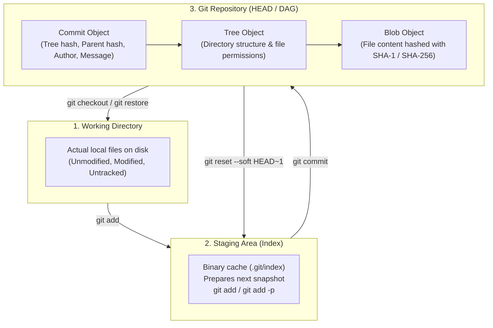
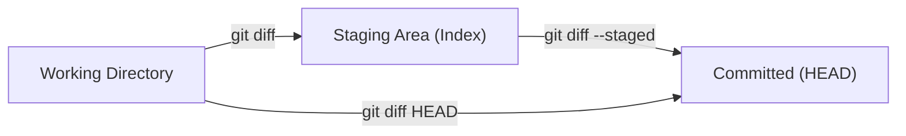
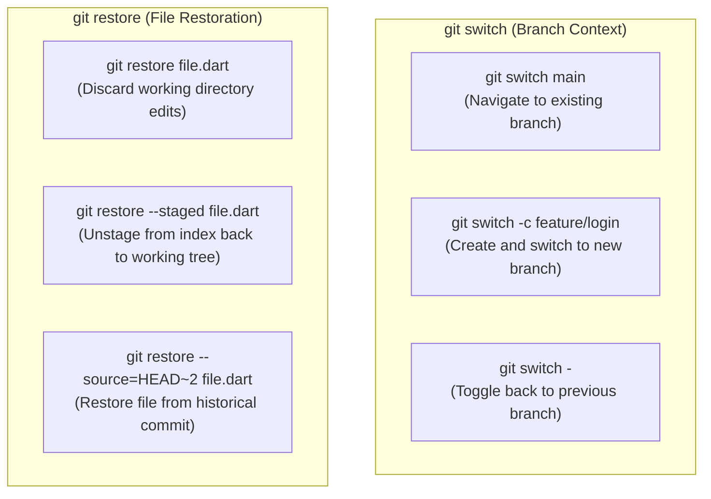
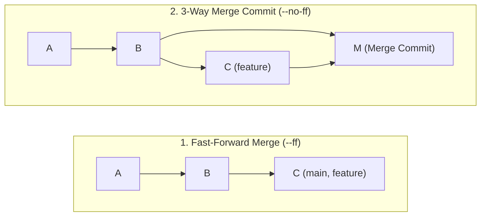

# Git Fundamentals & Core Workflow Architecture

A comprehensive foundation guide to **Git version control**, internal architecture, everyday command mastery, and team hygiene. This guide covers Git's content-addressable object database, the three-tree mental model, atomic commit standards, modern branching, and non-destructive stash operations.

> [!TIP]
> **💡 The Photography Studio Analogy:**
> Think of Git's three trees like a professional photoshoot:
> 1. **Working Directory:** Your live studio floor where actors, lights, and props are freely rearranged (messy, uncommitted changes).
> 2. **Staging Area (`git add`):** The camera viewfinder where you carefully compose and frame *only* what you want in the shot (`git add -p` lets you pick specific props).
> 3. **Commit (`git commit`):** Snapping the shutter. It freezes an unalterable, cryptographically signed 35mm negative into the archive album, linked sequentially to the shot taken before it.

---

## 1. Git Internal Architecture & Mental Model

Git is not a delta-based version control system that records diffs between files. Instead, Git is a **content-addressable directed acyclic graph (DAG)** that stores snapshots of your entire repository over time.



### The 4 Fundamental Git Objects inside `.git/objects/`

Every file, directory, and commit in Git is stored as a compressed object indexed by its 40-character cryptographic hash:

1. **Blob (`type: blob`):** Stores raw file contents only. Filename, folder path, and executable bits are **not** stored in the blob.
2. **Tree (`type: tree`):** Represents a directory snapshot. Maps filenames and permissions (`100644` standard file, `100755` executable script) to blob hashes or child tree hashes.
3. **Commit (`type: commit`):** Contains the top-level root tree hash, parent commit hash(es), author timestamp, committer timestamp, and commit log message.
4. **Annotated Tag (`type: tag`):** An explicit, signed pointer to a commit hash with tagger metadata, GPG signature, and release notes.

---

## 2. Global Setup & Developer Environment

Before committing code, configure your global identity, default branch, line endings, and productivity aliases in `~/.gitconfig`.

### Production `~/.gitconfig` Configuration

```ini
[user]
    name = Your Full Name
    email = your.email@example.com
    signingkey = YOUR_GPG_OR_SSH_KEY_ID

[commit]
    gpgsign = true

[init]
    defaultBranch = main

[core]
    editor = code --wait
    autocrlf = input
    excludesfile = ~/.gitignore_global
    quotepath = false

[pull]
    rebase = true

[fetch]
    prune = true
    prunetags = true

[merge]
    conflictstyle = zdiff3

[diff]
    colorMoved = default

[alias]
    st = status -sb
    co = checkout
    sw = switch
    br = branch -vv
    ci = commit
    cia = commit --amend --no-edit
    lg = log --graph --pretty=format:'%Cred%h%Creset -%C(yellow)%d%Creset %s %Cgreen(%cr) %C(bold blue)<%an>%Creset' --abbrev-commit
    lga = log --graph --all --pretty=format:'%Cred%h%Creset -%C(yellow)%d%Creset %s %Cgreen(%cr) %C(bold blue)<%an>%Creset' --abbrev-commit
    unstage = restore --staged
    discard = restore
    wipe = reset --hard HEAD
```

> [!TIP]
> Setting `pull.rebase = true` prevents messy, auto-generated merge commits ("Merge branch 'main' of github.com...") when synchronizing your local branch with remote changes.

---

## 3. Daily Command Mastery

### 3.1 Status & Granular Staging

```bash
# Compact status view with branch tracking information
git status -sb

# Stage specific changes interactively by hunk (Patch Mode)
git add -p [file]
# Prompts:
# [y] stage hunk, [n] skip hunk, [s] split into smaller hunks, [e] edit hunk manually, [q] quit

# Stage all tracked modifications (ignoring untracked files)
git add -u

# Stage entire directory
git add .
```

### 3.2 Inspecting Differences



```bash
# Compare unstaged changes in working tree against index
git diff

# Compare staged changes against the last commit (HEAD)
git diff --staged
# or: git diff --cached

# Compare working tree and index against a target branch
git diff main...feature/user-auth

# Show only changed filenames and status
git diff --name-status main HEAD

# Show visual word-by-word diff rather than line-by-line
git diff --word-diff
```

---

## 4. Modern Branching: `git switch` & `git restore`

In Git 2.23+, `git checkout` was split into two dedicated, unambiguous commands: `git switch` (for branch navigation) and `git restore` (for undoing file changes).



| Legacy Command | Modern Recommended Equivalent | Purpose |
| :--- | :--- | :--- |
| `git checkout main` | `git switch main` | Switch active branch. |
| `git checkout -b feature/auth` | `git switch -c feature/auth` | Create and check out new branch. |
| `git checkout -` | `git switch -` | Switch back to previous branch. |
| `git checkout -- file.dart` | `git restore file.dart` | Discard local unstaged modifications. |
| `git reset HEAD file.dart` | `git restore --staged file.dart` | Remove file from staging area. |

---

## 5. Merging Strategies & Conflict Resolution



### 5.1 Merge Types

```bash
# 1. Fast-Forward Only (Fails if main has diverged; ensures clean linear history)
git merge --ff-only feature/feed

# 2. Force Explicit Merge Commit (Preserves branch grouping in git graph)
git merge --no-ff feature/feed -m "merge: incorporate feature/feed into main"

# 3. Squash Merge (Condenses all branch commits into a single staged commit)
git merge --squash feature/feed
git commit -m "feat(feed): implement reels prefetch and player pool"
```

### 5.2 Resolving Conflicts with `zdiff3`

When conflicts arise, standard Git displays only two sides (`<<<<<<<` vs `>>>>>>>`). Setting `conflictstyle = zdiff3` renders the **common ancestor**, making resolution trivial:

```text
<<<<<<< HEAD:lib/config.dart
final String apiHost = 'https://api.production.com';
||||||| base:lib/config.dart
final String apiHost = 'https://api.staging.com';
=======
final String apiHost = 'https://api.v2.production.com';
>>>>>>> feature/api-upgrade:lib/config.dart
```

1. Review what the code was originally (`base`).
2. Compare what HEAD changed vs what the incoming branch changed.
3. Edit the file, remove conflict markers, and finalize:
   ```bash
   git add lib/config.dart
   git merge --continue
   ```

---

## 6. Stashing Operations: Safe Temporary Storage

`git stash` stores dirty working directory modifications onto a stack of incomplete changes without creating formal commits.

```bash
# Push working directory modifications to stash with a descriptive label
git stash push -m "WIP: audio equalizer slider animation"

# Include untracked files (newly created files not yet tracked)
git stash push -u -m "WIP: initial cubit and untracked models"

# Stash only unstaged changes (leave staged index intact)
git stash push --keep-index -m "WIP: unstaged scratch experimentation"

# List all stashed entries
git stash list
# Output:
# stash@{0}: On feature/audio: WIP: audio equalizer slider animation
# stash@{1}: On main: WIP: emergency hotfix scratchpad

# Inspect the diff of a specific stash
git stash show -p stash@{0}

# Apply most recent stash and remove it from stash stack
git stash pop

# Apply stash without removing from stack (safer for testing)
git stash apply stash@{0}

# Create a new branch directly from a stash entry
git stash branch feature/audio-resumed stash@{0}

# Clear all stashed items permanently
git stash clear
```

---

## 7. Atomic Commits & The Conventional Commits Standard

Every commit should represent **one logical, atomic change** that can compile and pass tests independently. Avoid bundling formatting, feature logic, and dependency updates into a single mega-commit.

### Format Specification

```text
<type>(<optional scope>): <description>

[optional body explaining WHY, not WHAT]

[optional footer(s): BREAKING CHANGE, Closes #123]
```

### Recognized Types

* **`feat`**: A new user-facing feature.
* **`fix`**: A bug fix.
* **`refactor`**: Code changes that neither fix a bug nor add a feature (e.g. renaming, modularizing).
* **`perf`**: Performance improvement (e.g. caching, memory pool).
* **`style`**: Formatting, white-space, semicolon fixes (no functional logic changed).
* **`test`**: Adding or correcting unit, widget, or integration tests.
* **`docs`**: Documentation updates only.
* **`ci`**: CI/CD pipeline changes (Codemagic, Fastlane, GitHub Actions).
* **`chore`**: Maintenance, dependency bumps, `.gitignore` updates.

### Production Example

```text
feat(feed): implement 2-controller video prefetch pool

Pre-warms the next reel in the feed queue to achieve zero-latency
transitions when the user flings vertically. Uses generation tokens
to cancel stale download streams during rapid scrolls.

Closes #142
```

---

## 8. Mobile & Flutter `.gitignore` Standards

Place this comprehensive, production `.gitignore` in your repository root to prevent building artifacts, credentials, or IDE state from polluting Git:

```gitignore
# Miscellaneous
*.class
*.log
*.pyc
*.swp
.DS_Store
.atom/
.buildlog/
.history
.svn/
migrate_working_dir/

# IntelliJ / Android Studio
*.iml
*.ipr
*.iws
.idea/

# Visual Studio Code
.vscode/
!.vscode/settings.json
!.vscode/tasks.json
!.vscode/launch.json
!.vscode/extensions.json
*.code-workspace

# Flutter / Dart
.dart_tool/
.flutter-plugins
.flutter-plugins-dependencies
.packages
.pub-cache/
.pub/
/build/
ephemeral/

# Android Specific
android/**/gradle-wrapper.jar
android/.gradle
android/captures/
android/gradlew
android/gradlew.bat
android/local.properties
android/**/GeneratedPluginRegistrant.java
android/app/build/
android/app/release/*.aab
android/app/release/*.apk

# iOS / macOS Specific
ios/**/Pods/
ios/.symlinks/
ios/Flutter/Flutter.framework
ios/Flutter/Flutter.podspec
ios/Flutter/Generated.xcconfig
ios/Flutter/app.flx
ios/DerivedData/
*.pbxuser
*.mode1v3
*.mode2v3
*.perspectivev3
*.xcuserstate
project.xcworkspace/
xcuserdata/

# Sensitive Secrets & Keystores (NEVER COMMIT)
*.keystore
*.jks
key.properties
*.p8
*.p12
*.mobileprovision
GoogleService-Info.plist
google-services.json
.env*
!.env.example
```
