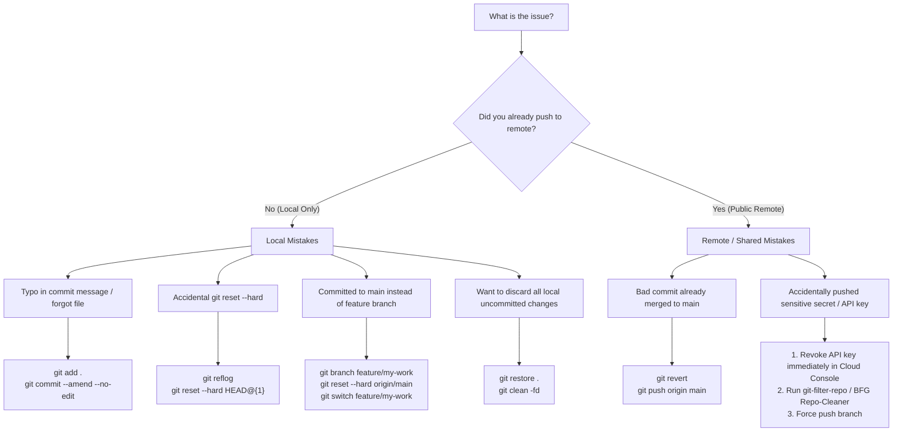

# Git & GitHub Emergency Cheatsheet & Incident Playbook

A rapid diagnostic reference for developers in high-pressure scenarios. Features an interactive emergency decision tree, copy-paste one-liners, and solutions to the 30 most frequent Git blunders.

> [!TIP]
> **💡 The ER Crash-Cart Analogy:**
> In a medical trauma bay, doctors don't read pharmacology textbooks from scratch during cardiac arrest—they grab the laminated crash-cart checklist. When an accidental `reset --hard` wipes your work or a bad commit lands on `main` minutes before a launch, this cheatsheet is your emergency defibrillator: check the decision matrix, run the exact one-liner antidote, and restore your repository without panic.

---

## 1. "How Do I Fix This?" Emergency Decision Matrix



---

## 2. The 30 Most Essential Git One-Liners

### Fixing the Last Commit

```bash
# 1. Modify the message of the most recent commit
git commit --amend -m "feat(auth): correct spelling in auth banner"

# 2. Add forgotten files to the last commit without modifying message
git add forgotten_file.dart
git commit --amend --no-edit

# 3. Change author of the last commit
git commit --amend --author="Jane Doe <jane@example.com>" --no-edit
```

### Undoing & Restoring Files

```bash
# 4. Discard all modifications in a specific file
git restore lib/main.dart

# 5. Discard all unstaged modifications in entire project
git restore .

# 6. Unstage a file from the index back to working directory
git restore --staged lib/config.dart

# 7. Unstage everything currently staged
git restore --staged .

# 8. Delete all untracked files and directories (Dry-run first!)
git clean -nd   # Preview what will be removed
git clean -fd   # Force remove untracked files & directories

# 9. Stop tracking a file without deleting it from disk (e.g. .env)
git rm --cached .env
echo ".env" >> .gitignore
git commit -m "chore: stop tracking .env file"
```

### Branch Management

```bash
# 10. Rename active local branch
git branch -m feature/new-name

# 11. Rename active branch on remote
git branch -m feature/new-name
git push origin -u feature/new-name
git push origin --delete feature/old-name

# 12. Delete a local branch (Safe delete: checks if merged)
git branch -d feature/old-feature

# 13. Force delete local branch (Ignores merge status)
git branch -D feature/abandoned-experiment

# 14. Delete a remote branch
git push origin --delete feature/old-feature

# 15. Prune local references to deleted remote branches
git fetch --prune
```

### Stash Mastery

```bash
# 16. Stash everything including untracked files with a message
git stash push -u -m "WIP: payment sheet flutter"

# 17. View full diff of the most recent stash
git stash show -p stash@{0}

# 18. Apply stash and delete from stash stack
git stash pop

# 19. Apply stash but KEEP it on stash stack (safest)
git stash apply stash@{0}
```

### Search & Historical Forensics

```bash
# 20. Find which commit introduced or removed a specific text string (Pickaxe)
git log -S "API_SECRET_KEY" --source --all -p

# 21. See line-by-line blame ignoring whitespace changes
git blame -w -L 40,65 lib/helpers/location_helper.dart

# 22. Compact graph log with timestamps and author names
git log --graph --oneline --decorate --all

# 23. Show commits from the last 7 days by a specific author
git log --author="Rahul" --since="7 days ago" --oneline
```

### Disaster Recovery

```bash
# 24. View the complete action journal of HEAD movements
git reflog

# 25. Recover accidentally deleted branch from reflog hash
git branch feature/recovered-work a1b2c3d

# 26. Undo a botched rebase
git rebase --abort

# 27. Undo a botched merge
git merge --abort

# 28. Undo a botched cherry-pick
git cherry-pick --abort
```

### Speed & Bandwidth Optimization

```bash
# 29. Blobless clone (Downloads file history only on demand; 10x faster)
git clone --filter=blob:none https://github.com/org/huge-repo.git

# 30. Shallow clone (Single latest commit snapshot for fast CI)
git clone --depth=1 --single-branch -b main https://github.com/org/huge-repo.git
```

---

## 3. Conventional Commit Prefix Reference

| Prefix | Usage | Triggers SemVer Bump |
| :--- | :--- | :---: |
| **`feat`** | Introduces a new feature to the codebase. | **Minor** (`0.x.0`) |
| **`fix`** | Patches a bug or defect in production or staging. | **Patch** (`0.0.x`) |
| **`perf`** | Performance enhancement (e.g. video prefetch, cache). | **Patch** (`0.0.x`) |
| **`refactor`** | Code refactoring without bug fixes or new features. | None |
| **`style`** | Code formatting, semicolon, or whitespace adjustments. | None |
| **`test`** | Adds missing tests or corrects existing test suites. | None |
| **`docs`** | Documentation updates only. | None |
| **`ci`** | GitHub Actions, Codemagic, Fastlane workflow edits. | None |
| **`chore`** | Maintenance, package upgrades, `.gitignore` edits. | None |
| **`BREAKING CHANGE`** | In footer or header (`feat!:`): introduces API break. | **Major** (`x.0.0`) |
