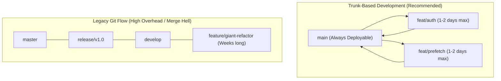
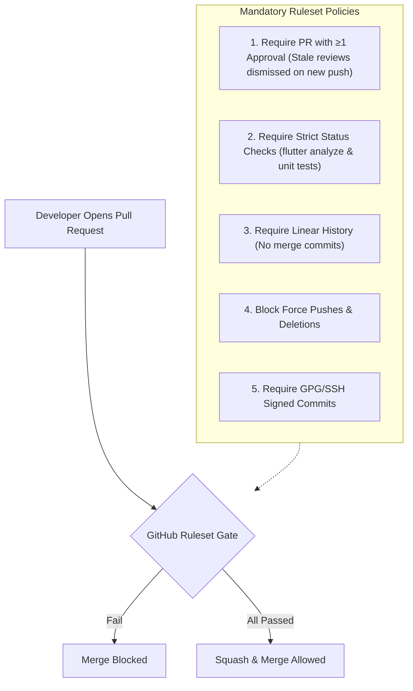

# The GitHub Stack: Enterprise Workflows, Rulesets & CI Automation

A production manual for structuring high-velocity engineering teams on **GitHub**. This guide covers modern **Trunk-Based Development**, enterprise **Branch Rulesets**, Pull Request craftsmanship (`CODEOWNERS`, templates, stacked PRs), **GitHub CLI (`gh`)** command mastery, and cost-efficient **GitHub Actions CI/CD patterns**.

> [!TIP]
> **💡 The High-Speed Railway & Air Traffic Control Analogy:**
> The `main` branch is a busy high-speed bullet train track that must never derail or halt. Feature branches are side maintenance spurs. Pull Requests, branch rulesets, and automated CI checks serve as the air traffic control radar and automated track switches: no railcar is permitted onto the high-speed main line until certified inspectors (`CODEOWNERS`) sign off and automated ultrasonic scans (`flutter analyze & tests`) confirm zero defects.

---

## 1. Branching Strategy: Trunk-Based Development vs Git Flow

Modern mobile teams deploying over-the-air patches (Shorebird) and automated store tracks (Fastlane/Codemagic) favor **Trunk-Based Development** over legacy Git Flow.



### Why Trunk-Based Development Wins

1. **Eliminates Merge Debt:** Short-lived feature branches (< 48 hours) minimize divergence from `main`.
2. **Pairs with Feature Flags:** Incomplete features are merged behind runtime flags rather than living in isolated branches for weeks.
3. **Continuous Verification:** Every commit to `main` triggers automated CI builds, unit tests, and internal distribution tracks.

---

## 2. GitHub Branch Protection & Modern Rulesets

GitHub Rulesets provide granular, enforceable policies across repositories without complex branch regexes.



### Recommended Ruleset Configuration for `main`

1. **Target Branches:** Include default branch (`main`).
2. **Restrict Deletions & Force Pushes:** Enabled (Enforce for all, including administrators).
3. **Require Linear History:** Enabled (Prevents visual "train tracks" in Git graph).
4. **Require Pull Request Before Merging:**
   * Required approvals: `1`
   * Dismiss stale pull request approvals when new commits are pushed: `true`
   * Require review from Code Owners: `true`
5. **Require Status Checks to Pass:**
   * Require branches to be up to date before merging: `true` (Prevents semantic merge conflicts).
   * Required checks: `Analyze & Lint (Flutter)`, `Unit & Widget Tests`, `Build Dev APK`.

---

## 3. Pull Request (PR) Craftsmanship

### 3.1 Pull Request Template: `.github/pull_request_template.md`

Add this standardized template to enforce architectural hygiene across team members:

```markdown
## 📝 Summary
Brief 1-2 sentence description of what this PR achieves.

## 🎯 Issue Reference
Closes #(issue)

## 🛠️ Changes Implemented
- [ ] Feature / Fix 1
- [ ] Feature / Fix 2

## 🧪 Verification & Evidence Gate
- [ ] `flutter analyze --fatal-infos` passed with 0 issues
- [ ] `flutter test` passed (Unit / Widget tests)
- [ ] Tested on Android physical device / emulator
- [ ] Tested on iOS physical device / simulator

## 📸 Screenshots / Video Proof
| Before | After |
| :---: | :---: |
| (Image or N/A) | (Image or Video) |

## 🔒 Security & Privacy Checklist
- [ ] No API keys, credentials, or `.env` files committed
- [ ] Sensitive data (tokens/PII) excluded from device logs
```

### 3.2 Automated Code Ownership: `.github/CODEOWNERS`

GitHub automatically requests reviews from specific developers or teams based on file paths modified:

```text
# Global fallback reviewers
* @mobile-leads

# Flutter Core Architecture & Dependency Management
pubspec.yaml @architecture-team
pubspec.lock @architecture-team
lib/core/ @architecture-team
lib/injection/ @architecture-team

# Native Platform Directories
android/ @android-leads
ios/ @ios-leads

# CI/CD Automation & GitHub Workflows
.github/workflows/ @devops-team
android/fastlane/ @devops-team
ios/fastlane/ @devops-team
codemagic.yaml @devops-team

# E2EE & Security Modules
lib/core/crypto/ @security-champions
```

---

## 4. GitHub CLI (`gh`) Productivity Engine

The official GitHub CLI brings issues, pull requests, and releases directly into your terminal.

```bash
# 1. Authenticate with GitHub
gh auth login

# 2. Clone repository with SSH
gh repo clone your-org/flutter-app

# 3. Create a Pull Request interactively
gh pr create --title "feat(chat): implement socket connection retain counting" --body "Closes #18"

# 4. Create a Draft PR for early architectural feedback
gh pr create --draft --title "feat(feed): initial 2-controller video pool" --body "WIP"

# 5. Check out a team member's PR locally for testing
gh pr checkout 482

# 6. Review and approve a PR from CLI
gh pr review 482 --approve -b "Architecture matches Law #4. Verified on Android."

# 7. Merge PR using squash & delete remote branch automatically
gh pr merge 482 --squash --delete-branch

# 8. View CI status checks for current branch
gh pr checks
```

---

## 5. GitHub Actions: Enterprise CI/CD Patterns

### 5.1 Concurrency Groups (Stop Burning CI Minutes!)

When a developer pushes 3 commits in rapid succession, running full CI on all 3 wastes runner minutes. Concurrency groups automatically cancel redundant older runs:

```yaml
name: Flutter CI Pipeline

on:
  push:
    branches: [main]
  pull_request:
    branches: [main]

# Cancel in-progress runs for the same branch/PR when a new commit is pushed
concurrency:
  group: ${{ github.workflow }}-${{ github.ref }}
  cancel-in-progress: true
```

### 5.2 Complete Fast, Cached Flutter CI Workflow

Create `.github/workflows/flutter_ci.yml`:

```yaml
name: Quality Gate & Tests

on:
  pull_request:
    branches: [main]

concurrency:
  group: ${{ github.workflow }}-${{ github.head_ref || github.run_id }}
  cancel-in-progress: true

jobs:
  validate:
    name: Flutter Lint & Unit Tests
    runs-on: ubuntu-latest
    timeout-minutes: 15

    steps:
      - name: Checkout Repository
        uses: actions/checkout@v4
        with:
          fetch-depth: 1

      - name: Setup Java 17
        uses: actions/setup-java@v4
        with:
          distribution: 'temurin'
          java-version: '17'

      - name: Setup Flutter SDK
        uses: subosito/flutter-action@v2
        with:
          flutter-version: '3.29.x'
          channel: 'stable'
          cache: true
          cache-key: 'flutter-:os:-:channel:-:version:-:arch:-:hash:'

      - name: Cache Pub Dependencies
        uses: actions/cache@v4
        with:
          path: |
            ~/.pub-cache
            .dart_tool/
          key: ${{ runner.os }}-pub-${{ hashFiles('**/pubspec.lock') }}
          restore-keys: |
            ${{ runner.os }}-pub-

      - name: Install Dependencies
        run: flutter pub get

      - name: Verify Formatting
        run: dart format --output=none --set-exit-if-changed .

      - name: Run Static Analyzer (Evidence Gate)
        run: flutter analyze --fatal-infos

      - name: Run Unit & Widget Tests
        run: flutter test --coverage --test-randomize-ordering-seed=random
```

---

## 6. GitHub Releases & Automated Semantic Versioning

Automate App Store & Play Store changelog generation using GitHub Releases:

```bash
# Generate release notes automatically based on merged PR labels and commit titles
gh release create v2.4.0 \
  --title "Release v2.4.0: High-Performance Social Feed & GPS Fallback" \
  --generate-notes \
  --target main \
  ./build/app/outputs/bundle/release/app-release.aab
```

### Automated Dependabot Configuration: `.github/dependabot.yml`

Keep dependencies and GitHub Actions securely updated automatically:

```yaml
version: 2
updates:
  # Maintain GitHub Actions dependencies
  - package-ecosystem: "github-actions"
    directory: "/"
    schedule:
      interval: "weekly"

  # Maintain Pub packages
  - package-ecosystem: "pub"
    directory: "/"
    schedule:
      interval: "weekly"
    groups:
      flutter-dependencies:
        patterns:
          - "*"
```
