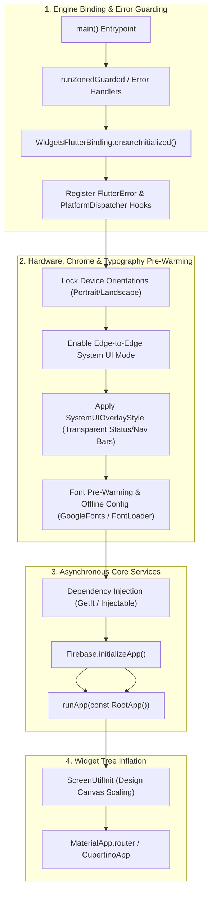

# Flutter Application Bootstrap: Production Initialization Guide

A comprehensive, production-grade guide to configuring `main.dart`, `bootstrap.dart`, and `app.dart`. This guide documents the definitive patterns for Flutter initialization: **engine bindings**, **global error zones**, **system UI overlay styling**, **orientation locking**, **responsive layout scaling (ScreenUtil)**, **Firebase & dependency injection**, and **app lifecycle management**.

> [!TIP]
> **💡 The Cockpit Pre-Flight Checklist Analogy:**
> You never turn on passenger cabin entertainment (the widget tree) while the jet is still dark on the tarmac. First, you power the auxiliary generators (`WidgetsFlutterBinding`), arm the cockpit flight recorder (`runZonedGuarded` & Crashlytics), pressurize the hydraulics (Dependency Injection), and calibrate the cabin altimeters (ScreenUtil). Executing in strict sequence prevents the app from stalling or blacking out on the startup runway.

---

## 1. Architecture & Bootstrap Pipeline

Initializing a Flutter app involves orchestrating asynchronous platform channels before inflating the widget hierarchy. Executing initialization in the wrong sequence can lead to dropped errors, ANR freezes, white flash flashes on startup, or unstyled system chrome.



---

## 2. Directory Structure

Adopt a clean separation between flavor entrypoints, the async bootstrap routine, and the root widget tree:

```text
lib/
├── bootstrap.dart             # Universal initialization orchestration & error zones
├── main_dev.dart              # Dev flavor entrypoint
├── main_prod.dart             # Prod flavor entrypoint
├── app.dart                   # Root MaterialApp with ScreenUtil & Router
└── core/
    ├── di/injection.dart      # GetIt / Injectable setup
    ├── theme/app_theme.dart   # System overlay & theme definitions
    └── error/app_logger.dart  # Production logging
```

---

## 3. Core Initialization Steps Explained

### Step 3.1: `WidgetsFlutterBinding.ensureInitialized()`
This must be the very first statement in your initialization. It establishes the platform channels between the Flutter engine (C++) and the Dart framework. Without it, calling any native plugin (`Firebase`, `SharedPreferences`, `SystemChrome`, `PathProvider`) before `runApp()` will throw an assertion error.

### Step 3.2: Universal Error Boundaries
Catch both framework render errors and asynchronous platform crashes:
1. **`FlutterError.onError`**: Catches errors during widget build, layout, and rendering phases.
2. **`PlatformDispatcher.instance.onError`**: Catches unhandled asynchronous Dart runtime errors across microtasks and event queues.

### Step 3.3: Device Orientation Locking
Locking the app to portrait mode avoids layout jank on devices where rotation is unsupported:

```dart
await SystemChrome.setPreferredOrientations([
  DeviceOrientation.portraitUp,
  DeviceOrientation.portraitDown,
]);
```

### Step 3.4: Edge-to-Edge & System UI Overlays
Modern mobile guidelines (Android 15+ edge-to-edge enforcement and iOS Dynamic Island) require transparent status and navigation bars:

```dart
// Enable true edge-to-edge rendering beneath the status and nav bars
await SystemChrome.setEnabledSystemUIMode(
  SystemUiMode.edgeToEdge,
);

// Style status bar and system navigation bar with transparent backgrounds
SystemChrome.setSystemUIOverlayStyle(
  const SystemUiOverlayStyle(
    statusBarColor: Colors.transparent,
    statusBarIconBrightness: Brightness.dark,       // Android
    statusBarBrightness: Brightness.light,          // iOS
    systemNavigationBarColor: Colors.transparent,
    systemNavigationBarDividerColor: Colors.transparent,
    systemNavigationBarIconBrightness: Brightness.dark,
  ),
);
```

### Step 3.5: Responsive Scaling with `ScreenUtil`
Wrap the root widget in `ScreenUtilInit` using your standard Figma artboard dimensions (typically `393 × 852` for modern iPhones):

```dart
ScreenUtilInit(
  designSize: const Size(393, 852),
  minTextAdapt: true,
  splitScreenMode: true,
  builder: (context, child) => child!,
  child: const AppView(),
);
```

### Step 3.6: Typography Pre-Warming & FOUT Prevention
When apps load custom typography or Google Fonts dynamically over HTTP at runtime:
1. **Flash of Unstyled Text (FOUT):** The app initially renders text in system fallback fonts (Roboto / San Francisco), then abruptly reflows and jumps when the font downloads 200–500ms later.
2. **Offline Vulnerability:** If the user launches the app in airplane mode or poor signal, runtime font fetches fail, resulting in missing or misaligned glyphs.

#### The Production Solutions:
* **Air-Gapped / Offline Compliance (`GoogleFonts`):**
  Bundle the `.ttf` files directly inside `assets/fonts/` and configure:
  ```dart
  // Disables runtime HTTP calls completely
  GoogleFonts.config.allowRuntimeFetching = false;
  ```
* **Font Asset Pre-Loading with `FontLoader`:**
  To pre-load custom proprietary font files into Flutter's native text engine before the first paint:
  ```dart
  final fontLoader = FontLoader('CustomBrandFont');
  fontLoader.addFont(rootBundle.load('assets/fonts/BrandFont-Regular.ttf'));
  fontLoader.addFont(rootBundle.load('assets/fonts/BrandFont-Bold.ttf'));
  await fontLoader.load();
  ```
* **License Registry Registration:**
  Register font licenses with Flutter's `LicenseRegistry` for compliance with the Open Font License (OFL):
  ```dart
  LicenseRegistry.addLicense(() async* {
    final license = await rootBundle.loadString('assets/fonts/OFL.txt');
    yield LicenseEntryWithLineBreaks(['google_fonts'], license);
  });
  ```

---

## 4. Complete Implementation

### `lib/bootstrap.dart`
The centralized bootstrap function that handles all pre-run logic:

```dart
import 'dart:async';
import 'package:flutter/foundation.dart';
import 'package:flutter/material.dart';
import 'package:flutter/services.dart';
import 'package:firebase_core/firebase_core.dart';
import 'package:flutter_screenutil/flutter_screenutil.dart';
import 'package:google_fonts/google_fonts.dart';

typedef AppBuilder = FutureOr<Widget> Function();

Future<void> bootstrap({
  required AppBuilder builder,
  FirebaseOptions? firebaseOptions,
}) async {
  // 1. Ensure Flutter engine bindings are initialized
  WidgetsFlutterBinding.ensureInitialized();

  // 2. Setup Global Error Handlers
  FlutterError.onError = (details) {
    FlutterError.presentError(details);
    if (kReleaseMode) {
      // Send to Crashlytics / Sentry in production
    } else {
      debugPrint('[FlutterError] ${details.exceptionAsString()}');
    }
  };

  PlatformDispatcher.instance.onError = (error, stack) {
    if (kReleaseMode) {
      // Send unhandled async error to monitoring
    } else {
      debugPrint('[PlatformDispatcher Error] $error\n$stack');
    }
    return true;
  };

  // 3. Lock device orientation
  await SystemChrome.setPreferredOrientations([
    DeviceOrientation.portraitUp,
  ]);

  // 4. Configure Edge-to-Edge System Chrome Overlays
  await SystemChrome.setEnabledSystemUIMode(SystemUiMode.edgeToEdge);
  SystemChrome.setSystemUIOverlayStyle(
    const SystemUiOverlayStyle(
      statusBarColor: Colors.transparent,
      statusBarIconBrightness: Brightness.dark,
      statusBarBrightness: Brightness.light,
      systemNavigationBarColor: Colors.transparent,
      systemNavigationBarDividerColor: Colors.transparent,
      systemNavigationBarIconBrightness: Brightness.dark,
    ),
  );

  // 5. Typography Pre-Warming & Strict Offline Configuration
  // Disables dynamic HTTP font downloads to prevent FOUT (Flash of Unstyled Text)
  GoogleFonts.config.allowRuntimeFetching = false;

  // Optional: Pre-load custom native font family before first paint
  // final fontLoader = FontLoader('BrandFont');
  // fontLoader.addFont(rootBundle.load('assets/fonts/BrandFont-Regular.ttf'));
  // await fontLoader.load();

  // 6. Initialize Firebase (if configured)
  if (firebaseOptions != null) {
    try {
      await Firebase.initializeApp(options: firebaseOptions);
    } catch (e) {
      debugPrint('[Firebase] Initialization skipped or already initialized: $e');
    }
  }

  // 7. Ensure ScreenUtil has device pixel data before first frame
  await ScreenUtil.ensureScreenSize();

  // 8. Inflate Widget Tree inside RunZonedGuarded
  runZonedGuarded(
    () async {
      final appWidget = await builder();
      runApp(appWidget);
    },
    (error, stackTrace) {
      debugPrint('[ZonedGuarded Error] $error\n$stackTrace');
    },
  );
}
```

---

### `lib/app.dart`
The root application widget configuring `ScreenUtilInit`, routing, and theming:

```dart
import 'package:flutter/material.dart';
import 'package:flutter_screenutil/flutter_screenutil.dart';

class MyApp extends StatelessWidget {
  const MyApp({super.key});

  @override
  Widget build(BuildContext context) {
    return ScreenUtilInit(
      // Match Figma artboard size
      designSize: const Size(393, 852),
      minTextAdapt: true,
      splitScreenMode: true,
      builder: (context, child) {
        return MaterialApp(
          title: 'Production App',
          debugShowCheckedModeBanner: false,
          theme: ThemeData(
            useMaterial3: true,
            colorSchemeSeed: const Color(0xFF0D6EFD),
            scaffoldBackgroundColor: const Color(0xFFF8F9FA),
            appBarTheme: const AppBarTheme(
              backgroundColor: Colors.transparent,
              elevation: 0,
              centerTitle: true,
            ),
          ),
          home: child,
        );
      },
      child: const HomePage(),
    );
  }
}

class HomePage extends StatelessWidget {
  const HomePage({super.key});

  @override
  Widget build(BuildContext context) {
    return Scaffold(
      appBar: AppBar(
        title: Text(
          'App Bootstrap Ready',
          style: TextStyle(fontSize: 18.sp, fontWeight: FontWeight.bold),
        ),
      ),
      body: Center(
        child: Container(
          width: 320.w,
          padding: EdgeInsets.all(20.r),
          decoration: BoxDecoration(
            color: Colors.white,
            borderRadius: BorderRadius.circular(16.r),
            boxShadow: [
              BoxShadow(
                color: Colors.black.withOpacity(0.05),
                blurRadius: 10.r,
                offset: const Offset(0, 4),
              ),
            ],
          ),
          child: Column(
            mainAxisSize: MainAxisSize.min,
            children: [
              Icon(Icons.check_circle_outline, color: Colors.green, size: 48.r),
              SizedBox(height: 12.h),
              Text(
                'Engine, UI & Storage Initialized',
                style: TextStyle(fontSize: 16.sp, fontWeight: FontWeight.w600),
                textAlign: TextAlign.center,
              ),
              SizedBox(height: 8.h),
              Text(
                'Orientation locked, edge-to-edge system bars applied, and responsive ScreenUtil active.',
                style: TextStyle(fontSize: 13.sp, color: Colors.grey[600]),
                textAlign: TextAlign.center,
              ),
            ],
          ),
        ),
      ),
    );
  }
}
```

---

### `lib/main_prod.dart`
The production flavor entrypoint invoking `bootstrap`:

```dart
import 'package:flutter/material.dart';
import 'package:my_app/app.dart';
import 'package:my_app/bootstrap.dart';

void main() async {
  await bootstrap(
    builder: () => const MyApp(),
    // firebaseOptions: DefaultFirebaseOptions.currentPlatform,
  );
}
```

---

## 5. Best Practices & Anti-Patterns Checklist

| Topic | Best Practice | Anti-Pattern |
| :--- | :--- | :--- |
| **`WidgetsFlutterBinding`** | Invoke first in `bootstrap()` before any plugin call. | Calling async native plugins before `ensureInitialized()`. |
| **`ScreenUtil`** | Use `ScreenUtil.ensureScreenSize()` before `runApp()`. | Accessing `.w` or `.h` extensions inside `main()` before context exists. |
| **Edge-to-Edge** | Set `SystemUiMode.edgeToEdge` with transparent system bars. | Leaving black status bars or hardcoded top status padding. |
| **Orientation** | Await `SystemChrome.setPreferredOrientations()`. | Forgetting to `await`, resulting in initial frame rendering in rotated orientation. |
| **Typography & Fonts** | Pre-warm fonts in `bootstrap()`; set `allowRuntimeFetching = false` for offline resilience. | Dynamic runtime HTTP font downloads causing FOUT (Flash of Unstyled Text) and offline blanks. |
| **Crash Safety** | Encase `runApp` in `runZonedGuarded` with `PlatformDispatcher.onError`. | Unhandled async exceptions causing silent failures without reporting. |
| **Startup ANR** | Initialize heavy background analytics asynchronously with `@lazySingleton`. | Blocking main thread for 3+ seconds in `main()` with synchronous `@preResolve`. |

