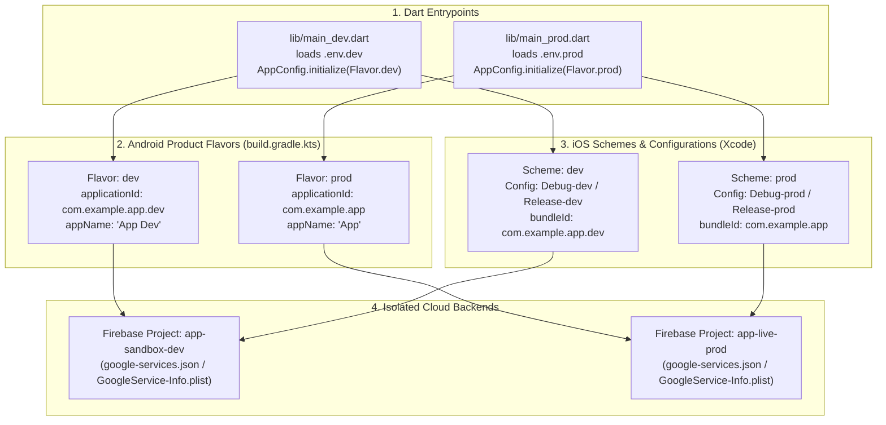

# Complete Flutter Flavors & Environment Setup Guide (Android & iOS)

A definitive, production-grade guide for configuring **Flutter Flavors** (`dev`, `staging`, `prod`) across Dart runtime environments, Android Gradle (Kotlin DSL & Groovy), and iOS Xcode Build Configurations and Schemes. This architecture ensures separate bundle IDs, independent app icons, isolated Firebase projects, and zero risk of staging data contaminating production databases.

> [!TIP]
> **💡 The NASA Training Simulator vs Orbital Spacecraft Analogy:**
> Astronauts never practice tricky docking maneuvers on a real orbital rocket attached to active liquid fuel tanks—they step into a flight simulator with mock alarms, simulated thrusters, and sandbox telemetry (`dev` flavor). When launch day arrives, they board the real sealed spacecraft pointing to live orbital engines (`prod` flavor). Both cockpits share the identical physical controls, dials, and airframe (the Flutter codebase), but their wiring routes to two completely isolated worlds.

---

## 1. Architectural Strategy & Flavor Matrix

Flavors allow you to install development and production builds side-by-side on the same physical phone without overwriting each other.



### The Flavor Environment Matrix

| Dimension | Development (`dev`) | Staging / QA (`staging`) | Production (`prod`) |
| :--- | :--- | :--- | :--- |
| **Android Application ID** | `com.example.app.dev` | `com.example.app.staging` | `com.example.app` |
| **iOS Bundle Identifier** | `com.example.app.dev` | `com.example.app.staging` | `com.example.app` |
| **Display Name** | `App Dev` | `App Staging` | `App` |
| **Dart Entrypoint** | `lib/main_dev.dart` | `lib/main_staging.dart` | `lib/main_prod.dart` |
| **Environment File** | `.env.dev` | `.env.staging` | `.env.prod` |
| **API Base URL** | `https://api-dev.example.com` | `https://api-qa.example.com` | `https://api.example.com` |
| **App Icons** | Distinct badge/ribbon (DEV) | Distinct badge/ribbon (QA) | Clean brand icon |

---

## 2. Dart Architecture: `AppConfig` & Entrypoints

### 2.1 The `AppConfig` Singleton (`lib/core/config/app_config.dart`)

```dart
import 'package:flutter_dotenv/flutter_dotenv.dart';

/// Available runtime flavors
enum Flavor {
  dev,
  staging,
  prod,
}

/// Centralized runtime environment configuration
class AppConfig {
  final Flavor flavor;
  final String appName;
  final String baseUrl;
  final String s3BaseUrl;
  final String dynamicLinkPrefix;

  static AppConfig? _instance;

  /// Singleton accessor
  static AppConfig get instance {
    assert(
      _instance != null,
      'AppConfig must be initialized in main_[flavor].dart before accessing instance.',
    );
    return _instance!;
  }

  /// Whether AppConfig is initialized
  static bool get isInitialized => _instance != null;

  AppConfig._({
    required this.flavor,
    required this.appName,
    required this.baseUrl,
    required this.s3BaseUrl,
    required this.dynamicLinkPrefix,
  });

  /// Initialize config from active Flavor and .env file
  static void initialize({required Flavor flavor}) {
    _instance = AppConfig._(
      flavor: flavor,
      appName: _resolveAppName(flavor),
      baseUrl: _getRequiredEnv('BASE_URL'),
      s3BaseUrl: _getRequiredEnv('S3_BASE_URL'),
      dynamicLinkPrefix: _getRequiredEnv('DYNAMIC_LINK_PREFIX'),
    );
  }

  static String _resolveAppName(Flavor flavor) {
    return switch (flavor) {
      Flavor.dev => 'App Dev',
      Flavor.staging => 'App Staging',
      Flavor.prod => 'App',
    };
  }

  static String _getRequiredEnv(String key) {
    final value = dotenv.env[key]?.trim();
    if (value == null || value.isEmpty) {
      throw StateError('Missing required environment variable in .env: $key');
    }
    return value;
  }

  bool get isDev => flavor == Flavor.dev;
  bool get isStaging => flavor == Flavor.staging;
  bool get isProd => flavor == Flavor.prod;
}
```

### 2.2 Flavor Entrypoints

#### Development Entrypoint: `lib/main_dev.dart`

```dart
import 'package:flutter/material.dart';
import 'package:flutter_dotenv/flutter_dotenv.dart';
import 'package:app/core/config/app_config.dart';
import 'package:app/main.dart' as app;

Future<void> main() async {
  WidgetsFlutterBinding.ensureInitialized();
  await dotenv.load(fileName: '.env.dev');
  AppConfig.initialize(flavor: Flavor.dev);
  await app.main();
}
```

#### Production Entrypoint: `lib/main_prod.dart`

```dart
import 'package:flutter/material.dart';
import 'package:flutter_dotenv/flutter_dotenv.dart';
import 'package:app/core/config/app_config.dart';
import 'package:app/main.dart' as app;

Future<void> main() async {
  WidgetsFlutterBinding.ensureInitialized();
  await dotenv.load(fileName: '.env.prod');
  AppConfig.initialize(flavor: Flavor.prod);
  await app.main();
}
```

---

## 3. Android Configuration (Gradle)

### 3.1 Kotlin DSL (`android/app/build.gradle.kts`)

Configure `flavorDimensions` and `productFlavors`:

```kotlin
android {
    ...
    flavorDimensions += "environment"

    productFlavors {
        create("dev") {
            dimension = "environment"
            applicationIdSuffix = ".dev"
            resValue("string", "app_name", "App Dev")
            manifestPlaceholders["appLabel"] = "App Dev"
        }
        create("staging") {
            dimension = "environment"
            applicationIdSuffix = ".staging"
            resValue("string", "app_name", "App Staging")
            manifestPlaceholders["appLabel"] = "App Staging"
        }
        create("prod") {
            dimension = "environment"
            resValue("string", "app_name", "App")
            manifestPlaceholders["appLabel"] = "App"
        }
    }
}
```

### 3.2 Dynamic App Label in `AndroidManifest.xml`

In `android/app/src/main/AndroidManifest.xml`, bind the label to `@string/app_name`:

```xml
<application
    android:label="@string/app_name"
    android:name="${applicationName}"
    android:icon="@mipmap/ic_launcher">
    ...
</application>
```

### 3.3 Flavor-Specific Firebase (`google-services.json`)

Organize distinct Firebase JSON files by source set directory:

```text
android/app/src/
├── dev/
│   └── google-services.json       # Dev Firebase Project
├── staging/
│   └── google-services.json       # QA / Staging Firebase Project
├── prod/
│   └── google-services.json       # Live Production Firebase Project
└── main/
    └── AndroidManifest.xml
```
*The Google Services Gradle plugin automatically selects the JSON file matching the active flavor.*

---

## 4. iOS Configuration (Xcode & xcconfig)

iOS manages flavors through **Build Configurations** and **Schemes**.

### 4.1 Create Build Configurations in Xcode

1. Open `ios/Runner.xcworkspace` in Xcode.
2. Select the top-level **Runner** project (not the Target).
3. Under **Configurations**, duplicate existing configurations to create:
   * `Debug-dev`, `Debug-staging`, `Debug-prod` (duplicated from `Debug`)
   * `Profile-dev`, `Profile-staging`, `Profile-prod` (duplicated from `Profile`)
   * `Release-dev`, `Release-staging`, `Release-prod` (duplicated from `Release`)

### 4.2 Create Base `xcconfig` Files in `ios/Flutter/`

Create modular configuration files:

#### `ios/Flutter/Dev.xcconfig`
```ini
#include "Generated.xcconfig"

FLUTTER_FLAVOR=dev
PRODUCT_BUNDLE_IDENTIFIER=com.example.app.dev
APP_DISPLAY_NAME=App Dev
```

#### `ios/Flutter/Prod.xcconfig`
```ini
#include "Generated.xcconfig"

FLUTTER_FLAVOR=prod
PRODUCT_BUNDLE_IDENTIFIER=com.example.app
APP_DISPLAY_NAME=App
```

#### Link Xcode Configurations:
In `ios/Flutter/Debug-dev.xcconfig`:
```ini
#include? "Pods/Target Support Files/Pods-Runner/Pods-Runner.debug-dev.xcconfig"
#include "Dev.xcconfig"
```

In `ios/Flutter/Release-dev.xcconfig`:
```ini
#include? "Pods/Target Support Files/Pods-Runner/Pods-Runner.release-dev.xcconfig"
#include "Dev.xcconfig"
```

In `ios/Flutter/Debug-prod.xcconfig`:
```ini
#include? "Pods/Target Support Files/Pods-Runner/Pods-Runner.debug-prod.xcconfig"
#include "Prod.xcconfig"
```

In `ios/Flutter/Release-prod.xcconfig`:
```ini
#include? "Pods/Target Support Files/Pods-Runner/Pods-Runner.release-prod.xcconfig"
#include "Prod.xcconfig"
```

### 4.3 Configure `Info.plist`

Bind the display name and bundle identifier to the xcconfig variables in `ios/Runner/Info.plist`:

```xml
<key>CFBundleDisplayName</key>
<string>$(APP_DISPLAY_NAME)</string>
<key>CFBundleIdentifier</key>
<string>$(PRODUCT_BUNDLE_IDENTIFIER)</string>
```

### 4.4 Create Xcode Shared Schemes

1. In Xcode: **Product $\rightarrow$ Scheme $\rightarrow$ Manage Schemes...**
2. Add a new scheme named **`dev`**:
   * **Run:** Build Configuration $\rightarrow$ `Debug-dev`
   * **Test:** Build Configuration $\rightarrow$ `Debug-dev`
   * **Profile:** Build Configuration $\rightarrow$ `Profile-dev`
   * **Analyze:** Build Configuration $\rightarrow$ `Debug-dev`
   * **Archive:** Build Configuration $\rightarrow$ `Release-dev`
3. Add a new scheme named **`prod`**:
   * **Run:** Build Configuration $\rightarrow$ `Debug-prod`
   * **Archive:** Build Configuration $\rightarrow$ `Release-prod`
4. Check the **Shared** checkbox for each scheme so they are committed to Git in `ios/Runner.xcodeproj/xcshareddata/xcschemes/`.

---

## 5. Developer Experience & Run Commands

### 5.1 Terminal Commands

```bash
# Run Development Flavor
flutter run --flavor dev -t lib/main_dev.dart

# Run Production Flavor
flutter run --flavor prod -t lib/main_prod.dart

# Build Android App Bundle for Store
flutter build appbundle --flavor prod -t lib/main_prod.dart

# Build iOS IPA for Store
flutter build ipa --flavor prod -t lib/main_prod.dart
```

### 5.2 VS Code Launch Profiles (`.vscode/launch.json`)

Configure one-click debugging profiles for team members:

```json
{
  "version": "0.2.0",
  "configurations": [
    {
      "name": "Flutter: Dev",
      "request": "launch",
      "type": "dart",
      "program": "lib/main_dev.dart",
      "args": ["--flavor", "dev"]
    },
    {
      "name": "Flutter: Staging",
      "request": "launch",
      "type": "dart",
      "program": "lib/main_staging.dart",
      "args": ["--flavor", "staging"]
    },
    {
      "name": "Flutter: Prod",
      "request": "launch",
      "type": "dart",
      "program": "lib/main_prod.dart",
      "args": ["--flavor", "prod"]
    }
  ]
}
```

---

## 6. Automated Flavor App Icons (`flutter_launcher_icons`)

Differentiate your dev and prod icons on user home screens:

```yaml
# flutter_launcher_icons.yaml in project root
flutter_launcher_icons:
  android: true
  ios: true
  remove_alpha_ios: true

flavors:
  dev:
    image_path: "assets/icons/icon_dev.png"
  staging:
    image_path: "assets/icons/icon_staging.png"
  prod:
    image_path: "assets/icons/icon_prod.png"
```

Run icon generation:
```bash
dart run flutter_launcher_icons
```
