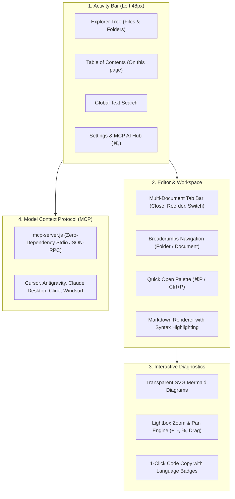

# Flutter Knowledge Base & Architecture Hub 🚀

> 🌐 **Live Web Documentation:** [https://docs.rahulsha.com.np](https://docs.rahulsha.com.np/)  
> 📦 **GitHub Repository:** [https://github.com/rahulshahDEV/flutter-docs](https://github.com/rahulshahDEV/flutter-docs)

Welcome to the **Flutter Engineering Knowledge Base & Architecture Hub**—a high-performance, developer-first documentation portal hosted live at [**docs.rahulsha.com.np**](https://docs.rahulsha.com.np/), styled with a pure **VS Code Dark IDE aesthetic** (`#1e1e1e`, `#252526`, `#181818`), optimized for instant static deployment to **Cloudflare Pages**, and connected directly to AI coding assistants via a native **Model Context Protocol (MCP)** server.

This knowledge base consolidates production-tested architectural blueprints, cryptographic systems, CI/CD pipelines, and open-source packages built for high-scale Flutter applications.

> [!TIP]
> **💡 The Formula 1 Pit Lane Garage Analogy:**
> Think of this portal as an F1 racing garage rather than a static library. The Explorer tree and tabs are your tool racks; the Mermaid zoom modals are live telemetry screens showing engine blueprints; and the MCP server is the telemetry umbilical cable directly plugged into your AI pair-programmer's headset so it can swap tires and tune engines with zero friction.

---

## 1. Portal Architecture & Navigation

The documentation portal mirrors the productivity workflows of the modern VS Code development environment.



---

## 2. Keyboard Shortcuts & Power Workflows

| Shortcut | Action | Description |
| :--- | :--- | :--- |
| **`⌘P`** / **`Ctrl+P`** | **Quick Open** | Fuzzy-search and instantly jump across all documentation files and section headings. |
| **`⌘,`** / **`Ctrl+,`** | **AI Settings Hub** | View MCP server connection configurations and copy ready-to-run implementation prompts for Cursor, Claude, and Antigravity. |
| **`Esc`** | **Close Overlays** | Dismiss Quick Open, Settings Modal, Search, or Diagram Lightbox modals. |
| **Click Diagram** | **Expand Lightbox** | Open any architectural Mermaid flowchart in a fullscreen canvas with zoom controls (`-`, `%`, `+`) and pan drag. |
| **Middle-Click Tab** | **Close Document** | Instantly close an active document tab in the top tab bar. |

---

## 3. The Complete Knowledge Base Index

Explore the production manuals organized across specialized engineering domains:

```text
docs/
├── guides/                       # Core Architecture & Initialization (Pinned at Top)
│   ├── app_initialization.md     # Production Bootstrap: WidgetsFlutterBinding, ScreenUtil, System Chrome, Firebase
│   ├── location_and_gps.md       # Dual-Gate Location: Permission vs Hardware GPS, Cache Fallback & ANR Fix
│   ├── flavors.md                # Multi-Flavor Architecture: Android Gradle, iOS Xcode Schemes & AppConfig
│   ├── proguard_rules.md         # ProGuard & R8 Obfuscation: Universal Rules, R8 Shrinking & De-obfuscation
│   └── getting_started.md        # Portal Overview, Navigation, MCP & Architecture Taxonomy
├── skills/                       # Senior Developer AI Skills & Automated Tooling
│   ├── flutter_superpower.md     # The 12 Laws of Flutter Architecture, SafeCubit, Clean Architecture & Evidence Gate
│   └── goldie.md                 # Goldie: Automated 6.9" iPhone & 13" iPad Store Screenshot & Video Pipeline
├── git/                          # Git Version Control & GitHub Enterprise Stack
│   ├── basics.md                 # Git Foundations: Content-Addressable DAG, 3 Trees, Patch Staging & Hygiene
│   ├── advanced.md               # Advanced Git: Interactive Rebase, Reset vs Revert, Reflog, Worktrees & Bisect
│   ├── github_stack.md           # The GitHub Stack: Trunk-Based Development, Rulesets, CODEOWNERS & Actions CI
│   └── cheatsheet.md             # Emergency Cheatsheet: Decision Matrix, 30 Essential One-Liners & Disaster Recovery
├── social/                       # High-Performance Social Feeds & Video Reels
│   └── feed_prefetch.md          # Feed Prefetch: Two-controller VideoPlayerPool, generation tokens, disk cache
├── in-app-update/                # App Store & Google Play Update Handlers
│   ├── upgrader.md               # Upgrader: App Store & Play Store alerts, UpgradeCard, force updates
│   └── in_app_update.md          # Google Play Core: Immediate fullscreen & flexible background downloads
├── monitoring/                   # Real-Time Telemetry & Crash Reporting
│   ├── logger.md                 # Structured Logging: Custom AppLogger (tags, zero leak) & PrettyDioLogger
│   ├── sentry.md                 # Sentry: Unhandled Async Errors, Navigation, HTTP Tracking & Symbolication
│   └── crashlytics.md            # Firebase Crashlytics: Fatal/Non-fatal errors, Logs & Custom Diagnostic Keys
├── analytics/                    # Product Telemetry & Metrics
│   └── amplitude.md              # Amplitude: ANR-Safe Lazy Injection, Typed Events & Session Tracking
├── chat/                         # Secure Messaging & Real-Time Infrastructure
│   ├── e2e.md                    # Zero-Knowledge End-to-End Encryption: Libsodium X25519 SealedBox + AES-256-GCM
│   └── socket.md                 # Real-Time WebSocket & Socket.io: Retain counting, lifecycle & events
├── CI-CD/                        # Continuous Integration & Delivery
│   ├── codemagic.md              # Codemagic Dual-Lane CI/CD (Google Drive QA APK + Play Store + App Store)
│   ├── fastlane.md               # Fastlane Automation: Supply, Match (Git code signing), Pilot & GitHub Actions
│   └── shorebird.md              # Shorebird Code Push: Instant OTA Dart Patching & Multi-Flavor CI/CD
├── auth/                         # Enterprise Social Authentication
│   ├── google.md                 # Google Sign-In: Android Credential Manager, 3 SHA-1 Keys & GoogleSignInHelper
│   └── apple.md                  # Sign in with Apple: Native iOS Keychain, Android Web OAuth & AppleSignInHelper
├── notifications/                # Real-Time Cloud Messaging
│   └── notification.md           # Push Notifications: Foreground local banners, background isolates & cold boot tap
└── packages/                     # Published pub.dev Libraries by rahulsha.com.np
    ├── overview.md               # Official packages catalog & quick install guide
    ├── flutter_smartdio.md       # SmartDio: HTTP wrapper with Hive cache policies & offline mutation queue
    ├── accurate_step_counter.md  # AccurateStepCounter: Android hardware step sensor & Foreground Service
    ├── contextengine.md          # ContextEngine: Provider-agnostic AI orchestration & Graphify token compression
    ├── flutter_handbreak.md      # FlutterHandbreak: Hardware-accelerated video & image compression
    └── fdev.md                   # fdev: Ultimate Flutter developer automation CLI
```

---

## 4. The Production Flutter Stack Blueprint

Every guide in this portal aligns with the **12 Laws of Flutter Architecture** detailed in [`skills/flutter_superpower.md`](file:///Volumes/automation/flutter%20docs/docs/skills/flutter_superpower.md):

```mermaid
flowchart LR
    subgraph UI["Presentation Layer"]
        A["ScreenUtil Responsive Layouts"]
        B["Feature-First Pages & Widgets"]
        C["SafeCubit / BLoC State Management"]
    end

    subgraph Core["Domain & Infrastructure"]
        D["GetIt + Injectable DI"]
        E["GoRouter Declarative Routing"]
        F["SmartDio HTTP + Offline Queue"]
        G["Hive / SecureStorage"]
    end

    subgraph SecurityTelemetry["Security & Observability"]
        H["E2EE Libsodium SealedBox + AES-GCM"]
        I["Sentry + Crashlytics Dual Monitoring"]
        J["Amplitude Product Analytics"]
    end

    subgraph Delivery["Distribution & CI/CD"]
        K["Shorebird Instant OTA Patches"]
        L["Codemagic / Fastlane Automated Lanes"]
        M["Goldie Automated Store Screenshots"]
    end

    UI --> Core
    Core --> SecurityTelemetry
    SecurityTelemetry --> Delivery
```



1. **Feature-First Clean Architecture:** Strict separation between `presentation/`, `domain/`, and `data/` within feature folders. No monolithic global dumping grounds.
2. **Deterministic State Management:** Safe Cubits emitting immutable states with Freezed or Equatable; zero business logic inside UI build methods.
3. **Resilient Initialization:** Clean separation between `bootstrap.dart`, `app.dart`, and flavor entrypoints with error-guarded run zones.
4. **Zero-Knowledge Privacy:** Cryptographic keys managed in hardware keystores; end-to-end encryption preserving user privacy.
5. **Continuous Quality Gate:** Zero analyzer warnings (`flutter analyze --fatal-infos`), automated branch builds, and seamless over-the-air code patching.

---

## 5. Connecting AI Coding Assistants via MCP Server

This portal includes a native **Model Context Protocol (MCP)** server ([`mcp-server.js`](file:///Volumes/automation/flutter%20docs/mcp-server.js)) that grants your AI pair programmer (Cursor, Antigravity, Claude Desktop, Cline, Windsurf) direct read and search access to these guides and code templates.

### Cursor (`.cursor/mcp.json`)
Add this configuration to `.cursor/mcp.json` in your target project:

```json
{
  "mcpServers": {
    "flutter-docs": {
      "command": "node",
      "args": ["/Volumes/automation/flutter docs/mcp-server.js"]
    }
  }
}
```

### Claude Desktop (`claude_desktop_config.json`)
```json
{
  "mcpServers": {
    "flutter-docs": {
      "command": "node",
      "args": ["/Volumes/automation/flutter docs/mcp-server.js"]
    }
  }
}
```

### Available MCP Tools for Your Agent:
* **`list_flutter_docs`**: Enumerates all guides by category with direct live web URLs on [docs.rahulsha.com.np](https://docs.rahulsha.com.np/).
* **`read_flutter_doc`**: Fetches the complete, raw markdown manual for any doc ID (with live web links and remote GitHub fallback).
* **`search_flutter_docs`**: Searches across the entire knowledge base for symbols, keywords, or error codes.
* **`get_implementation_code`**: Retrieves copy-paste-ready Dart/YAML/Ruby/TypeScript snippets.

---

## 6. How to Add & Extend Documentation

The portal uses Vite's eager glob loader (`import.meta.glob('/docs/**/*.md', { eager: true, query: '?raw' })`) to automatically discover documentation:

1. **Add or Edit Markdown Files:** Drop any standard GitHub Flavored Markdown file into the target directory inside `docs/`:
   ```bash
   # Example: add a new performance guide
   touch "docs/guides/performance_tuning.md"
   ```
2. **Automatic Extraction:**
   * **Title:** The first `# Heading` in your file becomes the document display title.
   * **Table of Contents:** All `##` and `###` headings are parsed, slugified, and rendered in the interactive outline with scroll-spy tracking.
   * **Folder Placement:** Files automatically nest inside their respective folder with customized icons and priority ordering.
3. **Compile Static Distribution:**
   ```bash
   npm run build
   ```
   Outputs an optimized single-page application into `dist/`, ready for direct deployment to **Cloudflare Pages** or any static hosting provider.
