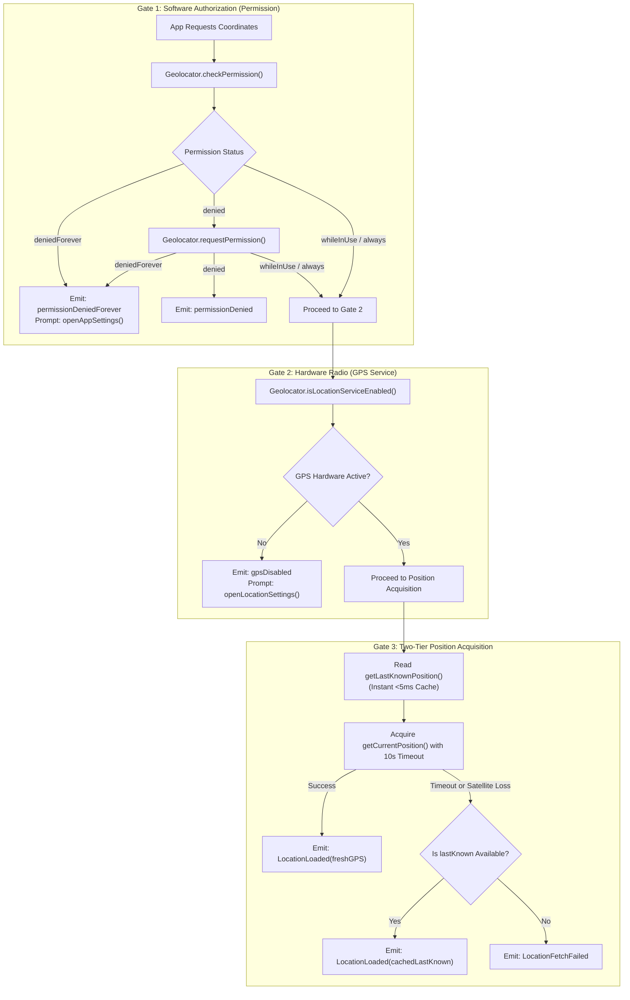

# Location Permission vs. GPS Hardware Service: Complete Flutter Guide

A production-grade implementation guide for handling **location and GPS telemetry** in Flutter. This guide documents the architectural distinction between **app-level software permissions** and **device-level hardware GPS radios**, instant cache fallbacks with `getLastKnownPosition()`, Android 14/15/16+ ANR prevention, real-time service status streams, and sanitized, copy-paste-ready code.

> [!TIP]
> **💡 The Driver's License vs Car Ignition Analogy:**
> Software Permission is your legal driver's license: the state grants you clearance to operate. GPS Hardware Service is the mechanical ignition key in your car's engine. Even with a 100% valid driver's license (`permission = granted`), if the engine ignition is turned off (`isLocationServiceEnabled = false`), your car cannot move. You must check both the legal permit and the mechanical ignition before requesting coordinates.

---

## 1. The Dual-Gate Location Architecture

A frequent source of critical bugs and 1-star reviews is treating "Location" as a single boolean check. Mobile operating systems (Android & iOS) enforce two completely independent gates before returning GPS coordinates:

1. **Gate 1: Software Authorization (Location Permission):**
   * Handled by the OS permission sandbox (`whileInUse`, `always`, `denied`, `deniedForever`).
   * Governs whether the application has legal clearance to inspect coordinates.
   * If `deniedForever`, the only remedy is redirecting the user to **App Settings** (`Geolocator.openAppSettings()`).
2. **Gate 2: Hardware Radio & System Service (GPS / Location Services):**
   * Handled by the device hardware switches and Google Location Accuracy / iOS Location Services.
   * Governs whether the physical GPS chip and cell/Wi-Fi positioning radios are receiving power.
   * If disabled, the only remedy is redirecting the user to **Device Location Settings** (`Geolocator.openLocationSettings()`).



---

## 2. Key Differences Matrix

| Dimension | Gate 1: Location Permission | Gate 2: GPS Hardware Service |
| :--- | :--- | :--- |
| **What It Governs** | App sandbox access to privacy APIs. | Power and radio reception of the GPS chip. |
| **Check Method** | `Geolocator.checkPermission()` | `Geolocator.isLocationServiceEnabled()` |
| **Request Method** | `Geolocator.requestPermission()` | Native system dialog (Android) or manual toggle. |
| **Permanent Failure** | `LocationPermission.deniedForever` | Hardware disabled / Airplane mode. |
| **Recovery Navigation** | `Geolocator.openAppSettings()` | `Geolocator.openLocationSettings()` |
| **Reactive Listener** | App resume lifecycle listener. | `Geolocator.getServiceStatusStream()` |

---

## 3. The 3 Production Traps & Solutions

### Trap 1: The Cold GPS Satellite Lock Delay
* **Problem:** Obtaining a cold satellite lock (`getCurrentPosition`) takes 5 to 30+ seconds, especially indoors or between urban high-rises. If you await it without fallback, the UI freezes or spins indefinitely.
* **Solution:** Immediately query `Geolocator.getLastKnownPosition()`. If available, use it as an instant baseline while fetching the fresh GPS lock in the background with a 10-second timeout.

### Trap 2: Android 14/15/16+ NMEA Listener ANR
* **Problem:** On modern Android devices, querying altitude with high precision triggers native NMEA string listeners that can hang the main looper thread and trigger an ANR.
* **Solution:** Explicitly set `useMSLAltitude: false` and `forceLocationManager: true` inside `AndroidSettings`.

### Trap 3: Confusing Settings Redirections
* **Problem:** Redirecting a user with disabled GPS to App Settings confuses them because the GPS toggle isn't there.
* **Solution:** Carefully branch: `openAppSettings()` for `deniedForever`, and `openLocationSettings()` for `!serviceEnabled`.

---

## 4. Dependencies & Platform Permissions

Add `geolocator` to `pubspec.yaml`:

```yaml
dependencies:
  flutter:
    sdk: flutter
  geolocator: ^13.0.2
```

---

### Android Manifest (`android/app/src/main/AndroidManifest.xml`)
```xml
<manifest xmlns:android="http://schemas.android.com/apk/res/android">
    <!-- Fine GPS satellite accuracy -->
    <uses-permission android:name="android.permission.ACCESS_FINE_LOCATION" />
    <!-- Coarse Wi-Fi / Cell tower accuracy -->
    <uses-permission android:name="android.permission.ACCESS_COARSE_LOCATION" />
</manifest>
```

---

### iOS Info.plist (`ios/Runner/Info.plist`)
```xml
<dict>
    <key>NSLocationWhenInUseUsageDescription</key>
    <string>We need your location to show nearby services and accurate directions.</string>
    <key>NSLocationAlwaysAndWhenInUseUsageDescription</key>
    <string>We need your location to keep tracking active even when minimized.</string>
</dict>
```

---

## 5. Complete Implementation: `LocationHelper`

Save this file as `lib/core/utils/location_helper.dart`:

```dart
import 'dart:async';
import 'package:flutter/foundation.dart';
import 'package:geolocator/geolocator.dart';

enum LocationFailureType {
  gpsDisabled,
  permissionDenied,
  permissionDeniedForever,
  timeoutOrUnknown,
}

class LocationFailure {
  final LocationFailureType type;
  final String message;
  const LocationFailure(this.type, this.message);
}

class LocationResult {
  final Position? position;
  final LocationFailure? failure;
  final bool isFromCache;

  const LocationResult.success(this.position, {this.isFromCache = false}) : failure = null;
  const LocationResult.error(this.failure) : position = null, isFromCache = false;

  bool get isSuccess => position != null;
}

class LocationHelper {
  /// Fetches device coordinates with strict gate separation and last-known fallback
  static Future<LocationResult> getCurrentLocation({
    LocationAccuracy accuracy = LocationAccuracy.high,
    Duration timeout = const Duration(seconds: 10),
  }) async {
    // =========================================================================
    // GATE 1: Verify Hardware GPS Service
    // =========================================================================
    final bool isGpsEnabled = await Geolocator.isLocationServiceEnabled();
    if (!isGpsEnabled) {
      return const LocationResult.error(
        LocationFailure(
          LocationFailureType.gpsDisabled,
          'Device GPS is turned off. Please enable location services.',
        ),
      );
    }

    // =========================================================================
    // GATE 2: Verify Software Permission Sandbox
    // =========================================================================
    LocationPermission permission = await Geolocator.checkPermission();

    if (permission == LocationPermission.denied) {
      permission = await Geolocator.requestPermission();
      if (permission == LocationPermission.denied) {
        return const LocationResult.error(
          LocationFailure(
            LocationFailureType.permissionDenied,
            'Location permission was denied.',
          ),
        );
      }
    }

    if (permission == LocationPermission.deniedForever) {
      return const LocationResult.error(
        LocationFailure(
          LocationFailureType.permissionDeniedForever,
          'Location permission permanently denied. Open App Settings to enable.',
        ),
      );
    }

    // =========================================================================
    // GATE 3: Two-Tier Position Acquisition (Cache First + GPS Timeout)
    // =========================================================================
    Position? lastKnownPosition;
    try {
      // 1. Instant non-blocking cache lookup (<5ms)
      lastKnownPosition = await Geolocator.getLastKnownPosition();
    } catch (_) {}

    try {
      // 2. Configure platform-optimized location settings
      late final LocationSettings locationSettings;

      if (defaultTargetPlatform == TargetPlatform.android) {
        locationSettings = AndroidSettings(
          accuracy: accuracy,
          distanceFilter: 0,
          forceLocationManager: true,
          intervalDuration: const Duration(seconds: 5),
          useMSLAltitude: false, // Prevents Android 14+ NMEA ANR
        );
      } else if (defaultTargetPlatform == TargetPlatform.iOS ||
          defaultTargetPlatform == TargetPlatform.macOS) {
        locationSettings = AppleSettings(
          accuracy: accuracy,
          activityType: ActivityType.fitness,
          pauseLocationUpdatesAutomatically: true,
          showBackgroundLocationIndicator: false,
        );
      } else {
        locationSettings = LocationSettings(accuracy: accuracy, distanceFilter: 0);
      }

      // 3. Acquire fresh GPS fix with timeout protection
      final freshPosition = await Geolocator.getCurrentPosition(
        locationSettings: locationSettings,
      ).timeout(timeout);

      return LocationResult.success(freshPosition, isFromCache: false);
    } on TimeoutException {
      // If satellite lookup timed out but cache exists, use cache
      if (lastKnownPosition != null) {
        return LocationResult.success(lastKnownPosition, isFromCache: true);
      }
      return const LocationResult.error(
        LocationFailure(
          LocationFailureType.timeoutOrUnknown,
          'GPS satellite lock timed out. No cached coordinates available.',
        ),
      );
    } catch (e) {
      if (lastKnownPosition != null) {
        return LocationResult.success(lastKnownPosition, isFromCache: true);
      }
      return LocationResult.error(
        LocationFailure(
          LocationFailureType.timeoutOrUnknown,
          'Failed to acquire location: $e',
        ),
      );
    }
  }

  /// Redirect helper based on failure type
  static Future<void> resolveFailureSettings(LocationFailure failure) async {
    if (failure.type == LocationFailureType.permissionDeniedForever) {
      await Geolocator.openAppSettings();
    } else if (failure.type == LocationFailureType.gpsDisabled) {
      await Geolocator.openLocationSettings();
    }
  }
}
```

---

## 6. Real-Time GPS Service Status Stream

Subscribe to changes in hardware GPS power (e.g. user toggles GPS from notification quick tiles):

```dart
class LocationStatusTracker {
  StreamSubscription<ServiceStatus>? _serviceSubscription;

  void startListening(VoidCallback onGpsRestored) {
    _serviceSubscription = Geolocator.getServiceStatusStream().listen((status) {
      if (status == ServiceStatus.enabled) {
        // Automatically re-fetch location when user turns GPS on!
        onGpsRestored();
      }
    });
  }

  void stopListening() {
    _serviceSubscription?.cancel();
    _serviceSubscription = null;
  }
}
```

---

## 7. State Management Integration (`LocationCubit`)

```dart
import 'package:flutter_bloc/flutter_bloc.dart';
import 'package:geolocator/geolocator.dart';
import 'package:my_app/core/utils/location_helper.dart';

sealed class LocationState {
  const LocationState();
}

class LocationInitial extends LocationState {
  const LocationInitial();
}

class LocationLoading extends LocationState {
  const LocationLoading();
}

class LocationLoaded extends LocationState {
  final Position position;
  final bool isFromCache;
  const LocationLoaded(this.position, {this.isFromCache = false});
}

class LocationError extends LocationState {
  final LocationFailure failure;
  const LocationError(this.failure);
}

class LocationCubit extends Cubit<LocationState> {
  LocationCubit() : super(const LocationInitial());

  Future<void> fetchLocation() async {
    emit(const LocationLoading());

    final result = await LocationHelper.getCurrentLocation();

    if (result.isSuccess) {
      emit(LocationLoaded(result.position!, isFromCache: result.isFromCache));
    } else {
      emit(LocationError(result.failure!));
    }
  }

  Future<void> handleSettingsRedirect(LocationFailure failure) async {
    await LocationHelper.resolveFailureSettings(failure);
  }
}
```

---

## 8. Verification & Debugging Checklist

| Scenario | Expected Result | Verification Check |
| :--- | :--- | :--- |
| **GPS Off + Permission Granted** | Emits `LocationFailureType.gpsDisabled` | Prompts user with "Turn on GPS" and calls `openLocationSettings()`. |
| **Permission Denied Forever** | Emits `LocationFailureType.permissionDeniedForever` | Prompts user with "Open Settings" and calls `openAppSettings()`. |
| **Indoor / Basement Test** | Falls back to `lastKnownPosition` within 10s | Does not hang UI; returns cached coordinate with `isFromCache: true`. |
| **Android 14/15/16 NMEA Safety** | Zero ANR in Google Play Console | Verified `useMSLAltitude: false` in `AndroidSettings`. |
| **Quick Settings Toggle** | Automatically refreshes on GPS enable | `Geolocator.getServiceStatusStream()` receives `ServiceStatus.enabled`. |

