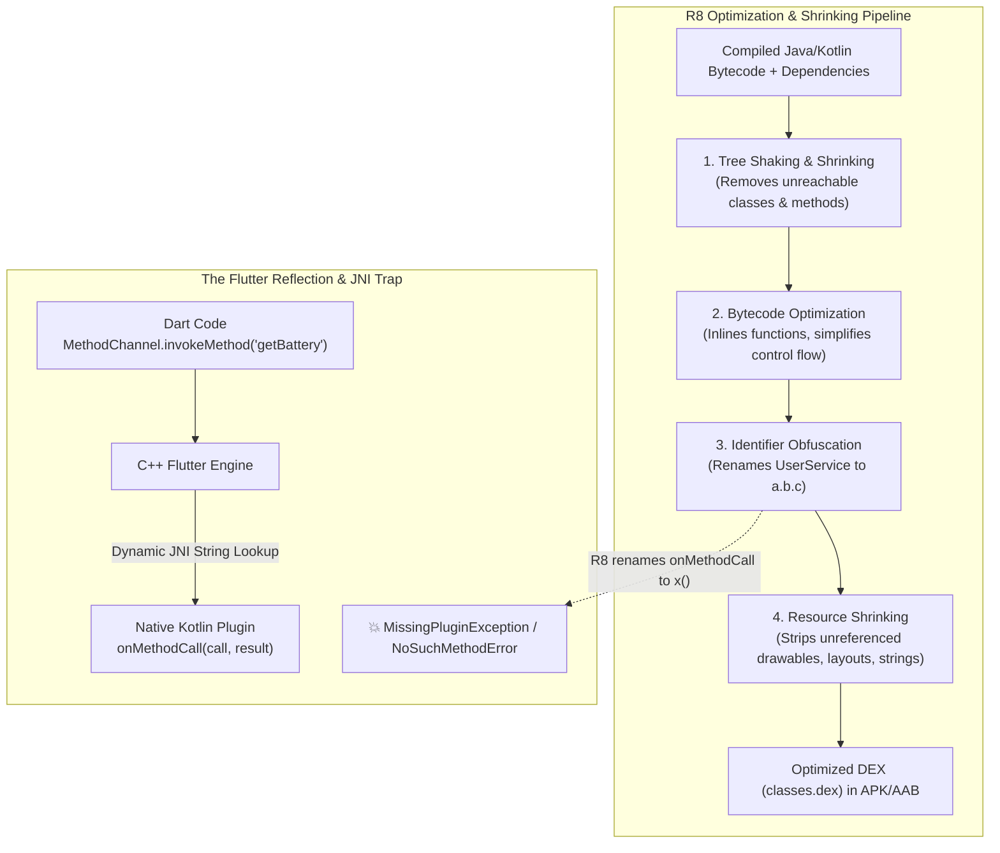
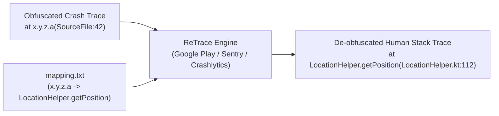

# Complete Flutter ProGuard & R8 Obfuscation Architecture Guide

A definitive, production-grade guide for configuring **ProGuard and R8 bytecode optimization, shrinking, and obfuscation** in Flutter Android applications. This guide covers why release builds crash with `MissingPluginException` or `ClassNotFoundException`, complete copy-paste `proguard-rules.pro` blueprints, Gradle Kotlin DSL configuration, crash symbolication with `mapping.txt`, and systematic debugging techniques.

> [!TIP]
> **💡 The Overzealous Declutterer & Secret Codebook Analogy:**
> R8 is like an overzealous decluttering cleaner who sweeps through your house throwing out everything nobody actively speaks aloud. Because Flutter invokes native Java/Kotlin methods dynamically behind the scenes through C++ string tunnels (Platform Channels), R8 peers into the Android codebase, sees no direct Java caller, assumes the code is abandoned junk, and shreds it in the incinerator (`ClassNotFoundException` in release mode!). ProGuard rules are the bright neon *"DO NOT TOUCH / HISTORICAL RECORD"* labels you slap onto critical boxes so R8 leaves them intact.

---

## 1. How R8 & ProGuard Work in Flutter

When you run `flutter build appbundle --release` or `flutter build apk --release`, the Android build system invokes **R8** (Google's modern replacement for ProGuard). R8 executes four sequential optimization phases on native Java/Kotlin bytecode:



### The 4 Pillars of R8

1. **Code Shrinking (Tree Shaking):** Detects and safely removes unused classes, fields, methods, and attributes from your app and its library dependencies.
2. **Bytecode Optimization:** Analyzes and rewrites your bytecode to reduce size and improve execution speed (e.g. inlining short methods, stripping dead branches).
3. **Obfuscation (Renaming):** Renames classes, fields, and methods with short, meaningless names (e.g. `MyRepository` becomes `a.b.c`), protecting intellectual property and shrinking DEX string pools.
4. **Resource Shrinking:** Automatically removes unused resources (images, XML drawables) from packaged dependencies (`isShrinkResources = true`).

---

## 2. Enabling R8 in Gradle

### 2.1 Kotlin DSL (`android/app/build.gradle.kts`)

Configure `buildTypes.release`:

```kotlin
android {
    ...
    buildTypes {
        release {
            // Enable code shrinking, obfuscation, and optimization
            isMinifyEnabled = true

            // Enable resource shrinking (requires isMinifyEnabled = true)
            isShrinkResources = true

            // Specify ProGuard rule files
            proguardFiles(
                getDefaultProguardFile("proguard-android-optimize.txt"),
                "proguard-rules.pro"
            )

            // Optional: apply release signing
            signingConfig = signingConfigs.getByName("release")
        }

        debug {
            isMinifyEnabled = false
            isShrinkResources = false
        }
    }
}
```

### 2.2 Groovy DSL (`android/app/build.gradle`)

```groovy
android {
    ...
    buildTypes {
        release {
            minifyEnabled true
            shrinkResources true
            proguardFiles getDefaultProguardFile('proguard-android-optimize.txt'), 'proguard-rules.pro'
            signingConfig signingConfigs.release
        }
        debug {
            minifyEnabled false
            shrinkResources false
        }
    }
}
```

---

## 3. The Universal Production `proguard-rules.pro`

Save this file directly to `android/app/proguard-rules.pro`. It protects Flutter core engine internals, serialization, platform channels, and popular native plugins:

```proguard
# ==============================================================================
# FLUTTER ENGINE & PLATFORM CHANNELS
# ==============================================================================
# Prevent R8 from mangling core Flutter engine classes and JNI entrypoints
-keep class io.flutter.app.** { *; }
-keep class io.flutter.plugin.** { *; }
-keep class io.flutter.util.** { *; }
-keep class io.flutter.view.** { *; }
-keep class io.flutter.** { *; }
-keep class io.flutter.plugins.** { *; }

# Preserve native JNI methods invoked across the C++ engine boundary
-keepclasseswithmembernames class * {
    native <methods>;
}

# Preserve Flutter custom views instantiated from XML
-keepclassmembers class * extends android.view.View {
    public <init>(android.content.Context);
    public <init>(android.content.Context, android.util.AttributeSet);
    public <init>(android.content.Context, android.util.AttributeSet, int);
    public void set*(...);
}

# Preserve callback methods registered via reflection
-keepclassmembers class * {
    @android.webkit.JavascriptInterface <methods>;
}

# ==============================================================================
# ANDROID ARCHITECTURE & COMPATIBILITY
# ==============================================================================
# Keep Parcelable CREATOR instances for IPC serialization
-keepclassmembers class * implements android.os.Parcelable {
    public static final ** CREATOR;
}

# Keep Serializable class members and serialVersionUID
-keepclassmembers class * implements java.io.Serializable {
    static final long serialVersionUID;
    private static final java.io.ObjectStreamField[] serialPersistentFields;
    private void writeObject(java.io.ObjectOutputStream);
    private void readObject(java.io.ObjectInputStream);
    java.lang.Object writeReplace();
    java.lang.Object readResolve();
}

# Keep enum methods for values() and valueOf() reflection
-keepclassmembers enum * {
    public static **[] values();
    public static ** valueOf(java.lang.String);
}

# ==============================================================================
# GOOGLE PLAY CORE & IN-APP UPDATES
# ==============================================================================
-keep class com.google.android.play.core.** { *; }
-keep interface com.google.android.play.core.** { *; }
-dontwarn com.google.android.play.core.**

# ==============================================================================
# FIREBASE & GOOGLE CLOUD SERVICES
# ==============================================================================
# Firebase Core & Analytics
-keepattributes *Annotation*,InnerClasses,Signature,EnclosingMethod
-dontwarn com.google.firebase.**
-keep class com.google.firebase.** { *; }

# Firebase Crashlytics & Sentry Forensic Stacktraces
-keepattributes SourceFile,LineNumberTable
-keep public class * extends java.lang.Exception

# FCM & Google Play Services
-keep class com.google.android.gms.** { *; }
-dontwarn com.google.android.gms.**

# ==============================================================================
# NETWORKING & HTTP (OKHTTP & RETROFIT)
# ==============================================================================
-dontwarn okhttp3.**
-dontwarn okio.**
-keepnames class okhttp3.internal.publicsuffix.PublicSuffixDatabase
-dontwarn org.codehaus.mojo.animal_sniffer.*

# ==============================================================================
# SECURITY & CRYPTOGRAPHY (BOUNCY CASTLE, CONSCRYPT, OPENJSSE)
# ==============================================================================
# Silence missing platform provider warnings during compilation
-dontwarn org.bouncycastle.jsse.BCSSLParameters
-dontwarn org.bouncycastle.jsse.BCSSLSocket
-dontwarn org.bouncycastle.jsse.provider.BouncyCastleJsseProvider
-dontwarn org.conscrypt.Conscrypt$Version
-dontwarn org.conscrypt.Conscrypt
-dontwarn org.conscrypt.ConscryptHostnameVerifier
-dontwarn org.openjsse.javax.net.ssl.SSLParameters
-dontwarn org.openjsse.javax.net.ssl.SSLSocket
-dontwarn org.openjsse.net.ssl.OpenJSSE

# ==============================================================================
# JSON SERIALIZATION (GSON & MOSHI)
# ==============================================================================
# Prevent field renaming on models parsed via reflection
-keepclassmembers class * {
    @com.google.gson.annotations.SerializedName <fields>;
    @com.google.gson.annotations.Expose <fields>;
}
-keep class com.google.gson.** { *; }
-dontwarn com.google.gson.**

# ==============================================================================
# COROUTINES & KOTLIN METADATA
# ==============================================================================
-keepattributes RuntimeVisibleAnnotations,RuntimeVisibleParameterAnnotations
-dontwarn kotlinx.coroutines.**
```

---

## 4. De-obfuscation & Stack Trace Symbolication

When obfuscation is active, unhandled crash stack traces from Google Play Console or Firebase Crashlytics will look scrambled:

```text
java.lang.NullPointerException: Attempt to invoke virtual method 'void a.b.c.d()' on a null object reference
    at x.y.z.a(SourceFile:42)
    at io.flutter.embedding.engine.FlutterJNI.handlePlatformMessage(Unknown Source:0)
```

### The `mapping.txt` File

Every release compilation generates an obfuscation lookup table at:

```text
build/app/outputs/mapping/release/mapping.txt
# Or multi-flavor:
build/app/outputs/mapping/prodRelease/mapping.txt
```



### 4.1 Preserving Line Numbers in Crashes

Always include these two lines in `proguard-rules.pro`:

```proguard
-keepattributes SourceFile,LineNumberTable
-renamesourcefileattribute SourceFile
```
*Without `LineNumberTable`, all crashes will report `(Unknown Source:0)` instead of the real file line number.*

### 4.2 Automated Upload to Firebase Crashlytics

Ensure the Crashlytics Gradle plugin is active in `android/app/build.gradle.kts`:

```kotlin
plugins {
    id("com.android.application")
    id("kotlin-android")
    id("dev.flutter.flutter-gradle-plugin")
    id("com.google.gms.google-services")
    id("com.google.firebase.crashlytics") // Uploads mapping.txt automatically
}
```

---

## 5. ProGuard Directives Quick Reference

| Directive | What It Does | When to Use |
| :--- | :--- | :--- |
| **`-keep class X { *; }`** | Keeps class `X` and all its methods and fields from being removed or renamed. | Platform channel handlers, JNI wrappers, data models. |
| **`-keepclassmembers class X { ... }`** | Preserves specific members inside `X` (e.g. `CREATOR` or `@SerializedName`), but allows the class name itself to be obfuscated. | Parcelable, JSON DTOs, Enums. |
| **`-keepclasseswithmembernames class * { native <methods>; }`** | Preserves classes that declare native JNI methods. | C++ engine bridges. |
| **`-dontwarn com.package.**`** | Suppresses unresolved dependency warnings at compile time. | Optional library providers (BouncyCastle, OpenJSSE). |
| **`-dontobfuscate`** | Performs shrinking and optimization, but leaves class and method names intact. | **Debugging only** to isolate renaming issues. |
| **`-dontshrink`** | Skips code shrinking entirely. | Diagnosing missing class errors. |

---

## 6. How to Debug Release-Only R8 Crashes

If your app runs in debug mode but crashes immediately upon launching `--release`, follow this systematic 4-step triage playbook:

### Step 1: Reproduce Locally with Logcat

Connect a physical Android device and run:

```bash
flutter run --release
```

Open a separate terminal to watch the raw Android system logs:

```bash
adb logcat -v time *:E | grep -i "AndroidRuntime"
```

Look for:
* `java.lang.ClassNotFoundException: Didn't find class "..."`
* `java.lang.NoSuchMethodError: no non-static method "..."`
* `MissingPluginException: No implementation found for method ... on channel ...`

### Step 2: Inspect `seeds.txt` and `usage.txt`

Add these diagnostic lines to your `proguard-rules.pro` temporarily:

```proguard
# Prints classes and members matching keep rules
-printseeds build/app/outputs/mapping/release/seeds.txt

# Prints all code stripped out by R8
-printusage build/app/outputs/mapping/release/usage.txt
```

Run `flutter build apk --release` and check `usage.txt`. If your missing class appears in `usage.txt`, R8 discarded it!

### Step 3: Add Targeted `-keep` Rule

Instead of turning off obfuscation globally, add a precise keep rule for the missing package:

```proguard
-keep class com.problematic.library.** { *; }
-dontwarn com.problematic.library.**
```

### Step 4: Verify Clean Build

Recompile and verify the fix:

```bash
flutter build apk --release
flutter install --release
```
