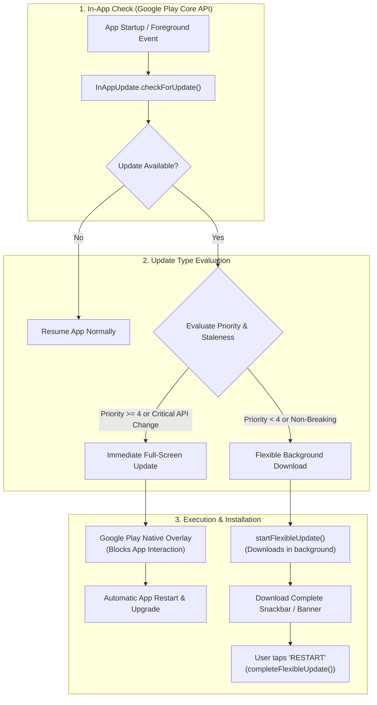

# Google Play In-App Updates in Flutter: Complete Production Guide

A comprehensive, production-ready manual for implementing **native Google Play Core In-App Updates** in Flutter using the **`in_app_update`** package. This guide covers **Immediate full-screen takeovers**, **Flexible background downloads**, update priority thresholds, app lifecycle re-engagement, and Google Play Store testing environments with sanitized, copy-paste-ready code.

> [!TIP]
> **💡 The Grounded Boarding Gate vs Quiet In-Flight Wi-Fi Analogy:**
> An **Immediate Update** is like an airline grounding the boarding gate because of a critical safety bulletin: no passenger boards until the plane is certified (blocking critical security fixes). A **Flexible Update** is like the cabin crew downloading new movies over satellite Wi-Fi in the background while you sip coffee: you keep using the app uninterrupted until a gentle snack bar offers a 1-second restart.

---

## 1. Architecture & Update Types

Native Google Play In-App Updates provide a frictionless experience where Android users download and install app updates directly inside your Flutter application without being routed out to the external Google Play Store app.



---

## 2. Dependencies & Android Configuration

Add `in_app_update` to your `pubspec.yaml`:

```yaml
dependencies:
  flutter:
    sdk: flutter
  in_app_update: ^4.2.3
```

### Android Requirements
* Minimum Android SDK: **21** (Android 5.0 Lollipop) or higher.
* Works exclusively on devices running the **Google Play Store**.
* The app must be signed with the same keystore published to Google Play.

---

## 3. Immediate vs Flexible Updates

| Feature | Immediate Update (`performImmediateUpdate`) | Flexible Update (`startFlexibleUpdate`) |
| :--- | :--- | :--- |
| **User Experience** | Fullscreen modal overlay managed by Google Play. | Background download while user continues interacting with app. |
| **Dismissible** | **No.** User cannot bypass or dismiss. | **Yes.** User chooses when to restart the application. |
| **Best Used For** | Critical zero-day vulnerability fixes, breaking backend changes. | New non-breaking features, minor visual polish, performance tweaks. |
| **Completion Flow** | Google Play installs and reboots app automatically. | Developer calls `InAppUpdate.completeFlexibleUpdate()` to restart. |

---

## 4. Implementation: Production `PlayUpdateService`

Save this file as `lib/core/services/play_update_service.dart`:

```dart
import 'dart:io';
import 'package:flutter/material.dart';
import 'package:in_app_update/in_app_update.dart';

class PlayUpdateService {
  static final PlayUpdateService _instance = PlayUpdateService._internal();
  factory PlayUpdateService() => _instance;
  PlayUpdateService._internal();

  /// Check for updates and initiate Immediate or Flexible workflow
  Future<void> checkForPlayUpdate(BuildContext context) async {
    // In-App Updates are an Android Google Play Core feature
    if (!Platform.isAndroid) return;

    try {
      final AppUpdateInfo updateInfo = await InAppUpdate.checkForUpdate();

      if (updateInfo.updateAvailability == UpdateAvailability.updateAvailable) {
        // Condition for Immediate (Forced) Update:
        // Update priority set in Play Console Developer API (0 to 5)
        if (updateInfo.immediateUpdateAllowed && updateInfo.updatePriority >= 4) {
          await _performImmediate(context);
        } else if (updateInfo.flexibleUpdateAllowed) {
          await _performFlexible(context);
        }
      }
    } catch (e) {
      debugPrint('[PlayUpdateService] Check failed (device might lack Play Store or running local debug build): $e');
    }
  }

  /// Fullscreen blocking update flow
  Future<void> _performImmediate(BuildContext context) async {
    try {
      final AppUpdateResult result = await InAppUpdate.performImmediateUpdate();
      if (result == AppUpdateResult.userDeniedUpdate) {
        debugPrint('[PlayUpdateService] User refused immediate update.');
      }
    } catch (e) {
      debugPrint('[PlayUpdateService] Immediate update failed: $e');
    }
  }

  /// Non-blocking background download flow
  Future<void> _performFlexible(BuildContext context) async {
    try {
      final AppUpdateResult result = await InAppUpdate.startFlexibleUpdate();

      if (result == AppUpdateResult.success) {
        // Background download completed successfully.
        // Prompt the user to restart the application and complete installation.
        if (context.mounted) {
          ScaffoldMessenger.of(context).showSnackBar(
            SnackBar(
              content: const Text('An update was downloaded and is ready to install!'),
              duration: const Duration(days: 1), // Persist until user takes action
              behavior: SnackBarBehavior.floating,
              action: SnackBarAction(
                label: 'RESTART',
                textColor: Colors.amber,
                onPressed: () async {
                  await InAppUpdate.completeFlexibleUpdate();
                },
              ),
            ),
          );
        }
      }
    } catch (e) {
      debugPrint('[PlayUpdateService] Flexible update error: $e');
    }
  }

  /// Re-check in didChangeAppLifecycleState to resume paused updates
  Future<void> checkPendingFlexibleUpdate(BuildContext context) async {
    if (!Platform.isAndroid) return;

    try {
      final updateInfo = await InAppUpdate.checkForUpdate();
      if (updateInfo.installStatus == InstallStatus.downloaded && context.mounted) {
        ScaffoldMessenger.of(context).showSnackBar(
          SnackBar(
            content: const Text('Downloaded update waiting to install.'),
            action: SnackBarAction(
              label: 'RESTART NOW',
              onPressed: () => InAppUpdate.completeFlexibleUpdate(),
            ),
          ),
        );
      }
    } catch (_) {}
  }
}
```

---

## 5. App Lifecycle Integration

If an immediate update is interrupted by a phone call or app backgrounding, Google Play will leave the update in progress. Resume checking when the user re-enters the app:

```dart
class HomeScreenState extends State<HomeScreen> with WidgetsBindingObserver {
  @override
  void initState() {
    super.initState();
    WidgetsBinding.instance.addObserver(this);

    // Initial check on startup
    WidgetsBinding.instance.addPostFrameCallback((_) {
      PlayUpdateService().checkForPlayUpdate(context);
    });
  }

  @override
  void dispose() {
    WidgetsBinding.instance.removeObserver(this);
    super.dispose();
  }

  @override
  void didChangeAppLifecycleState(AppLifecycleState state) {
    if (state == AppLifecycleState.resumed) {
      // Resume check when returning to foreground
      PlayUpdateService().checkPendingFlexibleUpdate(context);
    }
  }

  @override
  Widget build(BuildContext context) {
    return Scaffold(
      appBar: AppBar(title: const Text('Home Page')),
      body: const Center(child: Text('Content')),
    );
  }
}
```

---

## 6. How to Set Update Priority in Google Play

The `updatePriority` parameter (0 to 5) is set when publishing your release via the **Google Play Developer API** or CI/CD pipelines (e.g. Fastlane or Google Cloud):

```json
{
  "releases": [
    {
      "name": "2.4.0",
      "versionCodes": ["42"],
      "status": "completed",
      "inAppUpdatePriority": 5
    }
  ]
}
```

* **Priority 0–3:** Recommended for minor builds (triggers Flexible update).
* **Priority 4–5:** High-priority or breaking changes (triggers Immediate update).

---

## 7. Testing & Verification Checklist

> [!WARNING]
> **Direct USB Installs Will Fail:**
> If you install an APK via `adb install` or `flutter run`, `InAppUpdate.checkForUpdate()` will fail with error:
> `InstallErrorCode.ERROR_API_NOT_AVAILABLE`
>
> The Google Play Core API requires that the app was downloaded and licensed through Google Play.

### How to Test Locally:
1. **Google Play Internal App Sharing:**
   - Upload your build to **Google Play Console** &rarr; **Internal App Sharing**.
   - Download the app onto your test device via the shared link.
   - Upload a second build with an incremented version code.
   - Open the app on your device—the update prompt will trigger immediately!
2. **Internal Testing Track:**
   - Deploy to the Internal track. Add your test Google account to the email tester list.
   - Ensure the Play Store on your device is signed in with that test account.

