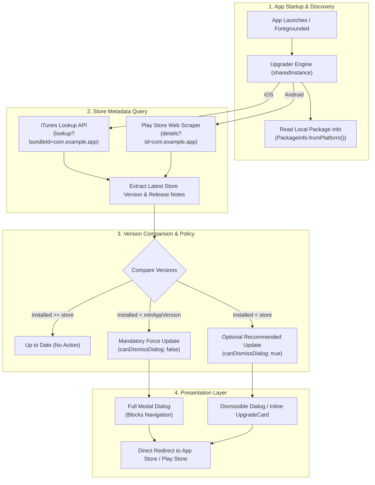

# App Store & Play Store Update Dialogs with Upgrader: Complete Guide

A comprehensive, production-ready guide for implementing cross-platform update alert dialogs and cards in Flutter using **`upgrader`**. This guide covers App Store and Google Play scraping, mandatory force updates, inline `UpgradeCard` banners, custom dialog localization with `UpgraderMessages`, version override logic, and release testing with sanitized, copy-paste-ready code.

> [!TIP]
> **💡 The Storefront Window Shopper Analogy:**
> Instead of building and hosting an expensive custom backend server just to ask *"is there a new app version?"*, `upgrader` acts like a personal assistant who walks down to the public App Store and Play Store front windows, peers through the glass at the current published price tag, compares it with what you are wearing, and taps you on the shoulder with a prompt if a shiny new edition is on display.

---

## 1. Architecture & Verification Flow

The `upgrader` package is the industry standard for cross-platform app update prompts. It queries the public **Apple iTunes Search API** (`https://itunes.apple.com/lookup?bundleId=...`) and scrapes the **Google Play Store** web listing using the installed application's bundle identifier—eliminating the need to deploy and maintain a dedicated backend version check endpoint.



---

## 2. Dependencies & Installation

Add `upgrader` to your `pubspec.yaml`:

```yaml
dependencies:
  flutter:
    sdk: flutter
  upgrader: ^11.1.0
```

Run `flutter pub get` to install.

---

## 3. Core Presentation Patterns

`upgrader` provides three distinct UI presentation patterns:
1. **`UpgradeAlert` (Modal Dialog):** Wraps a page and automatically shows a native Cupertino (iOS) or Material (Android) modal dialog when an update is detected.
2. **`UpgradeCard` (Inline Banner):** Embeds an update notice directly into a `ListView` or screen body (ideal for Home or Profile screens).
3. **Imperative API:** Query version states directly in code without automatic UI widgets.

---

### Pattern 1: Modal Dialog with `UpgradeAlert`

Wrap your primary navigation screen or `MaterialApp.builder` with `UpgradeAlert`:

```dart
import 'package:flutter/material.dart';
import 'package:upgrader/upgrader.dart';

class HomeScreen extends StatelessWidget {
  const HomeScreen({super.key});

  @override
  Widget build(BuildContext context) {
    return UpgradeAlert(
      upgrader: Upgrader(
        // Set to true to view the dialog during development without waiting for store release
        debugDisplayAlways: false,
        debugLogging: false,

        // Dialog style: auto matches the running OS (Cupertino on iOS, Material on Android)
        dialogStyle: UpgradeDialogStyle.material,

        // Frequency throttling: how often to prompt the user (default is 3 days)
        durationUntilAlertAgain: const Duration(days: 1),

        // Optional: specify country code for regional App Store pricing / availability
        countryCode: 'US',

        // Optional: Hard minimum required version (overrides store version for forced migrations)
        minAppVersion: '2.0.0',

        // Set to false for mandatory updates (cannot be dismissed)
        canDismissDialog: false,
        shouldPopScope: () => false,

        // Custom localized messages
        messages: AppCustomUpgraderMessages(),
      ),
      child: Scaffold(
        appBar: AppBar(title: const Text('My Application')),
        body: const Center(
          child: Text('Home Feed Content'),
        ),
      ),
    );
  }
}
```

---

### Pattern 2: Inline Banner with `UpgradeCard`

For non-intrusive notification, embed an `UpgradeCard` at the top of your feed:

```dart
import 'package:flutter/material.dart';
import 'package:upgrader/upgrader.dart';

class FeedPage extends StatelessWidget {
  const FeedPage({super.key});

  @override
  Widget build(BuildContext context) {
    return Scaffold(
      appBar: AppBar(title: const Text('Updates & News')),
      body: ListView(
        padding: const EdgeInsets.all(16.0),
        children: [
          // Automatically renders only when a store update is detected
          UpgradeCard(
            upgrader: Upgrader(
              debugDisplayAlways: false,
              dialogStyle: UpgradeDialogStyle.material,
              durationUntilAlertAgain: const Duration(hours: 12),
            ),
            margin: const EdgeInsets.only(bottom: 16.0),
          ),
          const ListTile(
            title: Text('Latest Post 1'),
            subtitle: Text('Welcome to the new release.'),
          ),
        ],
      ),
    );
  }
}
```

---

## 4. Custom Localization & Branded Copy

Subclass `UpgraderMessages` to control strings, translations, or brand terminology:

```dart
import 'package:upgrader/upgrader.dart';

class AppCustomUpgraderMessages extends UpgraderMessages {
  @override
  String? get title => 'Update Available';

  @override
  String? get body =>
      'A new version of {{appName}} is available with performance improvements and bug fixes. Please update to version {{currentAppStoreVersion}} for the best experience.';

  @override
  String? get prompt => 'Would you like to install the update now?';

  @override
  String? get buttonTitleUpdate => 'Update Now';

  @override
  String? get buttonTitleIgnore => 'Skip';

  @override
  String? get buttonTitleLater => 'Remind Me Later';

  @override
  String? get releaseNotes => 'Release Highlights:';
}
```

### Available Template Variables:
* `{{appName}}`: The display name of the application.
* `{{currentInstalledVersion}}`: The version currently running on the device.
* `{{currentAppStoreVersion}}`: The latest version available on the store.

---

## 5. Mandatory / Forced Update Configuration

To enforce a mandatory update that prevents users from using older, deprecated, or breaking client builds:

```dart
final forceUpgrader = Upgrader(
  // 1. Set the hard minimum required version
  minAppVersion: '2.5.0',

  // 2. Prevent user dismissal
  canDismissDialog: false,

  // 3. Prevent hardware back-button pop on Android
  shouldPopScope: () => false,

  // 4. Force dialog re-appearance on every cold launch
  durationUntilAlertAgain: Duration.zero,
);
```

---

## 6. Testing & Troubleshooting Checklist

| Test Scenario | Implementation Check | Common Gotcha |
| :--- | :--- | :--- |
| **Local Development Preview** | Set `debugDisplayAlways: true` in `Upgrader`. | Remember to set `debugDisplayAlways: false` before publishing to production! |
| **New Release Not Showing** | Verify bundle identifier matches App Store Connect / Play Console. | Apple's iTunes Lookup API caches globally for 1–2 hours after an app is approved by review. |
| **Android Back-Button Dismissal** | Verify Android navigation back button is blocked on forced updates. | Must set both `canDismissDialog: false` and `shouldPopScope: () => false`. |
| **Regional Store Mismatch** | Specify `countryCode: 'US'` (or target market). | If an app is only published in specific countries, iTunes API will return empty results without `countryCode`. |
| **Custom Store URLs** | Override `appStoreListingURL` if app is distributed via internal portal. | Required when using custom enterprise distribution or private testing catalogs. |

