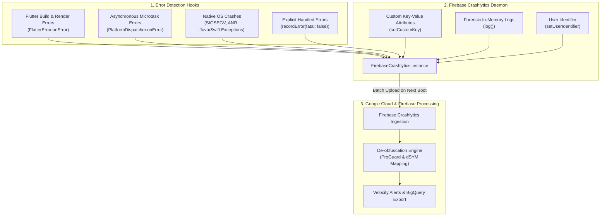

# Firebase Crashlytics: Production Error Monitoring Guide in Flutter

A complete, production-ready manual for implementing **Firebase Crashlytics** in Flutter applications. This guide covers automated fatal and non-fatal crash recording, asynchronous platform dispatcher hooks, forensic breadcrumb logging, custom diagnostic keys, dual Sentry+Crashlytics co-existence, and Android/iOS build configurations.

> [!TIP]
> **💡 The High-Velocity ER Triage Station Analogy:**
> If Sentry is the forensic crime lab, Crashlytics is the high-velocity Emergency Room triage board. It aggregates millions of patient visits into a single metric (e.g. 99.8% crash-free user rate), instantly sounds the alarms when a fatal artery tears (fatal NDK/JVM crashes), and tags the patient chart with vital signs (`customKeys` like `userId`, `network`, and `screenName`) so the on-call surgical team can stabilize the bleed immediately.

---

## 1. Architecture & Telemetry Overview

Firebase Crashlytics provides lightweight, real-time crash reporting for iOS, Android, and macOS. It aggregates uncaught fatal exceptions, unhandled asynchronous microtask errors, and non-fatal handled errors into prioritized impact groups in the Firebase Console.



---

## 2. Dependencies & Build Configuration

Add `firebase_core` and `firebase_crashlytics` to `pubspec.yaml`:

```yaml
dependencies:
  flutter:
    sdk: flutter
  firebase_core: ^3.6.0
  firebase_crashlytics: ^4.1.3
```

---

### Android Gradle Configuration

In `android/build.gradle.kts` (project level):
```kotlin
plugins {
    id("com.android.application") version "8.5.0" apply false
    id("com.google.gms.google-services") version "4.4.2" apply false
    id("com.google.firebase.crashlytics") version "3.0.2" apply false
}
```

In `android/app/build.gradle.kts` (app level):
```kotlin
plugins {
    id("com.android.application")
    id("kotlin-android")
    id("com.google.gms.google-services")
    id("com.google.firebase.crashlytics")
}

android {
    buildTypes {
        release {
            isMinifyEnabled = true
            isShrinkResources = true
            proguardFiles(
                getDefaultProguardFile("proguard-android-optimize.txt"),
                "proguard-rules.pro"
            )
        }
    }
}
```

---

### iOS Xcode Configuration

1. Download `GoogleService-Info.plist` from Firebase Console and add it to `ios/Runner` via Xcode.
2. In Xcode, select the **Runner** target &rarr; **Build Phases** &rarr; **+** &rarr; **New Run Script Phase**.
3. Set the script to upload dSYMs automatically:
```bash
"${PODS_ROOT}/FirebaseCrashlytics/run"
```
4. Add the input files:
```text
${DWARF_DSYM_FOLDER_PATH}/${DWARF_DSYM_FILE_NAME}
${DWARF_DSYM_FOLDER_PATH}/${DWARF_DSYM_FILE_NAME}/Contents/Resources/DWARF/${PRODUCT_NAME}
${DWARF_DSYM_FOLDER_PATH}/${DWARF_DSYM_FILE_NAME}/Contents/Info.plist
$(TARGET_BUILD_DIR)/$(UNLOCALIZED_RESOURCES_FOLDER_PATH)/GoogleService-Info.plist
$(TARGET_BUILD_DIR)/$(EXECUTABLE_PATH)
```

---

## 3. Production Initialization & Global Error Hooks

Wire Crashlytics to catch all unhandled exceptions across the entire Flutter framework and Dart asynchronous runtime.

### `lib/bootstrap.dart`

```dart
import 'dart:async';
import 'package:flutter/foundation.dart';
import 'package:flutter/material.dart';
import 'package:firebase_core/firebase_core.dart';
import 'package:firebase_crashlytics/firebase_crashlytics.dart';

Future<void> setupCrashlytics() async {
  // 1. Initialize Firebase Core first
  await Firebase.initializeApp();

  final crashlytics = FirebaseCrashlytics.instance;

  // 2. Disable reporting in development to avoid polluting production metrics
  if (kDebugMode) {
    await crashlytics.setCrashlyticsCollectionEnabled(false);
  } else {
    await crashlytics.setCrashlyticsCollectionEnabled(true);
  }

  // 3. Catch all Flutter framework errors (widget build, layout, render)
  FlutterError.onError = (FlutterErrorDetails details) {
    if (kReleaseMode) {
      // Pass fatal framework exceptions to Crashlytics
      crashlytics.recordFlutterFatalError(details);
    } else {
      FlutterError.dumpErrorToConsole(details);
    }
  };

  // 4. Catch all unhandled asynchronous runtime errors
  PlatformDispatcher.instance.onError = (error, stack) {
    if (kReleaseMode) {
      crashlytics.recordError(error, stack, fatal: true);
    } else {
      debugPrint('[Async Error] $error\n$stack');
    }
    return true; // Mark as handled so app does not crash unceremoniously
  };
}
```

---

## 4. Enriching Crashes: Custom Keys, Logs & User IDs

Raw stack traces alone are often insufficient to reproduce bugs. Crashlytics allows attaching real-time contextual telemetry:

```dart
import 'package:firebase_crashlytics/firebase_crashlytics.dart';

class CrashlyticsTelemetry {
  static final _crashlytics = FirebaseCrashlytics.instance;

  /// Set user ID upon login (Never use plaintext email or sensitive PII)
  static Future<void> setUser(String userId) async {
    await _crashlytics.setUserIdentifier(userId);
  }

  /// Clear user identity upon logout
  static Future<void> clearUser() async {
    await _crashlytics.setUserIdentifier('');
  }

  /// Attach high-cardinality metadata visible on every crash report
  static Future<void> setAppMetadata({
    required String flavor,
    required String appVersion,
    required String activeTheme,
  }) async {
    await _crashlytics.setCustomKey('flavor', flavor);
    await _crashlytics.setCustomKey('app_version', appVersion);
    await _crashlytics.setCustomKey('active_theme', activeTheme);
  }

  /// Record forensic breadcrumb logs (Stored in circular buffer, flushed on crash)
  static void log(String message) {
    _crashlytics.log(message);
  }

  /// Record handled / non-fatal exceptions
  static Future<void> recordNonFatal({
    required dynamic exception,
    required StackTrace stackTrace,
    String? reason,
  }) async {
    await _crashlytics.recordError(
      exception,
      stackTrace,
      reason: reason,
      fatal: false,
    );
  }
}
```

---

## 5. Dual Error Monitoring (Sentry + Crashlytics)

In mission-critical enterprise applications, both Sentry and Firebase Crashlytics are frequently operated side-by-side: Sentry for instant developer alerting, distributed tracing, and breadcrumbs; Crashlytics for Google Play Console integration and OS-level crash correlation.

### Combined Error Dispatcher

```dart
void setupDualMonitoring() {
  // Chain Flutter framework errors
  final originalFlutterOnError = FlutterError.onError;
  FlutterError.onError = (details) {
    // 1. Send to Crashlytics
    FirebaseCrashlytics.instance.recordFlutterFatalError(details);

    // 2. Send to Sentry
    Sentry.captureException(
      details.exception,
      stackTrace: details.stack,
    );

    // 3. Fallback to default handler
    originalFlutterOnError?.call(details);
  };

  // Chain asynchronous platform errors
  PlatformDispatcher.instance.onError = (error, stack) {
    FirebaseCrashlytics.instance.recordError(error, stack, fatal: true);
    Sentry.captureException(error, stackTrace: stack);
    return true;
  };
}
```

---

## 6. Verification & Production Checklist

| Task | Test Action | Expected Console Result |
| :--- | :--- | :--- |
| **Simulate Fatal Crash** | `FirebaseCrashlytics.instance.crash()` | App terminates immediately; crash appears in Firebase Console within 5 minutes after next cold restart. |
| **Verify Non-Fatal Error** | `CrashlyticsTelemetry.recordNonFatal(...)` | Event flagged as "Non-Fatal" under Issues tab in Firebase. |
| **Verify Custom Keys** | Inspect crash issue details | `flavor`, `app_version`, and custom properties visible in metadata sidebar. |
| **De-obfuscation Check** | Inspect release stack trace | Stack trace displays clean class names and line numbers, not obfuscated `a.b.c()`. |
| **Debug Mode Suppression** | Run `flutter run --debug` | `setCrashlyticsCollectionEnabled(false)` ensures no test noise pollutes production dashboard. |

