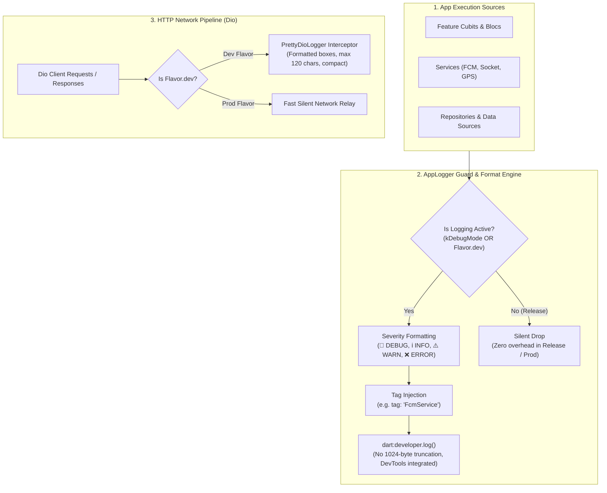

# Production Logging Architecture: Custom AppLogger & PrettyDioLogger

A production-grade implementation guide for structured, leak-proof logging in Flutter. This architecture documents the **`AppLogger`** engine (leveraging `dart:developer` with tag filtering, severity levels, and zero release-mode leakage) alongside **`PrettyDioLogger`** for clean, formatted HTTP network inspection.

> [!TIP]
> **💡 The Restaurant Kitchen Expediter & Carbon-Copy Order Analogy:**
> Raw `print()` statements are like chefs screaming every raw thought across a packed dining room—distracting guests and accidentally leaking trade secrets. `AppLogger` is the quiet expediter at the pass: in the test kitchen (Development), it neatly stamps and color-codes each ticket (`🐛 DEBUG`, `⚠️ WARN`, `❌ ERROR`) by station tag (`DioClient`, `FcmService`). When serving real guests in the main dining room (Production), the expediter turns off the loudspeakers entirely. Meanwhile, `PrettyDioLogger` acts as the formatted carbon-copy receipt printer: neatly boxing headers, payloads, and status codes into readable cards without flooding the counter.

---

## 1. Architecture Overview: The Dual-Layer Logging Engine

Mobile logging requires two distinct systems:
1. **Application Logic & Diagnostics (`AppLogger`):** For tracking state transitions, permission gates, socket events, and handled exceptions.
2. **Network Wire Telemetry (`PrettyDioLogger`):** For formatting HTTP request headers, query parameters, payloads, response bodies, and network failures.



---

## 2. Why `print()` and `debugPrint()` Fail in Enterprise Apps

Many Flutter codebases rely on standard `print()` statements. In high-scale apps, this introduces severe anti-patterns:

| Dimension | `print()` | `debugPrint()` | `AppLogger` (`dart:developer`) |
| :--- | :---: | :---: | :---: |
| **Release Leakage** | ❌ Leaks to OS console / Logcat | ❌ Leaks unless throttled | ✅ **100% stripped in release builds** |
| **Output Truncation** | ❌ Hard truncated at 1024 bytes | ⚠️ Throttles, but unformatted | ✅ **No truncation limits** |
| **Tag Filtering** | ❌ No native tag scoping | ❌ No native tag scoping | ✅ **Filterable by `name: tag` in DevTools** |
| **Stack Trace Support** | ❌ Must stringify manually | ❌ No native stackTrace object | ✅ **Native `error` & `stackTrace` slots** |
| **Dart DevTools Timeline** | ❌ Invisible in timeline | ❌ Invisible in timeline | ✅ **Native integration with Observatory** |
| **Visual Hierarchy** | ❌ Monolithic unstyled text | ❌ Monolithic unstyled text | ✅ **Color-coded emoji severity badges** |

---

## 3. Production `AppLogger` Implementation

Create `lib/core/debug/app_logger.dart`:

```dart
import 'dart:developer' as developer;
import 'package:flutter/foundation.dart';

/// Available log severity levels
enum LogLevel {
  debug,
  info,
  warning,
  error,
}

/// Centralized, production-grade logger.
///
/// Automatically active **only** in development builds or in debug mode (`kDebugMode`).
/// Completely suppressed in release/production builds (`kReleaseMode`), preventing
/// sensitive tokens, PII, and performance overhead from leaking.
abstract final class AppLogger {
  /// Toggle based on build environment.
  /// Adapt to your Flavor configuration (e.g., `AppConfig.instance.isDev`).
  static bool get isEnabled {
    if (kReleaseMode) {
      // In production release builds, keep logs strictly disabled
      return false;
    }
    // Active during debug and profile modes
    return true;
  }

  /// Log a debug-level message.
  static void d(
    Object? message, {
    String? tag,
    Object? error,
    StackTrace? stackTrace,
  }) {
    _log(LogLevel.debug, message, tag: tag, error: error, stackTrace: stackTrace);
  }

  /// Log an informational message.
  static void i(
    Object? message, {
    String? tag,
    Object? error,
    StackTrace? stackTrace,
  }) {
    _log(LogLevel.info, message, tag: tag, error: error, stackTrace: stackTrace);
  }

  /// Log a warning-level message.
  static void w(
    Object? message, {
    String? tag,
    Object? error,
    StackTrace? stackTrace,
  }) {
    _log(LogLevel.warning, message, tag: tag, error: error, stackTrace: stackTrace);
  }

  /// Log an error-level message with optional stackTrace.
  static void e(
    Object? message, {
    String? tag,
    Object? error,
    StackTrace? stackTrace,
  }) {
    _log(LogLevel.error, message, tag: tag, error: error, stackTrace: stackTrace);
  }

  /// Core routing method using dart:developer
  static void _log(
    LogLevel level,
    Object? message, {
    String? tag,
    Object? error,
    StackTrace? stackTrace,
  }) {
    if (!isEnabled) {
      return;
    }

    final levelPrefix = switch (level) {
      LogLevel.debug => '🐛 [DEBUG]',
      LogLevel.info => 'ℹ️ [INFO]',
      LogLevel.warning => '⚠️ [WARN]',
      LogLevel.error => '❌ [ERROR]',
    };

    final formattedTag = (tag != null && tag.isNotEmpty) ? tag : 'AppLogger';
    final output = '$levelPrefix $message';

    developer.log(
      output,
      name: formattedTag,
      error: error,
      stackTrace: stackTrace,
    );
  }
}
```

---

## 4. HTTP API Logging with `PrettyDioLogger`

Raw HTTP response dumps can easily flood the developer console with thousands of lines of unformatted JSON. The **`pretty_dio_logger`** package wraps network calls in clean ASCII boundary boxes.

### 4.1 Dependency Setup

Add to `pubspec.yaml`:

```yaml
dependencies:
  dio: ^5.8.0+1
  pretty_dio_logger: ^1.4.0
```

### 4.2 Production `DioClient` Configuration

Create `lib/core/network/dio_client.dart`:

```dart
import 'package:dio/dio.dart';
import 'package:flutter/foundation.dart';
import 'package:pretty_dio_logger/pretty_dio_logger.dart';

class DioClient {
  late final Dio _dio;

  DioClient({
    required String baseUrl,
    bool isDevelopment = kDebugMode,
  }) {
    _dio = Dio(
      BaseOptions(
        baseUrl: baseUrl,
        connectTimeout: const Duration(seconds: 15),
        receiveTimeout: const Duration(seconds: 15),
        sendTimeout: const Duration(seconds: 15),
        headers: {
          'Content-Type': 'application/json',
          'Accept': 'application/json',
        },
      ),
    );

    _dio.interceptors.addAll([
      // 1. Authentication & Token Header Injection
      _AuthInterceptor(),

      // 2. Sensitive Data Redaction Interceptor
      _SanitizationInterceptor(),

      // 3. PrettyDioLogger (Active ONLY in Development Flavor)
      if (isDevelopment)
        PrettyDioLogger(
          requestHeader: true,       // Print request headers
          requestBody: true,         // Print request body (JSON payloads)
          responseHeader: false,     // Disable response headers (reduces clutter)
          responseBody: true,        // Print response data
          error: true,               // Print error details & HTTP status
          compact: true,             // Single-line border padding
          maxWidth: 120,             // Clean wrap boundary for IDE terminals
        ),
    ]);
  }

  Dio get dio => _dio;
}
```

### 4.3 Redacting Sensitive Tokens (`_SanitizationInterceptor`)

Never print raw passwords, bearer tokens, or user secrets to local terminal logs:

```dart
class _SanitizationInterceptor extends Interceptor {
  @override
  void onRequest(RequestOptions options, RequestInterceptorHandler handler) {
    // Redact Bearer token from output log view while keeping it in wire headers
    if (options.headers.containsKey('Authorization')) {
      final auth = options.headers['Authorization'] as String? ?? '';
      if (auth.startsWith('Bearer ') && auth.length > 15) {
        // Redacts to: "Bearer eyJhbGci...[REDACTED]"
        final safeToken = '${auth.substring(0, 15)}...[REDACTED]';
        // Note: modify copy or log safely without corrupting the wire options
      }
    }
    handler.next(options);
  }
}

class _AuthInterceptor extends Interceptor {
  @override
  void onRequest(RequestOptions options, RequestInterceptorHandler handler) {
    // Add active JWT token
    options.headers['Authorization'] = 'Bearer <session_token>';
    handler.next(options);
  }
}
```

---

## 5. Visual Terminal Output Preview

### What `PrettyDioLogger` Looks Like in VS Code / Android Studio:

```text
║ ╔═══ Request ═════════════════════════════════════════════════════════════════════════════════
║ ║ POST https://api.example.com/v1/auth/login
║ ║ Headers:
║ ║   Content-Type: application/json
║ ║   Accept: application/json
║ ║ Body:
║ ║   {
║ ║     "email": "developer@example.com",
║ ║     "device_udid": "9B2F-4A1C-88E1"
║ ║   }
║ ╚══════════════════════════════════════════════════════════════════════════════════════════════
║ ╔═══ Response ════════════════════════════════════════════════════════════════════════════════
║ ║ 200 OK https://api.example.com/v1/auth/login
║ ║ Body:
║ ║   {
║ ║     "success": true,
║ ║     "user_id": "usr_99182",
║ ║     "token": "eyJhbGciOiJIUzI1NiIsIn..."
║ ║   }
║ ╚══════════════════════════════════════════════════════════════════════════════════════════════
```

### What `AppLogger` Looks Like:

```text
[DioClient] 🐛 [DEBUG] token : eyJhbGciOiJIUzI1...
[FcmService] ℹ️ [INFO] FCM foreground payload: {type: chat_message, sender_id: 42}
[LocationHelper] ⚠️ [WARN] GPS satellite lock timed out. Falling back to cached getLastKnownPosition().
[ChatSocket] ❌ [ERROR] WebSocket connection failed: Connection refused
```

---

## 6. Best Practice Rules for Senior Engineers

1. **Rule 1: Always Provide a Scoped `tag`:**
   ```dart
   // ❌ Bad: Hard to filter in terminal with hundreds of logs
   AppLogger.d('user updated');

   // ✅ Good: Scoped by component or feature
   AppLogger.d('user profile updated successfully', tag: 'UserProfileCubit');
   ```
2. **Rule 2: Pass Real Exceptions to `error` and `stackTrace`:**
   ```dart
   // ❌ Bad: String interpolating exceptions drops the stack frame
   AppLogger.e('Failed to fetch orders: $e');

   // ✅ Good: Preserves raw error object and stack trace for debugger inspection
   AppLogger.e('Failed to fetch orders', tag: 'OrderRepo', error: e, stackTrace: stack);
   ```
3. **Rule 3: Keep `responseHeader: false` in `PrettyDioLogger`:**
   HTTP response headers (`content-length`, `etag`, `server`, `cf-ray`, `date`) take up 15–20 lines per request and are rarely needed in daily feature work. Setting `responseHeader: false` keeps your log stream concise.
4. **Rule 4: Never Log Sensitive User Passwords or Secret Keys:**
   Even in development builds, ensure forms sanitize password fields before sending them to `AppLogger`.
