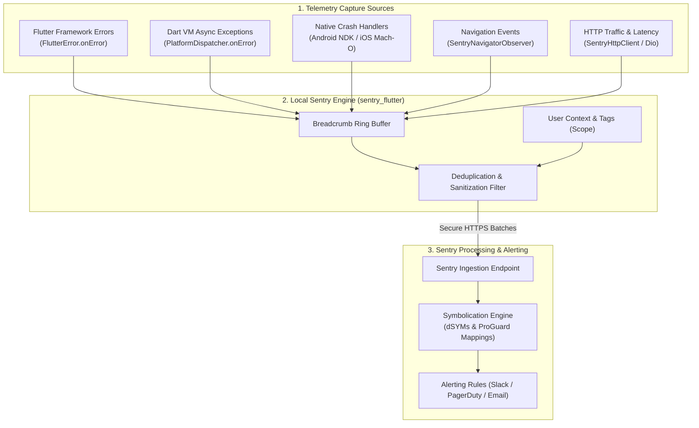

# Error Monitoring & Crash Reporting with Sentry: Complete Flutter Guide

A comprehensive, production-ready manual for implementing enterprise error monitoring and application performance telemetry in Flutter using **Sentry**. This guide details SDK initialization, global error boundaries, automated routing breadcrumbs, HTTP client interceptors, user scope assignment, release symbolication (Android ProGuard & iOS dSYMs), and sanitized configuration blueprints.

> [!TIP]
> **💡 The Aircraft Black Box & Telemetry Analogy:**
> When an airplane encounters turbulence or an engine flameout, investigators don't guess what broke—they pull the flight data recorder. Sentry is your app's digital black box: it tracks pilot control inputs (`SentryUserInteractionWidget`), navigation waypoint changes (`SentryNavigatorObserver`), radio messages (HTTP client spans), and engine alerts (breadcrumbs), reconstructing the exact seconds leading up to an unhandled crash.

---

## 1. Architecture & Telemetry Pipeline

Sentry acts as a unified real-time error and performance surveillance system. It instruments the Flutter engine, the Dart virtual machine, platform channels, native OS crashes (Java/Kotlin/Objective-C/Swift), and network layers into a single telemetry hub.



---

## 2. Dependencies & Prerequisites

Add `sentry_flutter` to your `pubspec.yaml`:

```yaml
dependencies:
  flutter:
    sdk: flutter
  sentry_flutter: ^8.11.0
  # Optional: for Dio HTTP tracking
  sentry_dio: ^8.11.0
```

---

## 3. Initialization & Global Error Hooks

Sentry replaces the standard `runApp()` call with `SentryFlutter.init()`. This sets up native Android/iOS crash reporters and Dart error listeners automatically.

### `lib/main.dart`

```dart
import 'package:flutter/material.dart';
import 'package:sentry_flutter/sentry_flutter.dart';
import 'package:my_app/app.dart';

Future<void> main() async {
  await SentryFlutter.init(
    (options) {
      // 1. Sentry Ingestion DSN (Keep confidential)
      options.dsn = 'https://examplePublicKey@o0.ingest.sentry.io/0';

      // 2. Performance Monitoring & Distributed Tracing
      // Use 1.0 during QA/Staging, lower (e.g. 0.1 = 10%) in high-traffic production
      options.tracesSampleRate = 0.2;

      // 3. Environment & Release Tagging
      options.environment = const String.fromEnvironment('ENV', defaultValue: 'production');
      options.release = 'com.example.app@2.1.0+42';

      // 4. Native Crash & Profiling Support
      options.enableAutoSessionTracking = true;
      options.attachScreenshot = false; // Set true only if privacy policy permits
      options.attachViewHierarchy = false;

      // 5. Breadcrumb Configuration
      options.maxBreadcrumbs = 100;

      // 6. Data Sanitization / Privacy Filter (Zero-Knowledge Compliance)
      options.beforeSend = (event, hint) {
        // Strip sensitive user passwords or tokens if they appear in logs
        if (event.exceptions != null) {
          for (final exception in event.exceptions!) {
            if (exception.value?.contains('Bearer') ?? false) {
              exception.value = exception.value?.replaceAll(
                RegExp(r'Bearer\s+[A-Za-z0-9\-._~+/]+=*'),
                'Bearer [REDACTED]',
              );
            }
          }
        }
        return event;
      };
    },
    // The Flutter app runner callback
    appRunner: () => runApp(
      // SentryUserInteractionWidget instruments tap and click breadcrumbs automatically
      const SentryUserInteractionWidget(
        child: MyApp(),
      ),
    ),
  );
}
```

---

## 4. Automatic Navigation & Route Breadcrumbs

Instrument screen transitions by attaching `SentryNavigatorObserver` to your routing configuration:

### With Standard `MaterialApp`
```dart
MaterialApp(
  navigatorObservers: [
    SentryNavigatorObserver(),
  ],
  home: const HomePage(),
);
```

### With `go_router`
```dart
final goRouter = GoRouter(
  observers: [
    SentryNavigatorObserver(),
  ],
  routes: [ ... ],
);
```

Every page transition is automatically recorded in the event breadcrumbs timeline with route names and timestamps.

---

## 5. Network Request Telemetry (HTTP & Dio)

### Using Standard `http.Client`
Wrap your client using `SentryHttpClient`:

```dart
import 'package:http/http.dart' as http;
import 'package:sentry_flutter/sentry_flutter.dart';

final client = SentryHttpClient(
  client: http.Client(),
  failedRequestStatusCodes: [
    SentryStatusCode.range(400, 599),
  ],
);
```

### Using `Dio` with `sentry_dio`
Add the Sentry interceptor directly into your Dio instance:

```dart
import 'package:dio/dio.dart';
import 'package:sentry_dio/sentry_dio.dart';

final dio = Dio();
dio.addSentry(); // Automatically tracks HTTP request durations, status codes, and errors
```

---

## 6. Capturing Exceptions, Breadcrumbs & User Context

### Step 6.1: Manual Exception Capture
```dart
try {
  await repository.fetchCriticalData();
} catch (exception, stackTrace) {
  // Capture unhandled error with stacktrace and additional metadata
  await Sentry.captureException(
    exception,
    stackTrace: stackTrace,
    hint: Hint.withMap({
      'feature': 'checkout',
      'attempt': 2,
    }),
  );
}
```

### Step 6.2: Adding Custom Breadcrumbs
Breadcrumbs provide forensic context leading up to a crash:

```dart
Sentry.addBreadcrumb(
  Breadcrumb(
    category: 'auth',
    message: 'User initiated biometric authentication',
    level: SentryLevel.info,
    data: {
      'method': 'FaceID',
    },
  ),
);
```

### Step 6.3: Setting User Scope & Global Tags
Attach sanitized user IDs and device states upon authentication:

```dart
// On user login
await Sentry.configureScope((scope) {
  scope.setUser(SentryUser(
    id: 'user_987654', // Never send plaintext emails or PII unless compliant
    data: {
      'tier': 'enterprise',
      'region': 'EU',
    },
  ));
  scope.setTag('subscription_status', 'active');
});

// On user logout
await Sentry.configureScope((scope) {
  scope.setUser(null);
  scope.clearBreadcrumbs();
});
```

---

## 7. Native Symbolication Setup (Android & iOS)

Without symbolication files, production crash reports display unreadable memory addresses (`0x0000000104a0e...`) instead of Dart line numbers and file names.

### Android ProGuard Mappings
Add Sentry's Gradle plugin to `android/build.gradle`:

```kotlin
plugins {
    id("io.sentry.android.gradle") version "4.14.0" apply false
}
```

In `android/app/build.gradle.kts`:
```kotlin
plugins {
    id("com.android.application")
    id("kotlin-android")
    id("io.sentry.android.gradle")
}

sentry {
    // Automatically uploads ProGuard mapping.txt to Sentry on release build
    uploadNativeSymbols.set(true)
    includeProguardMapping.set(true)
    autoUploadProguardMapping.set(true)
}
```

### iOS dSYM Symbolication via Fastlane
In your iOS Fastlane pipeline, upload dSYMs automatically:

```ruby
lane :upload_dsyms do
  sentry_upload_dsym(
    auth_token: ENV["SENTRY_AUTH_TOKEN"],
    org_slug: "my-organization",
    project_slug: "my-flutter-app",
    dsym_path: "./build/ios/archive/Runner.xcarchive/dSYMs"
  )
end
```

---

## 8. Verification & Production Checklist

| Step | Verification Command / Metric | Expected Outcome |
| :--- | :--- | :--- |
| **Test Event Capture** | `Sentry.captureMessage('Test Verification Event')` | Event appears immediately in Sentry dashboard within 5 seconds. |
| **Crashlytics Coexistence** | Trigger synthetic crash | Both Sentry and Firebase Crashlytics receive the stack trace. |
| **Sanitization** | Trigger error containing auth header | `Bearer [REDACTED]` displayed in Sentry console, no raw bearer tokens. |
| **Release Matching** | Verify `options.release` matches store build | Symbolication maps match `version+buildNumber` precisely. |
| **Breadcrumb Limit** | Check memory footprint on low-end devices | `maxBreadcrumbs = 100` prevents OOM memory leaks. |

