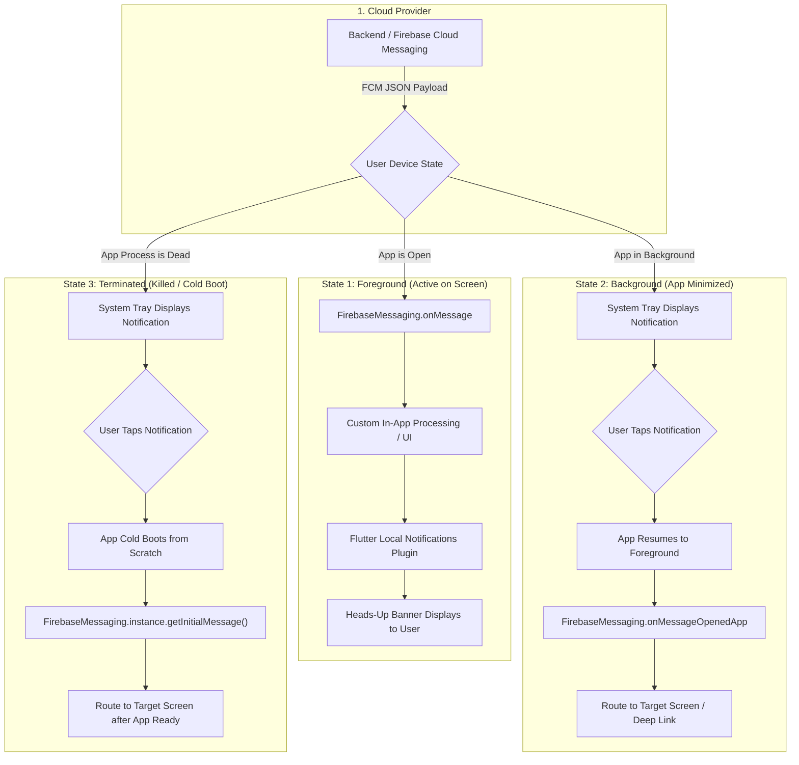
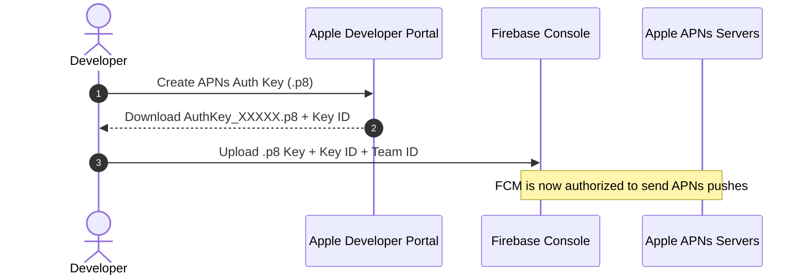

# Complete Flutter Push Notifications Guide: Foreground, Background & Terminated States

A complete, production-ready manual for implementing push notifications in Flutter using **Firebase Cloud Messaging (FCM)** and **Flutter Local Notifications**. This guide covers every console configuration step across **Google Firebase Console** and **Apple Developer Portal (APNs)**, native setup for Android and iOS, and an end-to-end, battle-tested Dart implementation that seamlessly handles notifications across **Foreground**, **Background**, and **Terminated (Killed)** app states with deep-link navigation.

> [!TIP]
> **💡 The Front Porch Doorbell vs Wake-Up Telegram Analogy:**
> When you're sitting in the living room reading (Foreground), the delivery courier rings the chime for an immediate heads-up banner. When you're resting in the bedroom (Background), the courier slides a receipt under the door into the system tray. And when the house is completely dark and locked up (Terminated state), an urgent telegram arrives: turning the key in the front door wakes the house up and guides you straight to the desk to read the open dispatch (cold-boot tap navigation).

---

## 1. Architecture & The Three Application States

Push notifications behave fundamentally differently depending on whether your application is active on screen, paused in the background, or completely terminated by the user or operating system:



### Notification Behavior Summary Matrix

| App State | Who Displays the Banner? | Dart Handler Triggered | Tap Navigation Entrypoint |
|---|---|---|---|
| **Foreground** (App open) | `FlutterLocalNotificationsPlugin` (OS suppresses banner by default) | `FirebaseMessaging.onMessage` | `onDidReceiveNotificationResponse` |
| **Background** (Minimized) | Operating System (Android / iOS Notification Center) | Top-level `@pragma('vm:entry-point')` background isolate | `FirebaseMessaging.onMessageOpenedApp` |
| **Terminated** (Killed) | Operating System (Android / iOS Notification Center) | Top-level background handler (if data-only) | `FirebaseMessaging.getInitialMessage()` & `getNotificationAppLaunchDetails()` |

---

## 2. Console Setup & Cloud Credentials

### Step 2.1: Firebase Console Setup
1. Open the [Firebase Console](https://console.firebase.google.com/) and create or select your project.
2. Register your **Android App**:
   - Provide your package name (e.g. `com.example.app`).
   - Download `google-services.json` and place it in `android/app/google-services.json`.
3. Register your **Apple App**:
   - Provide your bundle identifier (e.g. `com.example.app`).
   - Download `GoogleService-Info.plist` and place it in `ios/Runner/GoogleService-Info.plist` via Xcode.
4. In Firebase Console, go to **Project Settings** &rarr; **Cloud Messaging** &rarr; verify the **Firebase Cloud Messaging API (V1)** is enabled.

### Step 2.2: Apple Developer Portal & APNs Authentication Key (`.p8`)
iOS requires communication between Firebase Cloud Messaging and the **Apple Push Notification service (APNs)**:

1. Open [Apple Developer Portal](https://developer.apple.com/account/) &rarr; **Certificates, Identifiers & Profiles** &rarr; **Identifiers**.
2. Select your App ID &rarr; under **Capabilities**, check **Push Notifications** &rarr; click **Save**.
3. In the left sidebar, navigate to **Keys** &rarr; click **+** (Create a Key).
4. Name the key (e.g., `Apple Push Notifications Key`), check **Apple Push Notifications service (APNs)**, and click **Continue** &rarr; **Register**.
5. Download the `.p8` key file. Note your **Key ID** (10 characters) and **Team ID** (found top right in Developer Portal).



6. Return to **Firebase Console** &rarr; **Project Settings** &rarr; **Cloud Messaging** &rarr; scroll to **Apple app configuration**.
7. Under **APNs Authentication Key**, click **Upload** &rarr; upload your `.p8` file, enter the **Key ID** and **Team ID**, and click **Save**.

---

## 3. Native Platform Configuration

### Step 3.1: Android Setup

#### 1. Android Manifest Permissions
Open `android/app/src/main/AndroidManifest.xml` and add the following permissions inside `<manifest>`:

```xml
<!-- Required for Android 13+ (API 33+) runtime notification prompt -->
<uses-permission android:name="android.permission.POST_NOTIFICATIONS"/>
<uses-permission android:name="android.permission.INTERNET"/>
<uses-permission android:name="android.permission.VIBRATE" />
<uses-permission android:name="android.permission.RECEIVE_BOOT_COMPLETED"/>
```

#### 2. Default Notification Icon & Channel Metadata
Inside `<application>` in `android/app/src/main/AndroidManifest.xml`, declare the default channel ID and small status bar icon:

```xml
<!-- Sets default small icon in status bar (must be a white silhouette on transparent background) -->
<meta-data
    android:name="com.google.firebase.messaging.default_notification_icon"
    android:resource="@mipmap/ic_launcher" />

<!-- Sets default notification color accent -->
<meta-data
    android:name="com.google.firebase.messaging.default_notification_color"
    android:resource="@color/notification_accent" />

<!-- Default Notification Channel ID for background notifications -->
<meta-data
    android:name="com.google.firebase.messaging.default_notification_channel_id"
    android:value="high_importance_channel" />
```

#### 3. Gradle Dependencies
In `android/settings.gradle.kts`:
```kotlin
plugins {
    id("com.google.gms.google-services") version "4.4.2" apply false
}
```

In `android/app/build.gradle.kts`:
```kotlin
plugins {
    id("com.android.application")
    id("kotlin-android")
    id("dev.flutter.flutter-gradle-plugin")
    id("com.google.gms.google-services") // Apply Google Services plugin
}

android {
    defaultConfig {
        minSdk = 23 // Minimum Android 6.0+
        targetSdk = 34
    }
}
```

---

### Step 3.2: iOS Setup

#### 1. Enable Xcode Capabilities
Open your iOS project in Xcode (`open ios/Runner.xcworkspace`):
1. Select the **Runner** project in the project navigator.
2. Select the **Runner** target &rarr; **Signing & Capabilities** tab &rarr; click **+ Capability**.
3. Add **Push Notifications**.
4. Click **+ Capability** again &rarr; add **Background Modes**.
5. Under **Background Modes**, check:
   - [x] **Remote notifications**
   - [x] **Background fetch**

#### 2. Update `ios/Runner/AppDelegate.swift`
Ensure iOS registers for APNs remote notifications on launch:

```swift
import UIKit
import Flutter
import FirebaseCore
import FirebaseMessaging

@main
@objc class AppDelegate: FlutterAppDelegate {
  override func application(
    _ application: UIApplication,
    didFinishLaunchingWithOptions launchOptions: [UIApplication.LaunchOptionsKey: Any]?
  ) -> Bool {
    // Register for remote notifications on app launch
    if #available(iOS 10.0, *) {
      UNUserNotificationCenter.current().delegate = self as? UNUserNotificationCenterDelegate
    }
    application.registerForRemoteNotifications()

    GeneratedPluginRegistrant.register(with: self)
    return super.application(application, didFinishLaunchingWithOptions: launchOptions)
  }

  // Forward APNs device token to Firebase Messaging
  override func application(
    _ application: UIApplication,
    didRegisterForRemoteNotificationsWithDeviceToken deviceToken: Data
  ) {
    Messaging.messaging().apnsToken = deviceToken
    super.application(application, didRegisterForRemoteNotificationsWithDeviceToken: deviceToken)
  }
}
```

---

## 4. Flutter Dependencies (`pubspec.yaml`)

Add the required packages to your Flutter project:

```yaml
dependencies:
  flutter:
    sdk: flutter
  firebase_core: ^3.10.0
  firebase_messaging: ^15.2.0
  flutter_local_notifications: ^18.0.1
```

Run:
```bash
flutter pub get
```

---

## 5. Complete Production Implementation (`NotificationService`)

Here is the complete, self-contained `NotificationService` that handles:
- Foreground presentation via `flutter_local_notifications`
- Android 13+ runtime permissions
- Dedicated Android notification channels
- Background isolate message handling
- Terminated state cold boot tap handling
- Deep-link payload dispatching

Create `lib/core/notifications/notification_service.dart`:

```dart
import 'dart:async';
import 'dart:convert';
import 'dart:io';
import 'package:firebase_core/firebase_core.dart';
import 'package:firebase_messaging/firebase_messaging.dart';
import 'package:flutter/foundation.dart';
import 'package:flutter_local_notifications/flutter_local_notifications.dart';

/// Top-level background message handler.
/// MUST be declared as a top-level function outside any class with the
/// @pragma('vm:entry-point') annotation so the Flutter engine can invoke it
/// inside an isolated background Dart isolate.
@pragma('vm:entry-point')
Future<void> firebaseMessagingBackgroundHandler(RemoteMessage message) async {
  // Ensure Firebase is initialized within the background isolate
  await Firebase.initializeApp();
  debugPrint('FCM background message received: ${message.messageId}');
}

class NotificationService {
  NotificationService._();
  static final NotificationService instance = NotificationService._();

  final FirebaseMessaging _messaging = FirebaseMessaging.instance;
  final FlutterLocalNotificationsPlugin _localNotifications =
      FlutterLocalNotificationsPlugin();

  // Notification Channel Definition for Android 8.0+ (API 26+)
  static const AndroidNotificationChannel _highImportanceChannel =
      AndroidNotificationChannel(
    'high_importance_channel',
    'High Importance Notifications',
    description: 'This channel is used for essential alert notifications.',
    importance: Importance.max,
    playSound: true,
    enableVibration: true,
  );

  bool _isInitialized = false;

  /// Callback hook invoked when a user taps a notification in any state
  Function(Map<String, dynamic> data)? onNotificationTapped;

  /// Initializes push notifications and hooks up all lifecycle handlers
  Future<void> initialize({Function(Map<String, dynamic> data)? onNotificationTap}) async {
    if (_isInitialized) return;
    onNotificationTapped = onNotificationTap;

    // 1. Request permissions (Android 13+ and iOS)
    await requestPermission();

    // 2. Configure Local Notifications for foreground display
    await _initializeLocalNotifications();

    // 3. Configure foreground presentation options for iOS
    await _messaging.setForegroundNotificationPresentationOptions(
      alert: false, // Handled manually by local notifications to avoid duplicate banners
      badge: true,
      sound: true,
    );

    // 4. Hook up the 3 state listeners
    _listenForegroundMessages();
    _listenBackgroundMessageTaps();
    await _handleTerminatedStateMessage();

    // 5. Setup Token Refresh Listener
    _listenTokenRefresh();

    _isInitialized = true;
    debugPrint('NotificationService initialized successfully.');
  }

  /// Requests runtime notification permissions
  Future<NotificationSettings> requestPermission() async {
    final settings = await _messaging.requestPermission(
      alert: true,
      badge: true,
      sound: true,
      provisional: false,
    );

    debugPrint('Push notification permission status: ${settings.authorizationStatus}');
    return settings;
  }

  /// Retrieves the device FCM Registration Token
  Future<String?> getToken() async {
    try {
      // On iOS, ensure APNs token is minted before requesting FCM token
      if (!kIsWeb && Platform.isIOS) {
        final apnsToken = await _messaging.getAPNSToken();
        if (apnsToken == null) {
          // Wait briefly for iOS APNs token generation
          await Future.delayed(const Duration(milliseconds: 500));
        }
      }

      final token = await _messaging.getToken();
      debugPrint('Device FCM Token: $token');
      return token;
    } catch (e) {
      debugPrint('Failed to get FCM token: $e');
      return null;
    }
  }

  /// Initialize local notifications for rendering foreground banners
  Future<void> _initializeLocalNotifications() async {
    const androidSettings = AndroidInitializationSettings('@mipmap/ic_launcher');
    const darwinSettings = DarwinInitializationSettings(
      requestAlertPermission: false,
      requestBadgePermission: false,
      requestSoundPermission: false,
    );

    const initSettings = InitializationSettings(
      android: androidSettings,
      iOS: darwinSettings,
    );

    // Create the high importance channel on Android
    final androidPlugin = _localNotifications
        .resolvePlatformSpecificImplementation<AndroidFlutterLocalNotificationsPlugin>();
    if (androidPlugin != null) {
      await androidPlugin.createNotificationChannel(_highImportanceChannel);
    }

    await _localNotifications.initialize(
      initSettings,
      onDidReceiveNotificationResponse: (NotificationResponse response) {
        if (response.payload != null && response.payload!.isNotEmpty) {
          try {
            final Map<String, dynamic> data = jsonDecode(response.payload!);
            onNotificationTapped?.call(data);
          } catch (_) {}
        }
      },
    );
  }

  /// STATE 1: FOREGROUND (App is currently open and focused)
  void _listenForegroundMessages() {
    FirebaseMessaging.onMessage.listen((RemoteMessage message) async {
      debugPrint('Foreground push received: ${message.data}');

      final notification = message.notification;
      final android = message.notification?.android;

      // Present a Heads-Up banner using Flutter Local Notifications
      if (notification != null && !kIsWeb) {
        await _localNotifications.show(
          notification.hashCode,
          notification.title,
          notification.body,
          NotificationDetails(
            android: AndroidNotificationDetails(
              _highImportanceChannel.id,
              _highImportanceChannel.name,
              channelDescription: _highImportanceChannel.description,
              importance: Importance.max,
              priority: Priority.high,
              icon: android?.smallIcon ?? '@mipmap/ic_launcher',
            ),
            iOS: const DarwinNotificationDetails(
              presentAlert: true,
              presentBadge: true,
              presentSound: true,
            ),
          ),
          payload: jsonEncode(message.data),
        );
      }
    });
  }

  /// STATE 2: BACKGROUND (App minimized, user taps notification in system tray)
  void _listenBackgroundMessageTaps() {
    FirebaseMessaging.onMessageOpenedApp.listen((RemoteMessage message) {
      debugPrint('App opened from background via notification tap: ${message.data}');
      onNotificationTapped?.call(message.data);
    });
  }

  /// STATE 3: TERMINATED (App killed completely, cold-booted via notification tap)
  Future<void> _handleTerminatedStateMessage() async {
    // Check if app was cold-booted from an FCM push
    final initialMessage = await _messaging.getInitialMessage();
    if (initialMessage != null) {
      debugPrint('App cold-booted from FCM notification: ${initialMessage.data}');
      // Delay slightly to allow Flutter widget tree and navigation router to mount
      Future.delayed(const Duration(milliseconds: 300), () {
        onNotificationTapped?.call(initialMessage.data);
      });
      return;
    }

    // Check if app was cold-booted from a Local Notification tap
    final launchDetails =
        await _localNotifications.getNotificationAppLaunchDetails();
    if (launchDetails?.didNotificationLaunchApp == true &&
        launchDetails?.notificationResponse?.payload != null) {
      try {
        final Map<String, dynamic> data =
            jsonDecode(launchDetails!.notificationResponse!.payload!);
        Future.delayed(const Duration(milliseconds: 300), () {
          onNotificationTapped?.call(data);
        });
      } catch (_) {}
    }
  }

  /// Listen for FCM Token rotations (e.g. app restore, data clear)
  void _listenTokenRefresh() {
    _messaging.onTokenRefresh.listen((newToken) {
      debugPrint('FCM Token refreshed: $newToken');
      // Transmit updated token to your backend API here
    });
  }
}
```

---

## 6. App Integration (`main.dart`)

Integrate `NotificationService` inside your app's `main()` function:

```dart
// lib/main.dart
import 'package:flutter/material.dart';
import 'package:firebase_core/firebase_core.dart';
import 'package:firebase_messaging/firebase_messaging.dart';
import 'core/notifications/notification_service.dart';

final GlobalKey<NavigatorState> navigatorKey = GlobalKey<NavigatorState>();

void main() async {
  WidgetsFlutterBinding.ensureInitialized();

  // 1. Initialize Firebase Core
  await Firebase.initializeApp();

  // 2. Register Background Message Handler
  FirebaseMessaging.onBackgroundMessage(firebaseMessagingBackgroundHandler);

  // 3. Initialize Push Notification Service with Tap Navigation Handler
  await NotificationService.instance.initialize(
    onNotificationTap: (Map<String, dynamic> data) {
      debugPrint('Handling navigation for notification data: $data');
      
      final route = data['route'] as String?;
      final itemId = data['id'] as String?;

      if (route == '/details' && itemId != null) {
        navigatorKey.currentState?.pushNamed('/details', arguments: itemId);
      }
    },
  );

  runApp(const MyApp());
}

class MyApp extends StatelessWidget {
  const MyApp({super.key});

  @override
  Widget build(BuildContext context) {
    return MaterialApp(
      navigatorKey: navigatorKey,
      title: 'Push Notifications Demo',
      theme: ThemeData.dark(),
      home: const HomeScreen(),
      routes: {
        '/details': (context) => const DetailsScreen(),
      },
    );
  }
}

class HomeScreen extends StatelessWidget {
  const HomeScreen({super.key});

  @override
  Widget build(BuildContext context) {
    return Scaffold(
      appBar: AppBar(title: const Text('Notifications Home')),
      body: Center(
        child: ElevatedButton(
          onPressed: () async {
            final token = await NotificationService.instance.getToken();
            debugPrint('FCM Token: $token');
          },
          child: const Text('Print FCM Token'),
        ),
      ),
    );
  }
}

class DetailsScreen extends StatelessWidget {
  const DetailsScreen({super.key});

  @override
  Widget build(BuildContext context) {
    final id = ModalRoute.of(context)?.settings.arguments as String?;
    return Scaffold(
      appBar: AppBar(title: const Text('Notification Details')),
      body: Center(child: Text('Opened with Item ID: $id')),
    );
  }
}
```

---

## 7. Testing Payloads with cURL & HTTP v1 API

To verify that all 3 states work properly, send a test payload using the Firebase Cloud Messaging v1 API:

```json
{
  "message": {
    "token": "<DEVICE_FCM_REGISTRATION_TOKEN>",
    "notification": {
      "title": "New Order Received! 🚀",
      "body": "Tap to inspect details for Order #9842."
    },
    "data": {
      "route": "/details",
      "id": "9842",
      "click_action": "FLUTTER_NOTIFICATION_CLICK"
    },
    "android": {
      "priority": "high",
      "notification": {
        "channel_id": "high_importance_channel",
        "sound": "default"
      }
    },
    "apns": {
      "payload": {
        "aps": {
          "sound": "default",
          "badge": 1
        }
      }
    }
  }
}
```

---

## 8. Troubleshooting & Common Pitfalls Checklist

> [!CAUTION]
> **Android 13+ Permissions**: Calling `requestPermission()` before creating the Android Notification Channel can cause Android to ignore notification alerts. Always create the `AndroidNotificationChannel` prior to requesting permissions.

- **Duplicate Sound in Foreground**: On iOS, setting `alert: true` in `setForegroundNotificationPresentationOptions` while also displaying a banner via `flutter_local_notifications` will play the sound twice. Set `alert: false` in `setForegroundNotificationPresentationOptions`.
- **Top-Level Function Requirement**: `firebaseMessagingBackgroundHandler` MUST be a top-level function outside any class, marked with `@pragma('vm:entry-point')`. If placed inside a class or closure, background and terminated push processing will crash with an isolate reflection error.
- **iOS APNs Token Delay**: On physical iOS devices, `FirebaseMessaging.instance.getToken()` can occasionally return `null` on first launch if the APNs device token hasn't finished registering with Apple's servers. Always call `await FirebaseMessaging.instance.getAPNSToken()` first.
- **Simulator Limitations**: iOS Simulators running on macOS 13+ support remote notifications, but physical devices remain the gold standard for testing APNs delivery and cold-boot navigation.

