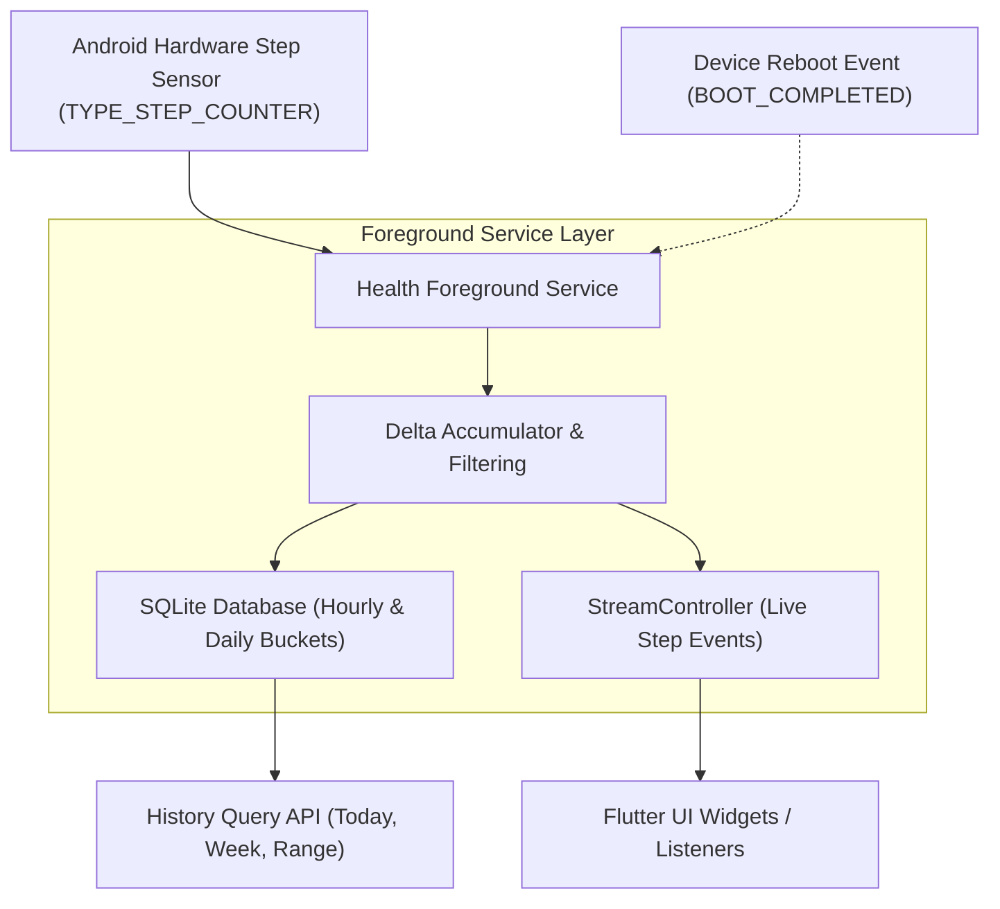

# Accurate Step Counter: Android Hardware Step Sensor & Health Service

[](https://pub.dev/packages/accurate_step_counter)
[](https://opensource.org/licenses/MIT)

- **pub.dev**: [https://pub.dev/packages/accurate_step_counter](https://pub.dev/packages/accurate_step_counter)
- **GitHub**: [https://github.com/rahulshahDEV/accurate_step_counter](https://github.com/rahulshahDEV/accurate_step_counter)

`accurate_step_counter` provides battery-efficient, reliable step tracking for **Android API 24+** using the device's hardware step counter sensor (`Sensor.TYPE_STEP_COUNTER`) combined with an Android Health Foreground Service, live stream broadcasts, and local SQLite historical storage.

> [!TIP]
> **💡 The Mechanical Bicycle Odometer Analogy:**
> Software step counters are like strapping a power-hungry video camera to your bicycle pedals to calculate wheel spins—draining your battery in hours and stopping the second the screen locks. `accurate_step_counter` instead reads the phone's dedicated silicon odometer gear (`Sensor.TYPE_STEP_COUNTER`), which ticks using almost zero microwatts while the main CPU sleeps, protected by a Foreground Service shield so Android never terminates it.

---

## 1. Architecture & Background Tracking



---

## 2. Key Features

- **🔋 Hardware Sensor Efficiency**: Uses the device hardware step counter instead of continuous accelerometer polling, reducing battery consumption to near zero.
- **🛡️ Android Health Foreground Service**: Prevents the operating system from terminating the step tracking process when the app is minimized or the screen is locked.
- **💾 SQLite Persistence**: Automatically groups and persists step counts into hourly and daily buckets.
- **🔄 Reboot Recovery**: Restores the baseline step count across device restarts without losing uncommitted steps.
- **📡 Real-Time Streams**: Broadcasts live step count updates to the Flutter UI via standard Dart streams.

> [!IMPORTANT]
> `accurate_step_counter` version 4.0.0 is dedicated strictly to Android (API 24+). iOS and Web platforms are not supported.

---

## 3. Installation & Android Setup

### 3.1: Add Package Dependencies
```bash
flutter pub add accurate_step_counter permission_handler
```

### 3.2: Configure Android SDK Constraints
In `android/app/build.gradle.kts`:
```kotlin
android {
    defaultConfig {
        minSdk = 24       // Minimum supported Android version
        compileSdk = 34
    }
}
```

### 3.3: Permissions in `AndroidManifest.xml`
The package's Android manifest automatically merges required background services and hardware sensor declarations into your application. Ensure your `android/app/src/main/AndroidManifest.xml` includes runtime permissions:

```xml
<manifest xmlns:android="http://schemas.android.com/apk/res/android">
    <!-- Required for step tracking on Android 10+ (API 29+) -->
    <uses-permission android:name="android.permission.ACTIVITY_RECOGNITION"/>
    
    <!-- Required for foreground service persistence on Android 14+ (API 34+) -->
    <uses-permission android:name="android.permission.FOREGROUND_SERVICE"/>
    <uses-permission android:name="android.permission.FOREGROUND_SERVICE_HEALTH"/>
    
    <!-- Required for notification display on Android 13+ (API 33+) -->
    <uses-permission android:name="android.permission.POST_NOTIFICATIONS"/>
    <uses-permission android:name="android.permission.RECEIVE_BOOT_COMPLETED"/>
</manifest>
```

---

## 4. Implementation Guide

### 4.1: Request Permissions & Start Tracking
Use a singleton instance for your application lifecycle:

```dart
import 'package:flutter/material.dart';
import 'package:accurate_step_counter/accurate_step_counter.dart';
import 'package:permission_handler/permission_handler.dart';

class StepTrackingService {
  StepTrackingService._();
  static final StepTrackingService instance = StepTrackingService._();

  final AccurateStepCounter _stepCounter = AccurateStepCounter();

  Future<bool> initializeAndStart() async {
    // 1. Request Activity Recognition (Android 10+)
    final activityStatus = await Permission.activityRecognition.request();
    if (!activityStatus.isGranted) {
      debugPrint('Activity recognition permission denied.');
      return false;
    }

    // 2. Request Notification Permission (Android 13+ for foreground service notification)
    if (await Permission.notification.isDenied) {
      await Permission.notification.request();
    }

    // 3. Start hardware tracking & initialize SQLite storage
    final started = await _stepCounter.startTracking(
      notificationTitle: 'Step Counter Active',
      notificationContent: 'Tracking your daily movement in background.',
    );

    debugPrint('Step tracking started: $started');
    return started;
  }

  /// Real-time live step count stream
  Stream<int> get liveStepsStream => _stepCounter.stepStream;

  /// Query total steps accumulated today
  Future<int> getTodaySteps() async {
    return await _stepCounter.getTodaySteps();
  }

  /// Stop tracking service
  Future<void> stop() async {
    await _stepCounter.stopTracking();
  }
}
```

### 4.2: Building a Real-Time Step Counter Widget
Display live steps that update continuously without polling:

```dart
import 'package:flutter/material.dart';
import 'step_tracking_service.dart';

class StepCounterWidget extends StatefulWidget {
  const StepCounterWidget({super.key});

  @override
  State<StepCounterWidget> createState() => _StepCounterWidgetState();
}

class _StepCounterWidgetState extends State<StepCounterWidget> {
  int _currentSteps = 0;

  @override
  void initState() {
    super.initState();
    _loadInitialSteps();
    _listenToLiveUpdates();
  }

  Future<void> _loadInitialSteps() async {
    final steps = await StepTrackingService.instance.getTodaySteps();
    if (mounted) setState(() => _currentSteps = steps);
  }

  void _listenToLiveUpdates() {
    StepTrackingService.instance.liveStepsStream.listen((steps) {
      if (mounted) setState(() => _currentSteps = steps);
    });
  }

  @override
  Widget build(BuildContext context) {
    return Card(
      color: const Color(0xFF1E1E1E),
      shape: RoundedRectangleBorder(borderRadius: BorderRadius.circular(16)),
      child: Padding(
        padding: const EdgeInsets.all(24.0),
        child: Column(
          mainAxisSize: MainAxisSize.min,
          children: [
            const Icon(Icons.directions_walk, size: 48, color: Colors.blueAccent),
            const SizedBox(height: 12),
            Text(
              '$_currentSteps',
              style: const TextStyle(fontSize: 42, fontWeight: FontWeight.bold, color: Colors.white),
            ),
            const Text(
              'Steps Today',
              style: TextStyle(color: Colors.white54, fontSize: 14),
            ),
          ],
        ),
      ),
    );
  }
}
```

### 4.3: Querying Historical Step Records
Query SQLite history to plot weekly activity charts or review past days:

```dart
Future<void> printWeeklySummary() async {
  final stepCounter = AccurateStepCounter();
  
  final now = DateTime.now();
  final sevenDaysAgo = now.subtract(const Duration(days: 7));

  // Retrieve daily step records
  final List<DailyStepRecord> history = await stepCounter.getDailyHistory(
    startDate: sevenDaysAgo,
    endDate: now,
  );

  for (final record in history) {
    debugPrint('${record.date}: ${record.stepCount} steps');
  }
}
```

