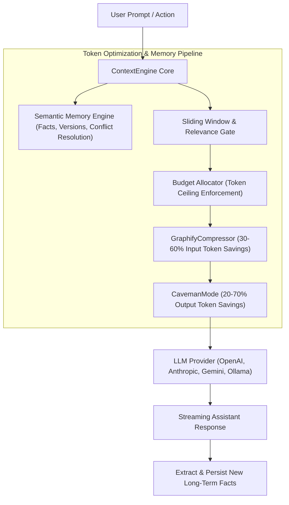

# ContextEngine: Provider-Agnostic AI Context & Semantic Memory Layer

[](https://pub.dev/packages/contextengine)
[](https://opensource.org/licenses/MIT)

- **pub.dev**: [https://pub.dev/packages/contextengine](https://pub.dev/packages/contextengine)
- **GitHub**: [https://github.com/rahulshahDEV/context_engine](https://github.com/rahulshahDEV/context_engine)

`contextengine` is a provider-agnostic AI orchestration, memory, and context-optimization layer for Flutter and Dart applications (iOS, Android, macOS, Windows, Linux). It sits between your mobile/desktop client and any LLM provider (OpenAI, Gemini, Anthropic, Ollama), managing prompt generation, conversation trimming, and token reduction automatically.

> [!TIP]
> **💡 The Executive Chief of Staff & Telegram Shorthand Analogy:**
> Handing an LLM 50 unformatted conversation turns is like dropping a 200-page chaotic binder on a busy CEO's desk—wasting thousands of dollars in token fees while the model forgets core facts. `contextengine` acts as an elite Chief of Staff: it indexes past memories, strips out filler words with Graphify and CavemanMode algorithms (slashing token bills by 30–60%), and delivers a razor-sharp executive briefing.

---

## 1. Architecture: The AI Context Pipeline



---

## 2. Key Capabilities

- **🧠 Structured Memory Engine**: Stores persistent user facts, relationship data, and profile state. Features automatic conflict resolution and fact versioning.
- **⚡ GraphifyCompressor (Input Optimization)**: Compresses natural-language context into compact structural shorthands and symbol representations, reducing input token overhead by **30% to 60%** without losing semantic meaning.
- **🗿 CavemanMode (Output Optimization)**: Injects targeted brevity directives and output token caps, driving output token savings between **20% and 70%** for cost-sensitive mobile chat.
- **🎯 Dynamic Budget Allocator**: Automatically prioritizes system directives, recent conversation turns, and retrieved memory facts to fit within strict token ceilings (e.g. 2k, 4k, or 8k tokens).
- **🔌 Provider Agnostic**: Compatible with any model provider via a standard adapter contract.

> [!NOTE]
> `contextengine` is designed for mobile and desktop platforms (iOS, Android, macOS, Windows, Linux). Flutter Web is not supported due to local file-based semantic storage.

---

## 3. Installation

Add `contextengine` to your `pubspec.yaml`:

```bash
flutter pub add contextengine
```

---

## 4. Implementation Guide

### 4.1: Initializing the Engine
Set up `ContextEngine` with a storage adapter and token optimization policies:

```dart
import 'package:flutter/foundation.dart';
import 'package:contextengine/contextengine.dart';

class AiAssistantService {
  late final ContextEngine _engine;

  Future<void> initialize() async {
    _engine = ContextEngine(
      config: ContextEngineConfig(
        maxContextTokens: 4096, // Maximum input context window
        enableGraphifyCompression: true, // 30-60% input token savings
        enableCavemanMode: true, // Output brevity optimization
        systemPrompt: 'You are an intelligent, concise personal assistant.',
      ),
      // Local file storage for long-term memory facts
      storage: await FileStorage.create(directoryName: 'ai_memory'),
    );

    debugPrint('ContextEngine initialized.');
  }

  ContextEngine get engine => _engine;
}
```

### 4.2: Storing and Querying Long-Term Memory
Store user preferences and facts that survive across chat sessions:

```dart
Future<void> saveUserPreferences(ContextEngine engine) async {
  // Save long-term facts
  await engine.memory.recordFact(
    category: 'diet',
    fact: 'User is lactose intolerant and avoids dairy.',
    importance: Importance.high,
  );

  await engine.memory.recordFact(
    category: 'fitness',
    fact: 'User exercises every morning at 7:00 AM.',
    importance: Importance.medium,
  );
}
```

### 4.3: Generating Token-Optimized Context for LLM Calls
Before dispatching a request to your model, let `ContextEngine` assemble the optimized payload:

```dart
Future<String> askAssistant(ContextEngine engine, String userQuestion) async {
  // 1. Add user turn to conversation history
  engine.conversation.addUserMessage(userQuestion);

  // 2. Assemble optimized context (applies sliding window, memory retrieval & compression)
  final OptimizedContext context = await engine.buildContext(
    currentPrompt: userQuestion,
    maxBudgetTokens: 2000,
  );

  debugPrint('Original token estimate: ${context.rawTokens}');
  debugPrint('Compressed token count: ${context.compressedTokens}');
  debugPrint('Token savings: ${context.percentageSaved}%');

  // 3. Send compressed prompt to your LLM provider (e.g. OpenAI / Gemini)
  final responseText = await callYourLlmProvider(
    systemPrompt: context.assembledSystemPrompt,
    messages: context.optimizedMessages,
  );

  // 4. Record assistant response into memory
  engine.conversation.addAssistantMessage(responseText);
  return responseText;
}

Future<String> callYourLlmProvider({
  required String systemPrompt,
  required List<dynamic> messages,
}) async {
  // Plug in OpenAI / Gemini / Anthropic SDK here
  return 'Here is your optimized answer.';
}
```

