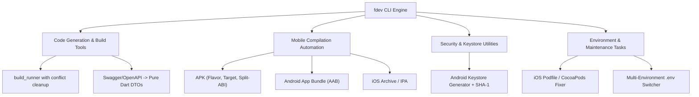

# fdev: Ultimate Flutter Developer CLI & Automation Tool

[](https://pub.dev/packages/fdev)

- **pub.dev**: [https://pub.dev/packages/fdev](https://pub.dev/packages/fdev)
- **GitHub**: [https://github.com/rahulshahDEV/fdev](https://github.com/rahulshahDEV/fdev)

`fdev` is a local Dart developer CLI designed to eliminate repetitive terminal commands across Flutter engineering workflows. It provides zero-dependency automation for `build_runner`, multi-flavor compilation, Android upload keystores, CocoaPods updates, and Swagger/OpenAPI Dart model generation.

> [!TIP]
> **💡 The Pneumatic Pit-Stop Wheel Gun Analogy:**
> Manually typing 90-character terminal incantations for `dart run build_runner build --delete-conflicting-outputs`, CocoaPods de-integrations, and SHA-1 keytool queries is like tightening wheel nuts with a rusty hand wrench during a race. `fdev` is the high-torque pneumatic pit-stop gun: tap one short command, torque everything simultaneously, and get back onto the development track in 2 seconds.

---

## 1. Key CLI Capabilities



---

## 2. Installation & Global Activation

Activate `fdev` globally on your developer workstation via `dart pub global`:

```bash
dart pub global activate fdev
```

Make sure your pub global bin directory is in your `$PATH` (e.g., `~/.pub-cache/bin`).

Verify your setup:
```bash
fdev doctor
```

---

## 3. Essential Command Workflows

### 3.1: Code Generation (`build_runner`)
Run code generation with conflicting outputs removed automatically:

```bash
# Run build_runner with --delete-conflicting-outputs
fdev b

# Run in watch mode for active editing
fdev bw

# Filter build to specific files or packages to save CPU
fdev b --filter "lib/features/chat/**"
```

### 3.2: Clean & Pub Get Workflow
Perform a deep cache clear and restore dependencies in a single step:

```bash
# Cleans Flutter build cache, deletes generated files, and runs flutter pub get
fdev clean
```

### 3.3: Android Upload Keystore Generator
Generate a secure Java KeyStore (`.jks`), compute SHA-1 and SHA-256 fingerprints, and create `key.properties` in one interactive prompt:

```bash
fdev keystore
```

#### What it does automatically:
1. Prompts for alias, keystore filename, and passwords.
2. Invokes JDK `keytool` with `RSA 2048` encryption and 10,000-day validity.
3. Prints the **SHA-1** and **SHA-256** fingerprints for immediate paste into Google Cloud Console & Firebase.
4. Generates a template `android/key.properties` file.
5. Displays base64 output ready for Codemagic, GitHub Actions, or GitLab CI secrets.

### 3.4: Multi-Flavor Builds
Compile APKs, AABs, or iOS builds without typing long shell arguments:

```bash
# Build Android App Bundle for production
fdev aab --flavor prod -t lib/main_prod.dart

# Build APK with split-per-ABI flags for smaller test downloads
fdev apk --flavor dev -t lib/main_dev.dart --split-per-abi

# Build iOS archive with release flavor
fdev ios --flavor prod -t lib/main_prod.dart
```

### 3.5: Swagger / OpenAPI to Dart DTO Generator
Generate clean, dependency-free Dart models from an OpenAPI 3.0 or Swagger JSON file:

```bash
# Generate models from local swagger.json
fdev swagger swagger.json --output lib/models/

# Generate with copyWith methods
fdev swagger swagger.json --output lib/models/ --copy-with

# Watch mode: Re-generate models whenever swagger.json updates
fdev swagger-watch swagger.json --output lib/models/
```

### 3.6: Environment File Switcher
Switch between `.env.dev`, `.env.staging`, and `.env.prod`:

```bash
fdev env prod
```
Copies `.env.prod` to root `.env` and notifies listeners.

### 3.7: iOS CocoaPods Recovery
Fix broken iOS build pods and lockfiles:

```bash
fdev pod-update
```
Deletes `Podfile.lock`, removes `Pods/` directory, runs `pod repo update`, and executes `pod install` with verified symlinks.

---

## 4. CI/CD Pipeline Integration

You can activate and run `fdev` inside automated CI pipelines (GitHub Actions, Codemagic, GitLab CI) to keep CI configuration files terse and maintainable:

```yaml
# Inside GitHub Actions or Codemagic step
- name: Activate & Run fdev Code Generation
  run: |
    dart pub global activate fdev
    fdev b
    fdev aab --flavor prod -t lib/main_prod.dart
```

---

## 5. Commands Quick Reference

| Command | Action |
|---|---|
| `fdev b` | Runs `dart run build_runner build --delete-conflicting-outputs` |
| `fdev bw` | Runs `dart run build_runner watch --delete-conflicting-outputs` |
| `fdev clean` | Runs `flutter clean && flutter pub get` |
| `fdev keystore` | Generates Android keystore `.jks`, prints SHA-1 / SHA-256, writes `key.properties` |
| `fdev aab` | Compiles Android App Bundle with flavor and entrypoint |
| `fdev apk` | Compiles Android APK with optional `--split-per-abi` |
| `fdev ios` | Compiles iOS archive for App Store distribution |
| `fdev swagger <file>` | Converts Swagger/OpenAPI JSON into pure Dart models |
| `fdev pod-update` | Clean reinstall of iOS CocoaPods and dependencies |
| `fdev env <name>` | Selects and activates target environment `.env` |
| `fdev doctor` | Verifies Flutter SDK, Java JDK, CocoaPods, and PATH configuration |
