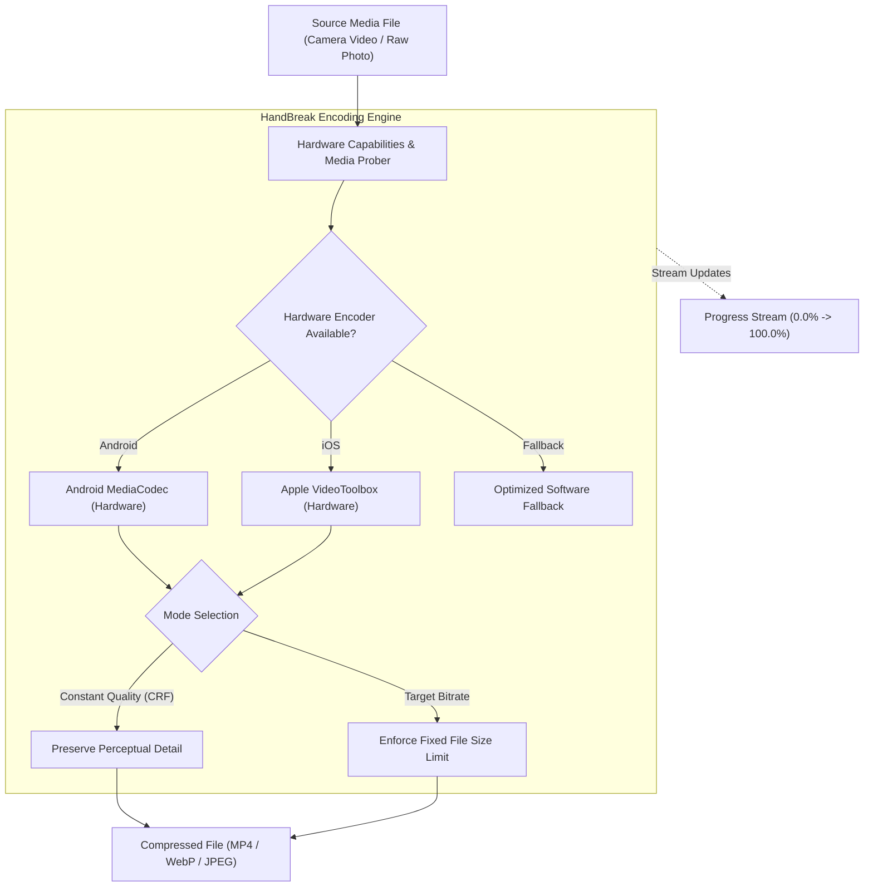

# Flutter HandBreak: Quality-First Video & Image Compression

[](https://pub.dev/packages/flutter_handbreak)
[](LICENSE)

- **pub.dev**: [https://pub.dev/packages/flutter_handbreak](https://pub.dev/packages/flutter_handbreak)
- **GitHub**: [https://github.com/rahulshahDEV/flutter_handbreak](https://github.com/rahulshahDEV/flutter_handbreak)

`flutter_handbreak` is a lightweight, quality-first video and image compression library for Flutter (**Android & iOS**). Inspired by [HandBrake](https://handbrake.fr), its pipeline, quality models, and presets were clean-room engineered for mobile devices with native hardware acceleration (`MediaCodec` on Android and `VideoToolbox` on iOS).

> [!TIP]
> **💡 The Vacuum-Sealed Travel Packing Bag Analogy:**
> Uploading a raw 300MB smartphone video over cellular is like trying to stuff a fluffy queen-sized duvet into an airplane overhead bin. `flutter_handbreak` uses the phone's native hardware silicon (`MediaCodec` & `VideoToolbox`) like an industrial vacuum pump: it rapidly compresses 300MB down to 18MB with zero perceptible loss in visual crispness, sliding effortlessly through 4G/5G airwaves.

---

## 1. Architecture Overview



---

## 2. Key Features

- **🎬 Video Compression**:
  - Codecs: H.264, H.265 (HEVC), AV1, VP9.
  - Containers: MP4, MOV, WebM, 3GP.
  - Constant-quality (CRF) and targeted bitrate modes.
- **🖼️ Image Compression**:
  - Formats: JPEG, PNG, WebP (universal); HEIC and AVIF where native device encoders exist.
  - EXIF-aware orientation preservation and alpha-channel transparency support.
- **⚡ Native Hardware Acceleration**: Uses `MediaCodec` on Android and `VideoToolbox` on iOS for near-instant encoding with minimal battery draw.
- **🎛️ HandBrake-Inspired Presets**: Pre-configured profiles (`fast1080p`, `socialMedia`, `emailAttachment`, `discordFriendly`).
- **📊 Real-Time Progress & Cancellation**: Stream fractional progress (0.0 to 1.0) directly to progress bars with full cancellation support.

---

## 3. Installation

Add `flutter_handbreak` to your `pubspec.yaml`:

```bash
flutter pub add flutter_handbreak
```

---

## 4. Implementation Guide

### 4.1: One-Liner Video Compression
Compress a camera video using standard quality metrics:

```dart
import 'package:flutter/material.dart';
import 'package:flutter_handbreak/flutter_handbreak.dart';

Future<void> compressUserVideo(String sourcePath) async {
  // Simple one-liner with quality score 0-100 (default 80 is balanced)
  final VideoCompressionResult result = await FlutterHandbreak.compressVideo(
    sourcePath,
    quality: 80,
  );

  debugPrint('Compressed path: ${result.path}');
  debugPrint('Original size: ${result.originalSizeFormatted}');
  debugPrint('New size: ${result.compressedSizeFormatted}');
  debugPrint('Size reduction: ${result.compressionPercentage.toStringAsFixed(1)}%');
}
```

### 4.2: Video Compression with Presets & Progress Tracking
Display a progress indicator while encoding large 4K / 1080p video files:

```dart
Future<void> compressWithProgress(String inputPath) async {
  final controller = HandbreakCompressionController();

  // Listen to live encoding percentage
  controller.progressStream.listen((progress) {
    debugPrint('Encoding progress: ${(progress * 100).toStringAsFixed(1)}%');
  });

  try {
    final result = await FlutterHandbreak.compressVideo(
      inputPath,
      preset: VideoPreset.socialMedia720p,
      controller: controller,
      outputFormat: VideoFormat.mp4,
    );

    debugPrint('Video encoded successfully to: ${result.path}');
  } catch (e) {
    debugPrint('Compression aborted or failed: $e');
  }
}
```

### 4.3: Compressing High-Resolution Camera Photos
Convert large 12MB camera photos into ultra-compact WebP or JPEG files:

```dart
Future<String?> compressCameraPhoto(String rawImagePath) async {
  final ImageCompressionResult result = await FlutterHandbreak.compressImage(
    rawImagePath,
    quality: 85,
    maxWidth: 1920,
    maxHeight: 1080,
    format: ImageFormat.webp, // Converts to WebP for maximum space efficiency
  );

  debugPrint('Image reduced from ${result.originalSizeBytes} to ${result.compressedSizeBytes} bytes');
  return result.path;
}
```

---

## 5. Preset Profiles

| Preset | Target Resolution | Recommended For |
|---|---|---|
| `VideoPreset.fast1080p` | 1920 x 1080 | High-fidelity archive & web playback |
| `VideoPreset.socialMedia720p` | 1280 x 720 | Instagram, TikTok, Twitter/X uploads |
| `VideoPreset.chatAttachment480p` | 854 x 480 | In-app instant messaging and quick sharing |
| `VideoPreset.discordFriendly` | Auto | Enforces file size under 10MB |

