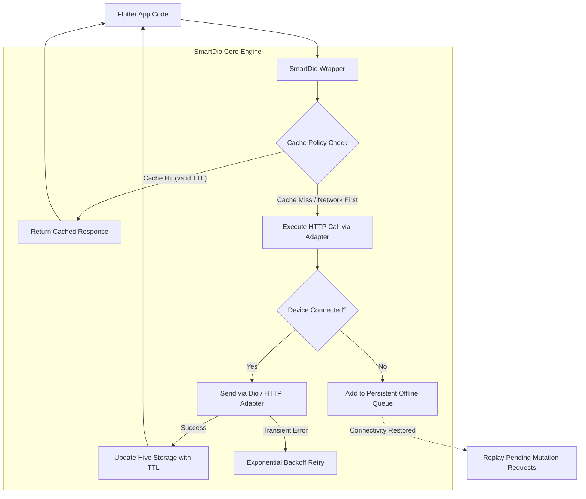

# Flutter SmartDio: Transport-Agnostic HTTP Wrapper with Offline Caching & Queue

[](https://pub.dev/packages/flutter_smartdio)
[](https://opensource.org/licenses/MIT)

- **pub.dev**: [https://pub.dev/packages/flutter_smartdio](https://pub.dev/packages/flutter_smartdio)
- **GitHub**: [https://github.com/rahulshahDEV/flutter_smartdio](https://github.com/rahulshahDEV/flutter_smartdio)

`flutter_smartdio` is a transport-agnostic HTTP wrapper that enhances any HTTP client (Dio, `package:http`, Chopper, or `dart:io` `HttpClient`) with **persistent offline caching**, **offline request queuing**, **automatic retry mechanisms**, and **network logging**.

> [!TIP]
> **💡 The Mountain Tunnel Mailbox & Outbox Queue Analogy:**
> When your train plunges into a mountain tunnel with zero signal, a standard HTTP client throws a red error and crashes. `flutter_smartdio` acts like a dedicated courier sitting beside you: it immediately serves saved responses from the local pantry (Hive cache), and if you write an outgoing message (mutation), slips it into an orderly outbox briefcase. The instant the train emerges back into 5G coverage, the courier quietly mails every queued letter in sequence.

---

## 1. Architecture Overview



---

## 2. Key Features

- **🔌 Transport-Agnostic Design**: Operates seamlessly with `Dio`, `http`, `Chopper`, or custom adapters without changing application-level code.
- **💾 Hive-Backed Persistent Caching**: Survives application restarts, supports custom TTL (Time-To-Live) expiration, and enforces cache size constraints.
- **🔄 Versatile Cache Policies**:
  - `CachePolicy.networkFirst`: Fetches fresh data from the server, falling back to cache if offline.
  - `CachePolicy.cacheFirst`: Returns cached data immediately if within TTL, avoiding unnecessary network calls.
  - `CachePolicy.cacheOnly`: Pure local offline read.
  - `CachePolicy.networkOnly`: Bypasses local cache completely.
- **📬 Offline Request Queuing**: Captures mutations (`POST`, `PUT`, `DELETE`) executed while offline and automatically replays them with identical headers and bodies when internet access is restored.
- **🔁 Resilient Retries**: Configurable exponential backoff retry policies for flaky network conditions and `5xx` server errors.

---

## 3. Installation

Add `flutter_smartdio` and `dio` to your `pubspec.yaml`:

```bash
flutter pub add flutter_smartdio dio
```

---

## 4. Quick Start & Initialization

Initialize `SmartDio` during application startup (typically inside `main.dart`):

```dart
import 'package:flutter/material.dart';
import 'package:flutter_smartdio/flutter_smartdio.dart';
import 'package:dio/dio.dart';

void main() async {
  WidgetsFlutterBinding.ensureInitialized();

  // 1. Initialize Hive storage and network connectivity monitors
  await SmartDio.initialize(
    config: SmartDioConfig(
      defaultCachePolicy: CachePolicy.networkFirst,
      defaultCacheDuration: const Duration(hours: 2),
      enableLogging: true,
      maxRetries: 3,
      retryDelay: const Duration(seconds: 1),
    ),
  );

  runApp(const MyApp());
}
```

---

## 5. Implementation Examples

### 5.1: GET Request with Caching Policies
Retrieve data with a `cacheFirst` policy to render cached content instantly:

```dart
import 'package:flutter_smartdio/flutter_smartdio.dart';
import 'package:dio/dio.dart';

class UserRepository {
  final SmartDio _client = SmartDio();

  Future<Map<String, dynamic>> fetchUserProfile(String userId) async {
    final response = await _client.get(
      'https://api.example.com/v1/users/$userId',
      options: SmartOptions(
        cachePolicy: CachePolicy.cacheFirst,
        cacheDuration: const Duration(minutes: 30),
        headers: {
          'Authorization': 'Bearer <ACCESS_TOKEN>',
        },
      ),
    );

    return response.data as Map<String, dynamic>;
  }
}
```

### 5.2: POST Request with Offline Queuing
Queue mutation requests when the user is offline (e.g., in airplane mode) and auto-sync when online:

```dart
Future<void> submitFeedback(String feedbackText) async {
  final client = SmartDio();

  await client.post(
    'https://api.example.com/v1/feedback',
    data: {
      'message': feedbackText,
      'submittedAt': DateTime.now().toIso8601String(),
    },
    options: SmartOptions(
      // When offline, persist this request to the queue instead of throwing a SocketException
      queueIfOffline: true,
      maxRetries: 5,
    ),
  );
}
```

### 5.3: Manual Cache Invalidation
Clear specific endpoints or reset the entire cache when users log out:

```dart
// Invalidate a single endpoint
await SmartDio.invalidate('https://api.example.com/v1/users/123');

// Invalidate all endpoints matching a pattern
await SmartDio.invalidateMatching(RegExp(r'/users/.*'));

// Clear all cached responses
await SmartDio.clearCache();
```

---

## 6. Configuration Options Reference

| Property | Type | Default | Description |
|---|---|---|---|
| `defaultCachePolicy` | `CachePolicy` | `CachePolicy.networkFirst` | Default caching behavior for all GET requests |
| `defaultCacheDuration` | `Duration` | `Duration(hours: 1)` | How long responses remain valid in local storage |
| `enableLogging` | `bool` | `true` | Formats request, response, and cache-hit metrics in console |
| `maxRetries` | `int` | `3` | Maximum attempts for transient network failures |
| `retryDelay` | `Duration` | `Duration(seconds: 1)` | Base delay for exponential backoff recalculation |
| `queueIfOffline` | `bool` | `false` | Queues failed mutations for background replay |

