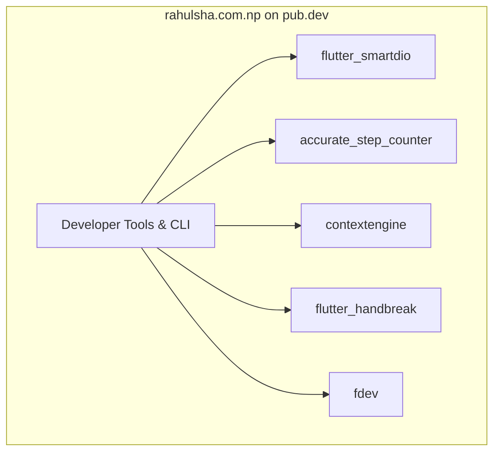

# Official Flutter Packages by rahulsha.com.np

A curated catalog of open-source Flutter packages, developer tools, and libraries published on [pub.dev/publishers/rahulsha.com.np](https://pub.dev/publishers/rahulsha.com.np/packages). These packages provide battle-tested solutions for HTTP networking with offline queues, hardware-level step tracking, AI context optimization, media compression, and Flutter CLI automation.

> [!TIP]
> **💡 The High-Performance Racecar Parts Crate Analogy:**
> When building an endurance racecar, you don't smelt raw iron to forge your own piston rings or brake calipers from scratch. This package catalog is a curated crate of dyno-tested, track-ready components: drop in `flutter_smartdio` for high-torque fuel delivery, `accurate_step_counter` for precision telemetry, and `contextengine` for lightweight ECU fuel maps.

---

## 📦 Packages Directory



| Package | Version | Description | pub.dev Link | GitHub Repository |
|---|---|---|---|---|
| [**flutter_smartdio**](flutter_smartdio.md) | `1.0.4` | Transport-agnostic HTTP wrapper with offline caching, persistent request queues, and retries | [](https://pub.dev/packages/flutter_smartdio) | [GitHub](https://github.com/rahulshahDEV/flutter_smartdio) |
| [**accurate_step_counter**](accurate_step_counter.md) | `4.0.0` | Android hardware sensor step tracker using a health foreground service & SQLite history | [](https://pub.dev/packages/accurate_step_counter) | [GitHub](https://github.com/rahulshahDEV/accurate_step_counter) |
| [**contextengine**](contextengine.md) | `0.2.0` | Provider-agnostic AI orchestration, semantic memory, and token-optimization layer | [](https://pub.dev/packages/contextengine) | [GitHub](https://github.com/rahulshahDEV/context_engine) |
| [**flutter_handbreak**](flutter_handbreak.md) | `1.0.5` | Lightweight, quality-first video & image compression inspired by HandBrake (Android + iOS) | [](https://pub.dev/packages/flutter_handbreak) | [GitHub](https://github.com/rahulshahDEV/flutter_handbreak) |
| [**fdev**](fdev.md) | `0.1.6` | Developer CLI to streamline `build_runner`, APK/IPA builds, Keystores, and OpenAPI codegen | [](https://pub.dev/packages/fdev) | [GitHub](https://github.com/rahulshahDEV/fdev) |

---

## 🚀 Quick Install Cheat Sheet

### 1. HTTP Networking & Offline Sync
```bash
flutter pub add flutter_smartdio
```
Wraps Dio or the standard `http` client. Provides Hive-backed persistent cache with TTL, stale-while-revalidate policies, and an offline request queue that replays mutation requests when the device regains internet connectivity.

### 2. Android Step Counting with Foreground Service
```bash
flutter pub add accurate_step_counter permission_handler
```
Reads the hardware `TYPE_STEP_COUNTER` directly inside an Android Foreground Health Service. Persists hourly and daily step records to an encrypted SQLite database and recovers total counts after device reboots.

### 3. AI Context & Semantic Memory Layer
```bash
flutter pub add contextengine
```
Slots between your Flutter app and LLMs (OpenAI, Gemini, Anthropic, Ollama). Automatically manages sliding conversation windows, semantic memory facts, and applies `GraphifyCompressor` (30–60% input token savings) and `CavemanMode` (20–70% output token savings).

### 4. Video & Image Compression
```bash
flutter pub add flutter_handbreak
```
Compresses heavy video recordings and camera photos directly on-device using hardware encoders (`MediaCodec` on Android, `VideoToolbox` on iOS) with HandBrake-inspired CRF presets and real-time progress callbacks.

### 5. Developer CLI & Automation
```bash
dart pub global activate fdev
```
Run `fdev` from any terminal in your Flutter workspace to run `build_runner`, generate Android upload keystores, build release bundles, update iOS CocoaPods, or watch Swagger OpenAPI files to generate clean Dart DTO models.

