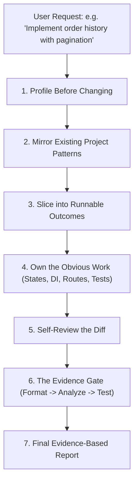

# Flutter Superpower: Senior Developer AI Coding Skill

[](https://opensource.org/licenses/MIT)
[](https://github.com/rahulshahDEV/flutter-superpower)

- **GitHub Repository**: [https://github.com/rahulshahDEV/flutter-superpower](https://github.com/rahulshahDEV/flutter-superpower)
- **Author**: [rahulshahDEV](https://github.com/rahulshahDEV)

`flutter-superpower` is an autonomous senior-developer skill and architectural framework for AI coding assistants (**Antigravity**, **Cursor**, **Claude Desktop / Claude Code**, **Windsurf**, and **VS Code Cline**). It equips agents with battle-tested scaffolding, feature ownership, UI/platform workflows, strict scope discipline, and evidence-based verification.

> [!TIP]
> **💡 The Staff Structural Architect vs Junior Carpenter Analogy:**
> When asked to add a balcony, an untrained carpenter nails two boards to the siding and walks away. A Staff Structural Architect calculates foundation load-bearing ratings, verifies municipal seismic codes (the 12 Laws), isolates the plumbing and electrical conduits (Clean Architecture & DI), and refuses to sign off until concrete stress tests pass (`flutter analyze --fatal-infos` & Evidence Gate). `flutter-superpower` forces AI pair-programmers to think and build like that Staff Architect.

---

## 1. Core Philosophy: Senior Developer Mode

When activated, `flutter-superpower` stops the AI from behaving like a naive code generator that produces throwaway snippets. Instead, the agent operates as a **staff/senior engineer** who owns the task end-to-end:



### The 6 Senior Mode Principles
1. **Profile Before Changing**: Inspect `pubspec.yaml`, state management, routing, DI, networking, theme, and tests before writing a single line of code.
2. **Existing Project Conventions > Skill Defaults > Generic Preference**: Greenfield apps adopt the house defaults; existing codebases are mirrored rather than rewritten. Migrations occur only when explicitly requested.
3. **Own the Obvious Work**: Never prompt the user for trivia. Automatically handle loading, error, empty, and success states, form validation, GetIt/Injectable registrations, GoRouter endpoints, constants, and edge-case tests.
4. **Slice by Observable Outcomes**: Implement one vertically sliceable outcome through all architectural layers (Data &rarr; Domain &rarr; Presentation), verify it, and then proceed to the next slice.
5. **Strict Scope Discipline (The Ponytail Ladder)**: Never introduce unneeded packages, unnecessary abstractions, or redundant widgets. Ask: *Does this feature need it at all? Is it already in `core/`? Does the Flutter SDK provide it? Can it be done in one clean line?*
6. **The Evidence Gate**: Never say *"Done."* without verifiable proof. Every completion report must provide:
   - **Implemented**: What was delivered.
   - **Files Changed**: Exact paths created or modified.
   - **Verification**: Terminal output from `dart format`, `flutter analyze`, and `flutter test`.
   - **Not Verified**: Any platform-dependent visual tests requiring physical hardware.
   - **Notes**: Edge cases or migration remarks.

---

## 2. The 12 Laws of Flutter Architecture

Every feature generated or audited by `flutter-superpower` adheres to the **12 Architectural Laws**:

| Law | Standard | Description |
|---|---|---|
| **1. Feature-First** | `lib/features/<name>/{data,domain,presentation}` | Strict layer isolation. `core/` never imports `features/` (except route assembly in `core/router/`). |
| **2. Cubits Only** | `flutter_bloc` Cubits extending `SafeCubit` | No Bloc events, no Riverpod, Provider, or GetX. Safe state emission via `safeEmit` prevents unmounted crashes. |
| **3. Clean State Separation** | Sealed class states (or Freezed) | Cubit and State reside in separate files. Default: sealed classes (`Initial`, `Loading`, `Success`, `Failure`). |
| **4. UI Separation** | Pure business logic | Cubits never hold `BuildContext`, never navigate, and never own `TextEditingController`s. UI navigates; cubits fold `Either`. |
| **5. Dependency Injection** | `get_it` + `injectable` | `@injectable` for cubits, `@LazySingleton(as: XRepository)` for implementations. Zero service-locator calls inside widgets. |
| **6. Declarative Routing** | `go_router` via `AppRouter` | Every screen owns `static const String path` + `routeName`. Path IDs, query filters, and typed `state.extra`. |
| **7. Functional Data Flow** | Data source throws &rarr; Repo returns `FutureEither<T>` | Data sources throw typed exceptions; repositories wrap `safeApiCall` and return `Either<Failure, T>`. |
| **8. Equatable Entities** | Pure domain objects | Wire models (`@JsonSerializable`) extend domain entities. Generated files (`.g.dart`) are gitignored and rebuilt. |
| **9. Centralized Constants** | Zero magic strings | Strings, assets, API endpoints, storage keys, and colors live in constants classes. Never inline hex codes or copy. |
| **10. Responsive Sizing** | `AppSizes` + bounded `ScreenUtil` | Tokens for paddings, radius, and typography. Constraints choose layouts; touch targets respect 48dp minimums. |
| **11. K-Widget Design System** | Reusable atomic components | Reuse `KButton`, `KTextField`, `ImageRenderer`, `EmptyStateWidget`, `ErrorStateWidget`, `LoadingWidget`. |
| **12. Quality Gate & Flavors** | `dev` & `prod` flavors + `fdev` | Verification gate: `dart format .` &rarr; `fdev gen` &rarr; `flutter analyze` &rarr; `flutter test`. |

---

## 3. Measured Benchmarks: Manual vs. Flutter Superpower

Performance benchmark measured on macOS (Flutter 3.38.9, Dart 3.10.8):

| Task | Typical Manual Time | With Flutter Superpower | Speedup |
|---|---|---|---|
| **New App Skeleton** (46 Dart files: layers, DI, theme, router, constants, design system, tests) | 2–4 hours | **19.1 seconds** (`scripts/new_app.sh`) | **~500x** |
| **New Feature Slice** (10 files across data/domain/presentation + codegen + routes) | 1–2 hours | **9.8 seconds** (`scripts/new_feature.sh`) | **~400x** |
| **Full Architecture Audit** (530-file production application) | 1–2 hours | **0.9 seconds** (`scripts/audit.sh`) | **Instant** |
| **Verification Gate** (format &rarr; analyze &rarr; test) | 5–10 minutes | **8.2 seconds** (automated evidence gate) | **100% reliable** |

---

## 4. Built-In Scaffolding Scripts

`flutter-superpower` provides tested bash and Dart scripts located in `scripts/`:

### 4.1: Scaffold a Production App in Seconds (`new_app.sh`)
```bash
# Creates a complete 46-file clean architecture app with flavors, DI, routing & design system
./scripts/new_app.sh my_new_app
```

### 4.2: Generate a Complete Feature Slice (`new_feature.sh`)
```bash
# Generates data source, repository, cubit, state, screen, and route registrations
./scripts/new_feature.sh user_profile --app /path/to/my_flutter_app
```

### 4.3: Mechanical Architecture Audit (`audit.sh`)
```bash
# Runs 24 mechanical architectural checks (layer leaks, raw strings, BuildContext in cubits)
./scripts/audit.sh /path/to/my_flutter_app [--perf]
```

### 4.4: Pre-Release Store Readiness Check (`release-check.sh`)
```bash
# Validates keystore signing, bundle ID parity, app icons, and flavor configurations
./scripts/release-check.sh /path/to/my_flutter_app
```

---

## 5. How to Install and Activate the Skill

### Option 1: Google Antigravity & Agent CLI
Add to your global Antigravity skills directory:
```bash
git clone https://github.com/rahulshahDEV/flutter-superpower.git ~/.gemini/config/skills/flutter-superpower
```
Antigravity automatically discovers `SKILL.md` and triggers senior-developer mode whenever you mention Flutter.

### Option 2: Cursor (`.cursor/rules/`)
Symlink or copy the skill into your project's Cursor configuration:
```bash
mkdir -p .cursor/rules
ln -s ~/.gemini/config/skills/flutter-superpower/SKILL.md .cursor/rules/flutter-superpower.mdc
```

### Option 3: Claude Desktop / Claude Code
Add to your Claude configuration directory:
```bash
git clone https://github.com/rahulshahDEV/flutter-superpower.git ~/Library/Application\ Support/Claude/skills/flutter-superpower
```

### Option 4: VS Code (Cline / Roo Code / Windsurf)
Add the repository path to your custom rules directory or paste `SKILL.md` into your system instructions.

---

## 6. Prompting Your AI Assistant with Superpower

Once installed, simply prompt your agent naturally. The skill automatically enforces the 12 laws and runs the evidence gate:

```text
"Implement a paginated transaction history screen with date-range filters following flutter-superpower."
```

```text
"Run an architecture audit on this Flutter project and fix any BuildContext leaks or layer violations."
```

```text
"Scaffold a new feature called 'kyc_verification' with camera document capture, repository error handling, and Cubit states."
```

