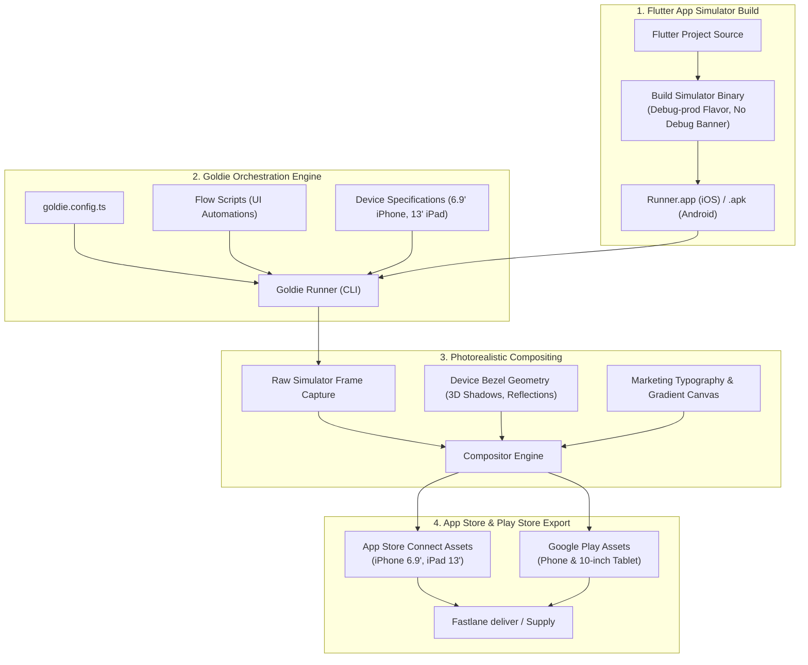

# Automated Store Screenshot Generation with Goldie: Complete Guide (iOS & Android)

A complete, production-ready manual for automating App Store Connect and Google Play Store screenshots and app preview videos using **Goldie**. This guide covers automated simulator replay, high-fidelity device framing (iPhone 16/17 Pro Max 6.9", iPad Pro 13", Pixel 9 Pro), gradient typography templating, and Fastlane `deliver` distribution with sanitized, copy-paste-ready configurations.

> [!TIP]
> **💡 The Hollywood Virtual Soundstage Analogy:**
> Instead of manually snapping 50 screenshots across 6 physical iPads and iPhones, cropping Photoshop canvases until 3 AM, and panicking because the battery meter shows 14%, Goldie is an automated virtual soundstage. It drives simulator actors through programmed choreography, wraps pixel-perfect captures in titanium hardware frames with clean 9:41 AM status bars, and renders high-conversion marketing graphics across 30 languages in minutes.

---

## 1. Architecture & Pipeline Overview

Goldie transforms manual, error-prone screenshot editing into a deterministic, scriptable build pipeline. It drives simulator/emulator sessions through automated UI flows, captures uncompressed frames, wraps them inside photorealistic hardware bezels, overlays localized marketing copy, and exports store-compliant bundles ready for upload.



---

## 2. Directory Layout & Prerequisites

Goldie lives at the root of your Flutter project or within a dedicated `tools/` or `goldie/` directory.

### Recommended Directory Structure

```text
my_flutter_app/
├── goldie/
│   ├── goldie.config.ts          # Core Goldie configuration & scene catalog
│   ├── flows/                    # Simulator automation flow definitions
│   │   ├── store-01-intro.ts
│   │   ├── store-02-features.ts
│   │   └── store-03-profile.ts
│   └── package.json              # Local Goldie CLI dependency
├── ios/
│   └── Runner.xcworkspace
├── android/
├── docs/
└── pubspec.yaml
```

### Installation
Add Goldie and TypeScript dependencies:

```bash
cd goldie
npm init -y
npm install -D goldie typescript @types/node
npx tsc --init
```

---

## 3. The Flutter Simulator Build Secret

> [!IMPORTANT]
> **Flutter Simulator AOT Limitation:** Flutter cannot produce a Release binary for the iOS simulator because Ahead-Of-Time (AOT) machine code compilation is device-only.
>
> If you point Goldie to a default debug build, the ugly red "DEBUG" banner will ruin your App Store screenshots.
>
> **The Solution:**
> 1. Use your `prod` flavor with `debugShowCheckedModeBanner: false`.
> 2. Build with configuration `Debug-prod` targeting `iphonesimulator`.
> 3. Point Goldie's `appPath` directly at the derived `Runner.app`.

### Compiling the Goldie Simulator App
Run this Xcode build command to create the clean simulator binary:

```bash
xcodebuild \
  -workspace ios/Runner.xcworkspace \
  -scheme Runner \
  -configuration Debug-prod \
  -sdk iphonesimulator \
  -derivedDataPath build/goldie-derived
```

The resulting binary will be located at:
```text
build/goldie-derived/Build/Products/Debug-prod-iphonesimulator/Runner.app
```

---

## 4. Complete Sanitized `goldie.config.ts`

Save this file as `goldie/goldie.config.ts`:

```typescript
import type { GoldieConfig } from "goldie";
import path from "path";

const PROJECT_ROOT = path.resolve(__dirname, "..");

const config: GoldieConfig = {
  appRoot: PROJECT_ROOT,

  // Path to the Debug-prod simulator build (clean, no debug banner)
  appPath: path.join(
    PROJECT_ROOT,
    "build/goldie-derived/Build/Products/Debug-prod-iphonesimulator/Runner.app"
  ),
  bundleId: "com.example.app",

  // Required App Store Connect formats: iPhone 6.9" and iPad 13"
  devices: ["iphone-6.9", "ipad-13"],
  locales: ["en-US"],
  appearance: "light",

  frame: {
    variant: {
      "iphone-6.9": "17-pro-blue",
      "ipad-13": "ipad-pro-13-space-gray",
    },
  },

  theme: {
    background: "linear-gradient(160deg, #D9ECF9 0%, #EFF6FD 55%, #FFFFFF 100%)",
    headlineColor: "#0E1B2A",
    subheadColor: "#5A6A7D",
    fontFamily: '-apple-system, "SF Pro Display", system-ui, sans-serif',
    copyHeightRatio: 0.24,
    deviceWidthRatio: 0.84,
    template: "editorial",
    layout: "classic",
  },

  store: {
    name: "Flutter SuperApp",
    subtitle: { "en-US": "Fast, Secure & Private" },
    developer: "Example Technologies Inc.",
    category: "Productivity",
    rating: 4.9,
    ratingCount: "2.5K Ratings",
    ageRating: "4+",
    price: "Free",
    description: {
      "en-US":
        "Experience seamless mobile performance with cutting-edge architecture.\n\nYour data is protected with hardware-level encryption and stays private.",
    },
  },

  scenes: [
    {
      kind: "screenshot",
      id: "01-welcome",
      flow: "store-01-intro",
      headline: { "en-US": "Engineered for pure speed" },
      subhead: {
        "en-US": "Experience instantaneous state synchronization and offline support.",
      },
    },
    {
      kind: "screenshot",
      id: "02-security",
      flow: "store-02-security",
      headline: { "en-US": "Zero-knowledge end-to-end encryption" },
      subhead: {
        "en-US": "Your keys never leave your device. Complete cryptographic privacy.",
      },
    },
    {
      kind: "screenshot",
      id: "03-insights",
      flow: "store-03-insights",
      headline: { "en-US": "Real-time metrics and alerts" },
      subhead: {
        "en-US": "Deep telemetry and analytics delivered straight to your fingertips.",
      },
    },
    {
      kind: "screenshot",
      id: "04-customization",
      flow: "store-04-settings",
      headline: { "en-US": "Tailored to your workflow" },
      subhead: {
        "en-US": "Dark mode, custom themes, and flexible preferences for power users.",
      },
    },
  ],
};

export default config;
```

---

## 5. Automation Flows

Goldie flows use lightweight browser or simulator automation scripts that drive the app to the exact target screens before capturing frames.

Create `goldie/flows/store-01-intro.ts`:

```typescript
export default async function flow({ simulator, page }: any) {
  // Wait for initial render
  await simulator.waitForText("Welcome back");

  // Dismiss any introductory tooltips or permission prompts
  if (await simulator.existsText("Allow")) {
    await simulator.tapText("Allow");
  }

  // Ensure animations have settled
  await simulator.sleep(800);
}
```

Create `goldie/flows/store-02-security.ts`:

```typescript
export default async function flow({ simulator }: any) {
  await simulator.tapText("Security Settings");
  await simulator.waitForText("End-to-End Encryption");
  await simulator.sleep(500);
}
```

---

## 6. CLI Execution Commands

Goldie provides unified commands for running flows, framing captures, and exporting production assets:

### Step 6.1: Run Full Pipeline
Executes flows, captures simulator screens, frames them in device bezels, and generates final images:
```bash
npx goldie run
```

### Step 6.2: Capture Only
Replays simulator automation and records raw screenshots without compositing:
```bash
npx goldie capture
```

### Step 6.3: Frame & Template
Re-renders typography, gradients, and device bezels over existing captures (useful when iterating on marketing copy without re-running the simulator):
```bash
npx goldie frame
```

### Step 6.4: Export for Store Upload
Outputs final store-compliant PNGs scaled precisely to Apple and Google requirements:
```bash
npx goldie export --out-dir ./dist/store-screenshots
```

---

## 7. Fastlane `deliver` & `supply` Integration

Automate store uploads by linking Goldie's output directory to Fastlane's metadata paths.

### Fastlane `Fastfile` Lane

```ruby
platform :ios do
  desc "Capture screenshots with Goldie and upload to App Store Connect"
  lane :screenshots do
    # 1. Compile simulator binary
    sh("xcodebuild -workspace ../ios/Runner.xcworkspace -scheme Runner -configuration Debug-prod -sdk iphonesimulator -derivedDataPath ../build/goldie-derived")

    # 2. Execute Goldie export
    sh("cd ../goldie && npx goldie run && npx goldie export --out-dir ../ios/fastlane/screenshots")

    # 3. Upload directly to App Store Connect
    deliver(
      skip_binary_upload: true,
      skip_metadata: true,
      overwrite_screenshots: true,
      screenshots_path: "./fastlane/screenshots"
    )
  end
end
```

---

## 8. Verification & Debugging Checklist

| Check | Expected Behavior | Troubleshooting |
| :--- | :--- | :--- |
| **Debug Banner** | No red banner on top-right | Ensure `debugShowCheckedModeBanner: false` in Flutter `MaterialApp`. |
| **iPhone 6.9" Aspect Ratio** | $1320 \times 2868$ px export | Verify `devices: ["iphone-6.9"]` is set in `goldie.config.ts`. |
| **iPad 13" Aspect Ratio** | $2064 \times 2752$ px export | Verify `devices: ["ipad-13"]` is set; required by App Store Connect. |
| **Font Rendering** | Sharp San Francisco/Roboto type | Set `fontFamily` in theme config; ensure simulator font scale is 1.0. |
| **Status Bar Cleanliness** | 9:41 AM, 100% battery, full Wi-Fi | Goldie automatically normalizes the iOS status bar via `xcrun simctl status_bar`. |

