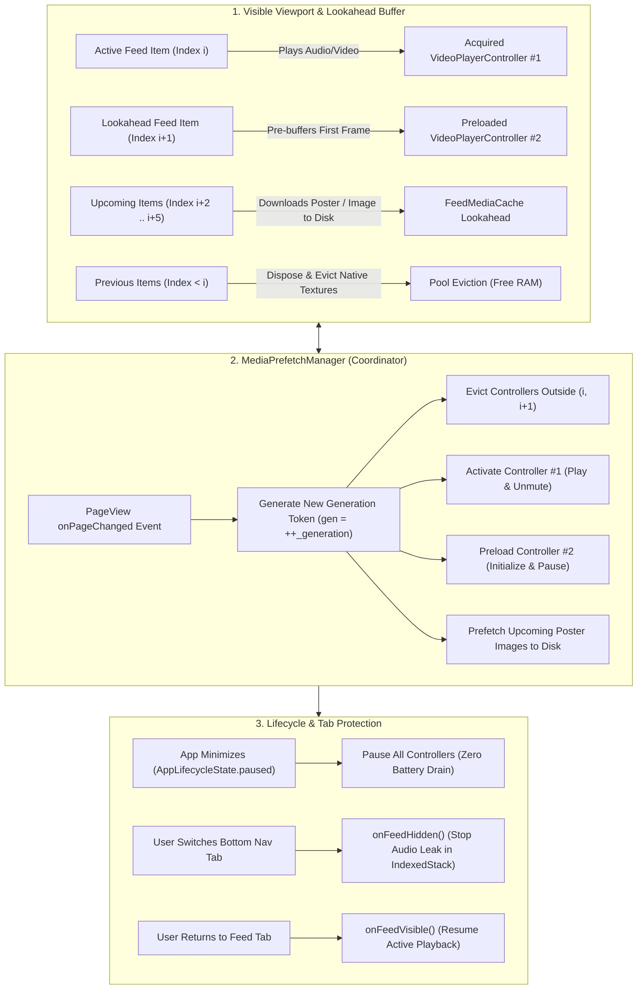

# High-Performance Feed & Video Reel Architecture: Complete Prefetch Guide

A comprehensive, production-grade guide for building **TikTok / Instagram Reels-style vertical feeds** in Flutter. This architecture documents an ultra-smooth, zero-lag scrolling engine featuring a **two-controller video player pool**, **lookahead disk prefetching**, **race-condition generation tokens**, **IndexedStack audio-leak prevention**, and sanitized, copy-paste-ready code.

> [!TIP]
> **💡 The Olympic 4x100m Relay Analogy:**
> Attempting to keep 50 video decoders running at once will instantly crash your app with Out-Of-Memory (OOM) errors. Instead, think of this architecture like a 4x100m relay race: only **Runner A** is actively sprinting with the baton (the playing video), while **Runner B** is already crouched and warming up in their acceleration lane (the pre-warmed second controller). The moment the user swipes, the baton passes in 0 milliseconds—zero stutter, zero waiting for the starter gun.

---

## 1. Architecture & The Pipelined Feed Model

Rendering full-screen vertical video and image feeds in Flutter requires strict memory and lifecycle discipline. Unbounded initialization of `VideoPlayerController` instances causes instant **Out-Of-Memory (OOM)** native crashes on Android and iOS devices.



---

## 2. Key Engineering Patterns

### 1. The Generation Token Pattern (`_generation`)
* **The Problem:** Rapid vertical fling gestures trigger multiple concurrent asynchronous `initialize()` and `acquire()` calls. A slow network request from a post 3 scrolls ago can finish late and start playing over the user's currently focused video.
* **The Solution:** Increment a monotonic generation token on every scroll:
  ```dart
  final gen = ++_generation;
  // ... asynchronous initialize ...
  if (_generation != gen) return; // Stale scroll; abort!
  ```

### 2. The Strict Lease Pool Model (`VideoPlayerPool`)
* Maintains at most **2 active native controllers**:
  * `Active Controller`: Playing audio and video for the visible card.
  * `Preload Controller`: Initialized and buffered at position `0:00` for the immediate next card.
* All other native video controllers are disposed immediately to release hardware video decoders and GPU surface textures.

### 3. The `IndexedStack` Audio Leak Trap
* In modern apps using a persistent bottom navigation bar with an `IndexedStack`, switching tabs hides the feed but **keeps the widget tree mounted**.
* Without explicit visibility hooks, the active video continues playing audio in the background under other tabs!
* Use `onFeedHidden()` and `onFeedVisible()` to cleanly pause and resume playback.

### 4. Disk Media Cache with TTL (`FeedMediaCache`)
* Media poster thumbnails and high-res images are cached on disk with a **1-day Time-To-Live (TTL)** and a max cap of 500 items. Feed content moves quickly; keeping cached media indefinitely wastes user flash storage.

---

## 3. Dependencies

Add these packages to `pubspec.yaml`:

```yaml
dependencies:
  flutter:
    sdk: flutter
  # Official video playback engine
  video_player: ^2.9.2
  # High-performance disk cache manager
  flutter_cache_manager: ^3.4.1
  injectable: ^2.5.0
  get_it: ^8.0.3
```

---

## 4. Implementation: The Feed Media Cache

Configure a custom disk cache manager with a 1-day retention policy:

```dart
// lib/core/services/feed_media_cache.dart
import 'package:flutter_cache_manager/flutter_cache_manager.dart';

/// Disk cache for feed images and video posters with a 1-day TTL.
/// Keeps storage lean and prevents serving stale assets.
class FeedMediaCache extends CacheManager {
  static const String _key = 'feed-media-cache';
  static const Duration _maxAge = Duration(days: 1);

  FeedMediaCache()
      : super(
          Config(
            _key,
            stalePeriod: _maxAge,
            maxNrOfCacheObjects: 500,
          ),
        );
}
```

---

## 5. Implementation: The Video Player Pool

A resource-bounded pool that controls controller leasing, memory eviction, and preloading:

```dart
// lib/core/services/video_player_pool.dart
import 'package:video_player/video_player.dart';

class VideoPlayerPool {
  final Map<String, VideoPlayerController> _pool = {};

  VideoPlayerController? get(String url) => _pool[url];

  /// Acquires an initialized controller for playback
  Future<VideoPlayerController> acquire(String url) async {
    if (_pool.containsKey(url)) {
      final existing = _pool[url]!;
      if (!existing.value.isInitialized) {
        await existing.initialize();
      }
      return existing;
    }

    final controller = VideoPlayerController.networkUrl(Uri.parse(url));
    _pool[url] = controller;
    await controller.initialize();
    return controller;
  }

  /// Preloads and buffers the first frame of the next upcoming video
  Future<void> preload(String url) async {
    if (_pool.containsKey(url)) return;

    final controller = VideoPlayerController.networkUrl(Uri.parse(url));
    _pool[url] = controller;
    await controller.initialize();
    await controller.setVolume(0);
    await controller.pause();
  }

  /// Pauses all controllers across the pool
  void pauseAll() {
    for (final controller in _pool.values) {
      if (controller.value.isPlaying) {
        controller.pause();
      }
    }
  }

  /// Pauses all controllers except the specified active video URL
  void pauseAllExcept(String activeUrl) {
    _pool.forEach((url, controller) {
      if (url != activeUrl && controller.value.isPlaying) {
        controller.pause();
      }
    });
  }

  /// Disposes and removes all controllers not in the keepUrls set
  void evictExcept(Set<String?> keepUrls) {
    final urlsToEvict = _pool.keys.where((url) => !keepUrls.contains(url)).toList();
    for (final url in urlsToEvict) {
      final controller = _pool.remove(url);
      controller?.dispose();
    }
  }

  void release(String url) {
    final controller = _pool.remove(url);
    controller?.dispose();
  }

  void dispose() {
    for (final controller in _pool.values) {
      controller.dispose();
    }
    _pool.clear();
  }
}
```

---

## 6. Implementation: The Unified Media Prefetch Manager

The coordinator that synchronizes scroll positions, prefetching, and lifecycle hooks:

```dart
// lib/core/services/media_prefetch_manager.dart
import 'dart:async';
import 'dart:math' as math;
import 'package:flutter/foundation.dart';
import 'package:video_player/video_player.dart';
import 'feed_media_cache.dart';
import 'video_player_pool.dart';

enum PostMediaType { video, image }

class FeedItem {
  final String id;
  final PostMediaType type;
  final String? videoUrl;
  final String? imageUrl;
  final String? posterUrl;

  FeedItem({
    required this.id,
    required this.type,
    this.videoUrl,
    this.imageUrl,
    this.posterUrl,
  });
}

class MediaPrefetchManager extends ChangeNotifier {
  final VideoPlayerPool _pool;
  final FeedMediaCache _mediaCache;
  final int videoLookahead;
  final int imageLookahead;

  MediaPrefetchManager({
    required VideoPlayerPool pool,
    required FeedMediaCache mediaCache,
    this.videoLookahead = 3,
    this.imageLookahead = 3,
  })  : _pool = pool,
        _mediaCache = mediaCache;

  List<FeedItem> _items = const [];
  int _activeIndex = 0;
  bool _isMuted = false;
  int _generation = 0;
  bool _isDisposed = false;
  bool _isBackgrounded = false;
  bool _isFeedHidden = false;

  String? _currentActiveUrl;
  String? _currentPreloadUrl;
  final Set<String> _userPausedIds = {};

  List<FeedItem> get items => _items;
  int get activeIndex => _activeIndex;
  bool get isMuted => _isMuted;
  String? get currentActiveUrl => _currentActiveUrl;

  bool isUserPaused(String id) => _userPausedIds.contains(id);
  VideoPlayerController? getController(String url) => _pool.get(url);

  /// Synchronizes feed state changes with the playback and prefetch pipelines
  void onFeedStateChanged({
    required List<FeedItem> items,
    required int activeIndex,
    required bool isMuted,
  }) {
    if (_isDisposed) return;

    _items = items;
    _activeIndex = activeIndex;
    _isMuted = isMuted;
    final gen = ++_generation;

    final activeItem = (activeIndex >= 0 && activeIndex < items.length)
        ? items[activeIndex]
        : null;

    final newActiveUrl = (activeItem?.type == PostMediaType.video)
        ? activeItem?.videoUrl
        : null;

    final newPreloadUrl = _findNextVideoUrl(items, activeIndex);

    _currentActiveUrl = newActiveUrl;
    _currentPreloadUrl = newPreloadUrl;

    // 1. Evict controllers outside the immediate playback window
    _pool.evictExcept({newActiveUrl, newPreloadUrl});

    // 2. Pause other active streams
    if (newActiveUrl != null) {
      final active = _pool.get(newActiveUrl);
      if (active != null && active.value.isInitialized) {
        active.setVolume(_isMuted ? 0 : 1);
      }
      _pool.pauseAllExcept(newActiveUrl);
    } else {
      _pool.pauseAll();
    }

    // 3. Activate current video
    if (newActiveUrl != null && !_isBackgrounded && !_isFeedHidden) {
      _activate(newActiveUrl, activeItem?.id, gen);
    }

    // 4. Preload next video
    if (newPreloadUrl != null && newPreloadUrl != newActiveUrl) {
      _preload(newPreloadUrl, gen);
    }

    // 5. Lookahead prefetch upcoming images and poster thumbnails
    _prefetchImages(items, activeIndex);
    notifyListeners();
  }

  /// User taps on reel to pause or resume
  void togglePlayPause(String id, String videoUrl) {
    final controller = _pool.get(videoUrl);
    if (controller == null || !controller.value.isInitialized) return;

    if (controller.value.isPlaying) {
      _userPausedIds.add(id);
      controller.pause();
    } else {
      _userPausedIds.remove(id);
      controller
        ..setVolume(_isMuted ? 0 : 1)
        ..play();
    }
    notifyListeners();
  }

  /// App lifecycle: Backgrounded
  void onAppBackground() {
    _isBackgrounded = true;
    _pool.pauseAll();
  }

  /// App lifecycle: Foregrounded
  void onAppForeground() {
    _isBackgrounded = false;
    _resumeActive();
  }

  /// Called when user taps another bottom-nav tab
  void onFeedHidden() {
    _isFeedHidden = true;
    _pool.pauseAll();
  }

  /// Called when user returns to feed tab
  void onFeedVisible() {
    if (!_isFeedHidden) return;
    _isFeedHidden = false;
    _resumeActive();
  }

  void _resumeActive() {
    if (_isBackgrounded || _isFeedHidden || _currentActiveUrl == null) return;
    if (_activeIndex < 0 || _activeIndex >= _items.length) return;

    final item = _items[_activeIndex];
    if (!isUserPaused(item.id)) {
      final controller = _pool.get(_currentActiveUrl!);
      if (controller != null && controller.value.isInitialized) {
        controller
          ..setVolume(_isMuted ? 0 : 1)
          ..play();
      }
    }
  }

  String? _findNextVideoUrl(List<FeedItem> items, int activeIndex) {
    final maxIndex = math.min(activeIndex + videoLookahead, items.length - 1);
    for (var i = activeIndex + 1; i <= maxIndex; i++) {
      if (items[i].type == PostMediaType.video && items[i].videoUrl != null) {
        return items[i].videoUrl;
      }
    }
    return null;
  }

  Future<void> _activate(String url, String? id, int gen) async {
    try {
      final controller = await _pool.acquire(url);
      if (_isDisposed || _generation != gen || _currentActiveUrl != url) return;

      controller
        ..setLooping(true)
        ..setVolume(_isMuted ? 0 : 1);

      final isPaused = id != null && isUserPaused(id);
      if (!isPaused && !_isBackgrounded && !_isFeedHidden) {
        await controller.play();
      }
      notifyListeners();
    } catch (_) {}
  }

  Future<void> _preload(String url, int gen) async {
    try {
      await _pool.preload(url);
      if (_isDisposed || _generation != gen) {
        if (_currentActiveUrl != url && _currentPreloadUrl != url) {
          _pool.release(url);
        }
        return;
      }
      notifyListeners();
    } catch (_) {}
  }

  void _prefetchImages(List<FeedItem> items, int activeIndex) {
    final maxIndex = math.min(activeIndex + imageLookahead, items.length - 1);
    for (var i = activeIndex + 1; i <= maxIndex; i++) {
      final url = items[i].type == PostMediaType.image
          ? items[i].imageUrl
          : items[i].posterUrl;

      if (url != null && url.startsWith('http')) {
        unawaited(
          _mediaCache.getSingleFile(url).then<dynamic>((_) => null, onError: (_) => null),
        );
      }
    }
  }

  @override
  void dispose() {
    _isDisposed = true;
    _pool.dispose();
    super.dispose();
  }
}
```

---

## 7. UI Integration in `FeedScreen`

```dart
class FeedScreenState extends State<FeedScreen> with WidgetsBindingObserver {
  late final PageController _pageController;
  late final MediaPrefetchManager _prefetchManager;

  @override
  void initState() {
    super.initState();
    WidgetsBinding.instance.addObserver(this);
    _pageController = PageController();
    _prefetchManager = MediaPrefetchManager(
      pool: VideoPlayerPool(),
      mediaCache: FeedMediaCache(),
    );
  }

  @override
  void didChangeAppLifecycleState(AppLifecycleState state) {
    if (state == AppLifecycleState.resumed) {
      _prefetchManager.onAppForeground();
    } else if (state == AppLifecycleState.paused) {
      _prefetchManager.onAppBackground();
    }
  }

  @override
  void dispose() {
    WidgetsBinding.instance.removeObserver(this);
    _prefetchManager.dispose();
    _pageController.dispose();
    super.dispose();
  }

  @override
  Widget build(BuildContext context) {
    return Scaffold(
      body: PageView.builder(
        controller: _pageController,
        scrollDirection: Axis.vertical,
        itemCount: items.length,
        onPageChanged: (index) {
          _prefetchManager.onFeedStateChanged(
            items: items,
            activeIndex: index,
            isMuted: false,
          );
        },
        itemBuilder: (context, index) {
          final item = items[index];
          return FeedCard(item: item, prefetchManager: _prefetchManager);
        },
      ),
    );
  }
}
```

---

## 8. Verification & Performance Checklist

| Metric | Target | Verification Method |
| :--- | :--- | :--- |
| **Active Decoders** | $\le 2$ concurrent native video controllers | Run Android Profiler or Xcode Instruments: Allocations for AVPlayer / MediaCodec remain constant. |
| **Scroll Latency** | Instant playback on snap | Next reel begins playing within $<50\text{ms}$ because first frame was preloaded during previous item view. |
| **Disk Cache Growth** | Capped at 500 items, 1-day TTL | Inspect cache directory: old assets automatically purged. |
| **Background Audio** | Silent when app minimized | Minimize app while video plays; sound cuts out immediately. |
| **IndexedStack Isolation** | Silent when switching bottom tabs | Navigate to Settings tab; feed video stops playing in background. |
| **Race Condition Safety** | Rapid scrolling never produces audio overlap | Fast scroll 10 posts down: generation counter discards stale in-flight decoders. |

